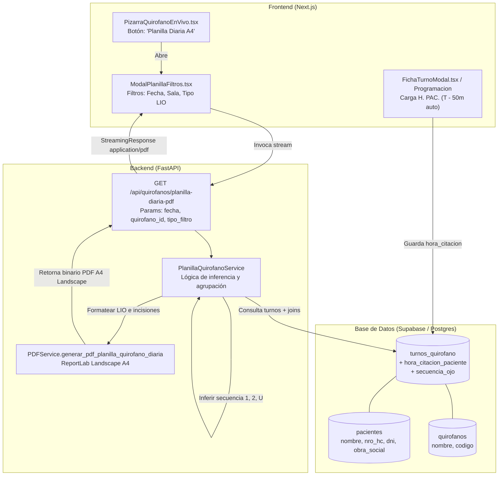

# Planilla Quirúrgica Operativa Diaria de Quirófano (A4 Landscape)

*   **Author:** malko
*   **Status:** Draft
*   **Date:** 2026-11-09

--------------------------------------------------------------------------------

## Overview

Este documento de diseño define la especificación técnica y el plan de implementación para la **Planilla Quirúrgica Operativa Diaria** en formato A4 apaisado (Landscape), orientada al personal de quirófano (enfermería, instrumentación y anestesiología).

El sistema sustituye la confección manual en papel por una generación determinística de alta densidad visual desde el CRM. Integra tres capacidades críticas:
1. **Sistematización de la Hora del Paciente (`H. PAC.`):** Incorporación de un nuevo campo persistido en base de datos con cálculo automático sugerido en la agenda (T - 50m / T - 30m / T - 60m según prestación) y edición manual flexible.
2. **Inferencia Algorítmica de Secuencia Bilateral (`Numero`):** Rotulado inequívoco de lateralidad (`1` = Primer ojo, `2` = Segundo ojo contralateral, `U` = Unilateral / Ojo único) para mitigar el riesgo de error de sitio quirúrgico.
3. **Control y Seguridad Visual de Implantes (LIO):** Extracción condensada de datos de lente intraocular, poder, toricidad, eje e incisión, alertas clínicas intraquirúrgicas prioritarias ("NO DILATAR", cuidados posturales) y señalética cromática estricta para lateralidad (`OD` fondo rojo / `OI` fondo verde manzana).
4. **Filtros Operativos en Pizarra en Vivo:** Botón de emisión inmediata en `PizarraQuirofanoEnVivo` con filtros por sala quirúrgica (Todas / Quirófano 1 / Quirófano 2) y tipo de procedimiento (Todas / Con LIO / Sin LIO).

## The Problem

En la rutina actual de quirófano de Centrovisión se identificaron tres cuellos de botella y riesgos operativos:

1. **Desacople entre Hora Quirúrgica y Hora de Citación:** El sistema únicamente programa la hora de inicio quirúrgico (`hora_inicio`). El horario de ingreso del paciente a prequirófano para dilatación pupilar y anestesia tópica se calcula verbalmente o de forma dispersa. Esto produce llegadas tardías de pacientes o aglomeraciones en la sala de dilatación.
2. **Ausencia de Indicador Rápido de Secuencia Bilateral:** En pacientes sometidos a cirugías bilaterales escalonadas (facoemulsificación de ambos ojos en días consecutivos o semanas alternas), el equipo de quirófano debe revisar manualmente el historial para saber si el paciente entra a su primer ojo o al segundo ojo, elevando el riesgo cognitivo en sala.
3. **Dispersión de Datos del LIO en Mesa Quirúrgica:** El equipo de instrumentación requiere una hoja impresa en soporte físico resistente de 14 columnas para cotejar el lente físico extraído de la caja con la programación médica antes de abrir el blister estéril. La falta de este reporte obligaba a depender de pantallas interactivas o planillas manuscritas paralelas propensas a errores de transcripción.

## Goals

*   **G1 - Persistencia de Citación Prequirúrgica:** Añadir el campo `hora_citacion_paciente` en la tabla `turnos_quirofano` con sugerencia automática reactiva (`hora_inicio - 50 min` para cataratas) editable en la agenda.
*   **G2 - Inferencia de Secuencia Bilateral:** Implementar un algoritmo que compare los turnos programados e históricos del paciente para calcular automáticamente `1`, `2` o `U`, permitiendo anulación manual en la ficha del turno.
*   **G3 - Generador PDF A4 Landscape de Alta Fidelidad:** Crear un generador ReportLab en orientación apaisada (297 × 210 mm, 794 pt útiles) que replique la estructura de 14 columnas de la planilla física institucional con badges cromáticos (`[OD]` rojo / `[OI]` verde) y condensación de LIO.
*   **G4 - Acceso y Filtros en Pizarra en Vivo:** Incorporar el botón de descarga/impresión directa en la barra de herramientas de `PizarraQuirofanoEnVivo.tsx`, permitiendo filtrar por sala/quirófano y por tipo de procedimiento (todas vs solo con LIO).
*   **G5 - Tiempo de Generación Sub-segundo:** La generación y entrega del stream PDF debe completarse en menos de 800 ms para jornadas completas de hasta 40 pacientes.

## Non-Goals

*   **NG1:** No reemplaza el Libro Oficial de Quirófano ni el Parte Quirúrgico individual de la historia clínica digital.
*   **NG2:** No modifica la mensajería ni las plantillas de WhatsApp enviadas a los médicos prestadores (`agenda_quirurgica_prestador`).
*   **NG3:** No interfiere con el flujo de recordatorios automáticos de pacientes, salvo para garantizar que el recordatorio informe la hora de citación (`H. PAC.`) y no la hora de cirugía.

## Open Questions

*   **Question 1:** ¿El intervalo sugerido por defecto para `H. PAC.` debe ser idéntico para todos los cirujanos (50 min) o se requiere una configuración diferenciada por profesional? *(Resuelto: 50 minutos por defecto general para cataratas, 30 min para inyecciones, 60 min para vitrectomías/complejas, con edición manual libre).*
*   **Question 2:** ¿La numeración secuencial de cirugías del día (# Orden 1, 2, 3...) debe reiniciar por cada sala o ser correlativa para todo el centro médico? *(Resuelto: correlativa por orden de hora de inicio en el reporte unificado, o numerada por sala cuando el filtro por sala está activo).*

## Critical User Journeys (CUJs)

### CUJ 1: Programación de Turno con Citación Sugerida en Agenda
*   **Given**: La secretaria quirúrgica abre la pantalla de *Programación Quirúrgica* o el modal de alta de turno.
*   **When**: Selecciona la fecha `2026-11-10` y la hora de cirugía `09:00 hs` para una facoemulsificación.
*   **Then**: El campo `hora_citacion_paciente` se completa automáticamente con `08:10 hs` (50 min antes). La secretaria puede aceptar dicho horario o modificarlo a `08:00 hs` con un clic antes de guardar.

### CUJ 2: Emisión de la Planilla Quirúrgica en Pizarra en Vivo
*   **Given**: La instrumentadora quirúrgica ingresa a las 07:15 hs a la *Pizarra de Quirófano en Vivo*.
*   **When**: Hace clic en el botón `[Planilla Diaria A4]`, selecciona su quirófano asignado ("Quirófano 1") y presiona "Descargar PDF".
*   **Then**: El sistema genera y abre inmediatamente el PDF en A4 apaisado con las 14 columnas completas, identificando lateralidad con colores vivos, pacientes de segundo ojo con `[2]`, y los modelos/dioptrías exactas de los lentes para preparar las mesas quirúrgicas.

--------------------------------------------------------------------------------

## Technical Plan (Architecture)

### 1. Diagrama de Flujo del Sistema (Data Flow)



### 2. Modificaciones de Esquema en Base de Datos

Migración SQL incremental e idempotente:

```sql
-- Adición de columna para hora de citación prequirúrgica
ALTER TABLE public.turnos_quirofano 
  ADD COLUMN IF NOT EXISTS hora_citacion_paciente TIME;

-- Adición de columna para override manual de secuencia ocular ('1', '2', 'U')
ALTER TABLE public.turnos_quirofano 
  ADD COLUMN IF NOT EXISTS secuencia_ojo VARCHAR(5) DEFAULT NULL;

-- Índice compuesto para acelerar la consulta cronológica diaria de planilla
CREATE INDEX IF NOT EXISTS idx_turnos_quirofano_planilla_diaria 
  ON public.turnos_quirofano(fecha_cirugia, hora_inicio);
```

### 3. Algoritmo de Inferencia de Secuencia Ocular (`Numero`: 1, 2, U)

El campo `secuencia_ojo` en la planilla se resuelve mediante la siguiente regla clínica determinística:

1. **Override Manual:** Si `turno.secuencia_ojo` posee un valor explícito (`1`, `2` o `U`), se utiliza dicho valor de forma prioritaria.
2. **Inferencia Automática:**
   - Si el turno posee `turno_par_id` o el paciente tiene dos turnos para la misma patología/asesoría:
     - El turno con `fecha_cirugia` y `hora_inicio` menor se cataloga como `1` (Primer ojo).
     - El turno con fecha/hora mayor se cataloga como `2` (Segundo ojo bilateral).
   - Si el paciente tiene una cirugía previa completada en el ojo contralateral (`estado IN ('operado', 'finalizado')`): se asigna automáticamente `2`.
   - Si el procedimiento es típicamente bilateral escalonado (catarata, LIO, faco, ICL) pero no se detecta antecedente contralateral: se asigna `1`.
   - Si el procedimiento es unilateral monocular o patología uniojo (trauma, retina específica, inyección aislada): se asigna `U`.

### 4. Especificación del Layout PDF (ReportLab - A4 Landscape)

* **Dimensiones de Página:** A4 Horizontal (`landscape(A4)` = 841.89 pt × 595.27 pt).
* **Márgenes:** Izquierdo: 24 pt, Derecho: 24 pt, Superior: 24 pt, Inferior: 24 pt.
* **Ancho Imprimible Útil:** 793.89 pt $\approx$ **794 pt**.

#### Distribución Exacta de Anchos de Columna (14 Columnas):

| # | Columna | Ancho (pt) | Alineación | Formateo y Reglas Visuales |
| :-: | :--- | :-: | :-: | :--- |
| 1 | `Fecha` | 42 | Centro | `DD/MM/AA` (ej: `10/11/26`) |
| 2 | `H. PAC.` | 38 | Centro | `HH:MM` negrita (ej: `08:10`) |
| 3 | `H. CIR.` | 38 | Centro | `HH:MM` negrita (ej: `09:00`) |
| 4 | `HC` | 44 | Centro | Número de HC / Ficha Geclisa (ej: `462289`) |
| 5 | `PACIENTE` | 112 | Izquierda | Nombre completo en mayúsculas negrita |
| 6 | `Número` | 20 | Centro | `1`, `2` o `U` centrado en negrita |
| 7 | `OJO` | 24 | Centro | Badge fondo rojo `#EF4444` (`OD`) o verde `#16A34A` (`OI`) con texto blanco |
| 8 | `LENTE` | 70 | Izquierda | Denominación clínica (ej: `CLAREON VIVITY T`, `ICL`, `SIN LENTE`) |
| 9 | `DIOPTRIA` | 52 | Centro | Poder y código tórico (ej: `T2 19,5`, `27`, `-8`) |
| 10 | `OBS` | 105 | Izquierda | Incisión axial (`X 180° EJE 88°`, `X 116° 2,8`) y advertencias destacadas |
| 11 | `Cirujano` | 75 | Izquierda | Nombre del cirujano (ej: `DR. LABAT`) |
| 12 | `DERIVADOR` | 65 | Izquierda | Oftalmólogo remitente o `----------------` |
| 13 | `ANESTESISTA` | 55 | Izquierda | Anestesiólogo interviniente |
| 14 | `OBRA SOCIAL` | 54 | Centro | Sigla de cobertura (ej: `OSDE`, `DAMSU`) |
| **Total** | | **794 pt** | | *Ajuste exacto sin desborde de página* |

### 5. Contrato de la API Backend

```http
GET /api/quirofanos/planilla-diaria-pdf?fecha=2026-11-10&quirofano_id=all&tipo_filtro=todos
```

* **Query Parameters:**
  - `fecha` (string, requerido, formato `YYYY-MM-DD`): Fecha de la jornada quirúrgica.
  - `quirofano_id` (string, opcional, default: `all`): Identificador del quirófano para filtrar o `all` para consolidar todas las salas.
  - `tipo_filtro` (string, opcional, default: `todos`): `todos` (todas las cirugías), `con_lio` (solo implantes LIO), `sin_lio` (procedimientos menores/retina).
* **Response:**
  - Status `200 OK`
  - Headers: `Content-Type: application/pdf`, `Content-Disposition: inline; filename="Planilla_Quirofano_2026-11-10.pdf"`
  - Body: Flujo binario directo de bytes ReportLab.

--------------------------------------------------------------------------------

## Alternatives Considered

### Alternative A: Cálculo en Memoria de H. PAC. sin Columna en Base de Datos
*   **Pros**: No requiere migración de esquema SQL ni cambios en el modelo de persistencia.
*   **Cons**: No permite guardar horarios de citación especiales para pacientes que requieren dilataciones complejas (sinequias, pseudoexfoliación), anestesia general o traslados en ambulancia. La recepción del centro médico y quirófano pierden consistencia auditada.
*   **Reason for Rejection**: *Rejected by author*: El horario de ingreso al centro médico es un dato operativo y asistencial que debe quedar registrado y sistematizado en el turno quirúrgico.

### Alternative B: Carga Manual Obligatoria del Número de Ojo (1, 2, U)
*   **Pros**: Cero lógica algorítmica de inferencia en el backend.
*   **Cons**: Aumenta la carga administrativa de las secretarias y multiplica el riesgo de error humano al tipear la lateralidad, comprometiendo la seguridad de sitio quirúrgico.
*   **Reason for Rejection**: *Rejected by author*: El sistema ya posee los antecedentes y la programación de ambos ojos del paciente; la inferencia automática garantiza coherencia y reserva la selección manual únicamente para excepciones de cirugías contralaterales realizadas en centros externos.

### Alternative C: Formato Vertical Estándar (A4 Portrait)
*   **Pros**: Reutiliza la configuración geométrica básica de otros reportes del CRM.
*   **Cons**: La planilla clínica exige 14 columnas de información crítica. En 547 pt de ancho imprimible útil, cada columna dispondría en promedio de apenas 39 pt, forzando tipografías microscópicas (< 6 pt) que impiden la lectura rápida a distancia requerida por el personal con vestimenta estéril.
*   **Reason for Rejection**: *Rejected by author*: La orientación horizontal apaisada (Landscape, 794 pt útiles) es el estándar ergonómico indispensable para la legibilidad en la mesa y pared de quirófano.

### Alternative D: Vista Digital Interactiva Exclusiva (Sin Generación de PDF Físico)
*   **Pros**: Ahorro de papel y actualización en tiempo real en monitores.
*   **Cons**: Dentro del quirófano, durante la preparación de campos e instrumental estéril, la instrumentadora y el cirujano no pueden tocar pantallas táctiles ni mouses de computadora. El soporte físico en papel continúa siendo obligatorio en el protocolo de acreditación y seguridad quirúrgica.
*   **Reason for Rejection**: *Rejected by author*: La rutina institucional y la esterilidad exigen contar con el documento físico impreso al iniciar la jornada.

--------------------------------------------------------------------------------

## Non-Functional Requirements

*   **Seguridad y Privacidad (PHI):**
    - La planilla contiene nombres, DNI y coberturas médicas. Su acceso está restringido a usuarios autenticados con rol de Quirófano, Médico o Administrador mediante tokens JWT de Supabase.
    - Se prohíbe el indexado público o almacenamiento en buckets abiertos; la generación es efímera en memoria (streaming directo).
*   **Rendimiento y Tiempo de Respuesta:**
    - Generación en memoria con ReportLab en menos de 800 ms para listas de hasta 40 cirugías diarias.
    - La consulta de base de datos realiza joins optimizados sobre `turnos_quirofano`, `pacientes` y `quirofanos` utilizando el índice compuesto `(fecha_cirugia, hora_inicio)`.
*   **Compatibilidad y Fidelidad de Impresión:**
    - Cumplimiento estricto de las dimensiones físicas A4 Landscape en cualquier lector de PDF e impresora institucional (Brother, HP, Epson).
    - Tipografía incrustada estándar (Helvetica / Helvetica-Bold) para garantizar cero dependencias de fuentes externas o problemas de visualización en offline.

--------------------------------------------------------------------------------

## Detailed Implementation Plan

### Target Files to Create/Modify

#### 1. `database/migrations/20261109_add_hora_citacion_secuencia_quirofano.sql` (Create)
*   **Type / Scope**: Database Migration Script (PostgreSQL / Supabase).
*   **Proposed Changes**:
    - DDL `ALTER TABLE public.turnos_quirofano ADD COLUMN IF NOT EXISTS hora_citacion_paciente TIME;`
    - DDL `ALTER TABLE public.turnos_quirofano ADD COLUMN IF NOT EXISTS secuencia_ojo VARCHAR(5) DEFAULT NULL;`
    - DDL `CREATE INDEX IF NOT EXISTS idx_turnos_quirofano_planilla_diaria ON public.turnos_quirofano(fecha_cirugia, hora_inicio);`
*   **Rationale**: Persistir el horario sistematizado de citación prequirúrgica y el selector de secuencia ocular en la base de datos sin downtime.

#### 2. `backend/app/schemas/quirofano.py` (Modify)
*   **Type / Scope**: Pydantic Data Models.
*   **Proposed Changes**:
    - Incorporar `hora_citacion_paciente: Optional[str] = None` y `secuencia_ojo: Optional[str] = None` en los esquemas `TurnoQuirofanoBase`, `TurnoQuirofanoCreate`, `TurnoQuirofanoUpdate`, y `TurnoQuirofanoResponse`.
*   **Rationale**: Validar y serializar los nuevos campos en las operaciones de lectura, creación y actualización de turnos.

#### 3. `backend/app/services/pdf_service.py` (Modify)
*   **Type / Scope**: ReportLab PDF Generator Service.
*   **Proposed Changes**:
    - Implementar la función `generar_pdf_planilla_quirofano_diaria(turnos: List[Dict], fecha_str: str, sala_filtro: Optional[str], config_override: Optional[Dict]) -> bytes`.
    - Configurar documento A4 Landscape (`pagesize=landscape(A4)`), anchos exactos de 14 columnas sumando 794 pt, celda `OJO` con badges rojo/verde (`#EF4444` / `#16A34A`), formateo condensado de LIO (tipo, dioptría, tórico, eje, incisión) y advertencias clínicas en `OBS`.
*   **Rationale**: Es el motor generador del artefacto físico y digital exigido por el personal de quirófano.

#### 4. `backend/app/routers/quirofano.py` (Modify)
*   **Type / Scope**: FastAPI REST Controller.
*   **Proposed Changes**:
    - Crear endpoint `GET /api/quirofanos/planilla-diaria-pdf` recibiendo `fecha: str`, `quirofano_id: Optional[str] = "all"`, `tipo_filtro: Optional[str] = "todos"`.
    - Consulta turnos activos con join a `pacientes` y `quirofanos`.
    - Aplica la inferencia de secuencia `1` / `2` / `U` y el filtrado por sala/procedimiento.
    - Retorna `StreamingResponse(io.BytesIO(pdf_bytes), media_type="application/pdf")`.
*   **Rationale**: Punto de entrada HTTP seguro consumido por el frontend para emitir o descargar la planilla.

#### 5. `backend/tests/test_planilla_quirofano_pdf.py` (Create)
*   **Type / Scope**: Pytest Test Suite.
*   **Proposed Changes**:
    - Test de inferencia de secuencia bilateral (`1`, `2`, `U`).
    - Test de renderizado ReportLab Landscape A4 (dimensiones de página, 14 columnas, cabecera PDF `%PDF-`).
    - Test de formateo condicional de LIO y advertencias clínicas en `OBS`.
    - Test de endpoint REST con filtros por sala y tipo de procedimiento.
*   **Rationale**: Garantizar cobertura de pruebas y verificación de que no existan regresiones clínicas.

#### 6. `frontend/src/components/quirofano/PizarraQuirofanoEnVivo.tsx` (Modify)
*   **Type / Scope**: React Client Component.
*   **Proposed Changes**:
    - Agregar botón `[Planilla Diaria A4]` en la barra de herramientas superior junto a la fecha activa.
    - Conectar el botón al modal de filtros `ModalPlanillaQuirurgicaA4`.
*   **Rationale**: Acceso directo y visible desde la pantalla que el personal de quirófano mantiene abierta durante toda la jornada.

#### 7. `frontend/src/components/quirofano/modal/ModalPlanillaQuirurgicaA4.tsx` (Create)
*   **Type / Scope**: React Modal Component.
*   **Proposed Changes**:
    - Modal emergente con selector de Sala (Todas / Quirófano 1 / Quirófano 2) y Tipo de Procedimiento (Todas / Solo con LIO / Sin LIO).
    - Botones de acción: "Previsualizar en Nueva Pestaña" y "Descargar PDF".
*   **Rationale**: Proveer una interfaz limpia y ergonómica para personalizar la emisión de la planilla según la necesidad del operador.

#### 8. `frontend/src/components/quirofano/FichaTurnoModal.tsx` (Modify)
*   **Type / Scope**: React Modal Component.
*   **Proposed Changes**:
    - Agregar campo de entrada `hora_citacion_paciente` (H. PAC.).
    - Agregar botón auxiliar `[↻ Sugerir (T - 50m)]` que autocompleta restando 50 min a `hora_inicio`.
    - Agregar selector de `secuencia_ojo` (`Automático`, `1 (Primer Ojo)`, `2 (Segundo Ojo)`, `U (Ojo Único)`).
*   **Rationale**: Permitir a enfermería o secretaría médica ajustar y persistir el horario real de citación de cada paciente.

#### 9. `frontend/src/components/quirofano/ProgramacionQuirurgicaModal.tsx` (Modify)
*   **Type / Scope**: React Modal Component.
*   **Proposed Changes**:
    - Replicar el cálculo automático reactivo de `hora_citacion_paciente` al momento de asignar o modificar la hora quirúrgica inicial.
*   **Rationale**: Asegurar que los turnos nuevos se programen con su horario de citación desde el primer momento.

---

### Verification Plan

*   **Compilación Frontend**:
    - `npm --prefix frontend run build` (debe compilar con código 0 y sin errores de TypeScript).
*   **Pruebas Unitarias Backend**:
    - `pytest backend/tests/test_planilla_quirofano_pdf.py -v` (todos los casos pasando al 100%).
    - `pytest backend/tests/` (verificación de regresión sobre los 272 tests existentes del sistema).
*   **Prueba de Generación Real**:
    - Ejecutar script de prueba para generar la planilla de las cirugías del `10-11-2026` y `11-11-2026` y comparar su estructura visual contra la planilla de referencia enviada por el usuario.
