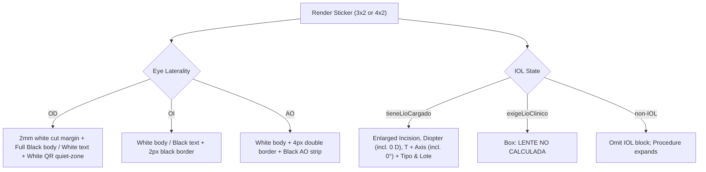

# Redesign of A4 Surgical Chest Stickers (`ModalCartelesPechoA4`)

*   **Author:** malko
*   **Status:** Draft
*   **Date:** 2026-11-20

--------------------------------------------------------------------------------

## Overview

`ModalCartelesPechoA4.tsx` generates printable A4 sheets (`3x2` 6-up and `4x2` 8-up) of chest identification stickers worn by surgical patients. This design redefines the sticker layout to maximize readability of critical operating-room identifiers—patient name, surgical procedure, incision degrees, intraocular lens (`LIO`) diopter, and toric `T` + axis—by removing non-essential institutional and administrative labels and introducing full-card black/white polarity inversion by operative eye (`OD` vs `OI`).

## The Problem

1. **Low-value clutter restricts typography:** Fixed text (`"CENTROVISIÓN QUIRÚRGICO"`, `obraSocial`, `"LENTE INTRAOCULAR (LIO)"`, `"CIRUGÍA SIN IMPLANTE DE LIO"`, and the 3-item bottom checklist `[ ] Dilatación`, `[ ] Consentimiento`, `[ ] Alergias`) occupies roughly 35–40% of each sticker's vertical space, forcing `Procedimiento` into a 2-line clamp and shrinking incision, diopter, and toric values.
2. **Eye laterality contrast is limited to one mid-card strip:** Both `OD` and `OI` stickers currently share a white card background, slowing at-a-glance differentiation in the operating room.
3. **Print engine and clinical value bugs:** `handleImprimir()` injects a manual `cssA4` stylesheet into a print `iframe` where `.etiqueta-pecho-card` hardcodes `background: #ffffff !important; color: #000000 !important;`, which would override black `OD` styling. Additionally, `lente_torico_eje || 90` turns a `0°` axis into `90°`, `lente_dioptria ? ... : 'N/D'` hides `0 D` lenses, and `p.includes('IMPL')` falsely flags non-IOL implants as requiring an IOL.

## Goals

*   Remove `"CENTROVISIÓN QUIRÚRGICO"`, `obraSocial`, `"CIRUGÍA SIN IMPLANTE DE LIO"`, `"LENTE INTRAOCULAR (LIO)"`, and the bottom checklist (`Dilatación`, `Consentimiento`, `Alergias`) from both `3x2` and `4x2` layouts.
*   Preserve `Fecha • Hora`, `SALA`, `#CódigoTurno`, `Cirujano`, `Nombre del Paciente`, `DNI`, `Edad`, and—when an IOL is assigned—`lente_tipo` and `Lote`.
*   Significantly enlarge `Nombre`, `Procedimiento` (removing the 2-line clamp when space allows), `Incisión`, `Dioptría`, and toric `T` + `eje`.
*   Omit the IOL block completely for non-IOL surgeries (`!exigeLioClinico && !tieneLioCargado`), and display `"LENTE NO CALCULADA"` when the procedure requires an IOL and no lens is assigned.
*   Apply full-card polarity inversion: `OD` with full black background and white text (preserving a white QR quiet zone and `2mm` outer white cut margin), `OI` with white background and black text, and `AO` with a distinct double-line frame.
*   Ensure 100% print/preview CSS parity (`print-color-adjust: exact`) and fix `0°` / `0 D` and non-IOL keyword false-positive bugs.

## Non-Goals

*   Modifying thermal wristband printing (`ModalImprimirPulsera`) or A4 daily surgical schedules (`ModalPlanillaQuirurgicaA4`).
*   Removing either `3x2` (6-up) or `4x2` (8-up) layout modes.
*   Altering backend database schemas or turno APIs.

## Open Questions

*   None. All layout, polarity, LIO detection, and print requirements are resolved.

## Critical User Journeys (CUJs)

### CUJ 1: Printing `OD` vs `OI` vs `AO` Chest Stickers in `3x2` and `4x2`
*   **Given**: A list of scheduled surgical turns for `OD`, `OI`, and `AO` eyes in `ModalCartelesPechoA4`.
*   **When**: Staff previews and prints in either `3x2` or `4x2` format.
*   **Then**: `OD` cards render with a full black body and white text (and a scannable white-framed QR code inside a `2mm` outer cut margin), `OI` cards render with a white body and black text, and `AO` cards render with a double-line outer frame and solid black eye strip.

### CUJ 2: Non-IOL vs Uncalculated-IOL vs Calculated-IOL Procedures
*   **Given**: Three turns: (a) eyelid/intravitreal surgery without IOL, (b) cataract surgery with no IOL assigned, and (c) toric cataract surgery with `0 D` or `21.5 D`, `0°` or `180°` axis, and incision degrees assigned.
*   **When**: Staff opens `ModalCartelesPechoA4` and prints.
*   **Then**: Case (a) omits the IOL block entirely and expands `Procedimiento`; Case (b) displays `"LENTE NO CALCULADA"`; Case (c) omits `"LENTE INTRAOCULAR (LIO)"` and renders enlarged `Incisión`, `Dioptría` (including `0 D`), and `T + eje` (including `0°`) alongside `lente_tipo` and `Lote`.

## Technical Plan (Architecture)

### 1. Semantic Print-Safe Styling & Polarity Inversion (`ModalCartelesPechoA4.tsx`)
*   **Shared Print Stylesheet Parity:** Replace scattered Tailwind color/border classes inside `renderEtiqueta()` with explicit semantic CSS classes (`.etiqueta-inner-od`, `.etiqueta-inner-oi`, `.etiqueta-inner-ao`, `.qr-quiet-zone`, `.sala-pill`, `.lio-box`, `.lio-metric-pill`, `.lio-toric-badge`, `.lio-no-calc-box`) defined identically in both `<style jsx global>` (`@media print`) and the `cssA4` string injected by `handleImprimir()`.
*   **Remove White-Override Trap:** Remove hardcoded `background: #ffffff !important; color: #000000 !important;` from `.etiqueta-pecho-card` in both `cssA4` and `@media print`, and enable `-webkit-print-color-adjust: exact !important; print-color-adjust: exact !important;` so `OD` black backgrounds print faithfully.
*   **Hardware Margins & QR Quiet Zone:** Each `.etiqueta-pecho-card` keeps a `2mm` white outer safety margin inside the dashed cut border. Inside that cut margin:
    *   `OD` renders `.etiqueta-inner-od` (`background: #000000; color: #ffffff`), inverting `SALA`, borders, and `Incisión`/`Toric` badges to white-on-black or black-on-white, and wrapping the QR in `.qr-quiet-zone` (`background: #ffffff; padding: 6px;`) with `margin: 2` in `QRCode.toDataURL`.
    *   `OI` renders `.etiqueta-inner-oi` (`background: #ffffff; color: #000000; border: 2px solid #000000`).
    *   `AO` renders `.etiqueta-inner-ao` (`background: #ffffff; color: #000000; border: 4px double #000000`) with a solid black `AMBOS OJOS (AO)` eye strip.
*   **Unified Padding:** Use identical padding (`8px 10px` for `4x2`, `10px 12px` for `3x2`) in both preview and `cssA4` so layout proportions match 1-to-1.

### 2. Content Simplification & Enlarged Typography
*   **Header Row:** Keep QR + `Fecha • Hora`, `SALA`, `#CódigoTurno`, and `Cirujano` (removing `"CENTROVISIÓN QUIRÚRGICO"`).
*   **Patient Row:** Keep `Nombre` (enlarged), `DNI`, and `Edad` (removing `obraSocial`).
*   **Eye Strip & Procedure:** Keep the eye laterality strip (`OJO DERECHO (OD)`, `OJO IZQUIERDO (OI)`, `AMBOS OJOS (AO)`), and enlarge `Procedimiento` without the 2-line `-webkit-line-clamp` so multi-word procedures remain readable and expand when the IOL block is omitted.
*   **Bottom Checklist Removed:** Delete `[ ] Dilatación`, `[ ] Consentimiento`, and `[ ] Alergias: _______`.

### 3. Conditional IOL Block & Clinical Bug Fixes
*   **Precision IOL Requirement Detection (`requiereLenteSemantico`):** Narrow keyword matching to genuine intraocular-lens procedures (`CATARATA`, `FACO`, `FACOEMULSIFICACION`, `LIO`, `LENTE`, `ICL`, `ARTISAN`, `RECAMBIO`, `EXTRACAPSULAR`, `IMPLANTACION SECUNDARIA`, `IMPLANTE DE LIO`, `IMPLANTE LIO`) rather than generic `IMPL`, avoiding false positives on glaucoma valves or stromal implants.
*   **Explicit Null/Empty Checks:**
    *   `tieneDioptria = t.lente_dioptria !== null && t.lente_dioptria !== undefined && String(t.lente_dioptria).trim() !== ''` (preserves `0` / `0 D`).
    *   `tieneEje = t.lente_torico_eje !== null && t.lente_torico_eje !== undefined && String(t.lente_torico_eje).trim() !== ''` (preserves `0°` without defaulting to `90°`).
    *   `tieneIncision = t.lente_incision_grados !== null && t.lente_incision_grados !== undefined && String(t.lente_incision_grados).trim() !== ''` (preserves `0°`).
    *   `tieneLioCargado = Boolean((t.lente_tipo && String(t.lente_tipo).trim() !== '') || tieneDioptria)` (avoids hiding an assigned lens if `lleva_lente` was unset).
*   **Three Render States:**
    1. `tieneLioCargado`: Render IOL box (without `"LENTE INTRAOCULAR (LIO)"` header) with enlarged **Row 1** (`Inc: {grados}°`, large `Dioptría`, large `T{valor} ({eje}°)` badge) and **Row 2** (`lente_tipo` + `Lote: ...`).
    2. `!tieneLioCargado && exigeLioClinico`: Render high-contrast `"LENTE NO CALCULADA"` alert box.
    3. `!tieneLioCargado && !exigeLioClinico`: Omit the IOL block completely.

## Non-Functional Requirements

*   **Print & Optical Readability:** QR codes on black `OD` cards must maintain a minimum `6px` white quiet zone (`margin: 2` in `QRCode.toDataURL`) and `print-color-adjust: exact` so laser printers and S224/camera scanners read reliably without clipping.
*   **Clinical Data Fidelity:** Never coerce `0` diopters or `0°` toric/incision angles to fallback strings or `90°`.

## Alternatives Considered

### Alternative A: Banner-only eye differentiation (keep white background on `OD`)
*   **Pros**: Uses less laser toner and avoids `cssA4` polarity inversion rules.
*   **Cons**: Slower visual distinction between right-eye and left-eye patients in the operating room when scanning a patient's chest sticker from a distance.
*   **Reason for Rejection**: Rejected by author: full-card black background with white text for `OD` vs. white background with black text for `OI` is required for immediate visual identification.

### Alternative B: Remove `lente_tipo`, `Lote`, `Edad`, or `#CódigoTurno`
*   **Pros**: Frees minor extra horizontal space on `4x2` stickers.
*   **Cons**: Removes useful surgical verification metadata (`lente_tipo`, `Lote`) and patient/turn identification (`Edad`, `#CódigoTurno`).
*   **Reason for Rejection**: Rejected by author: existing header metadata and lens model/lot fields must remain alongside enlarged clinical metrics.

--------------------------------------------------------------------------------

## Detailed Implementation Plan

### Target Files to Create/Modify

#### 1. `frontend/src/components/quirofano/modal/ModalCartelesPechoA4.tsx` (Modify)
*   **Type / Scope**: React A4 Print Modal Component (`3x2` and `4x2` stickers, preview + iframe `cssA4` + `@media print`).
*   **Proposed Changes**:
    *   **Shared Print CSS (`cssA4` in `handleImprimir()` and `<style jsx global>` `@media print`)**:
        *   Remove hardcoded `background: #ffffff !important; color: #000000 !important;` from `.etiqueta-pecho-card`; add `padding: 2mm;` outer white cut-margin and `-webkit-print-color-adjust: exact !important; print-color-adjust: exact !important;` on `*` inside print styles.
        *   Define semantic classes `.etiqueta-inner-od` (black background, white text, inverted borders/pills), `.etiqueta-inner-oi` (white background, black text, `2px` black border), `.etiqueta-inner-ao` (white background, black text, `4px double` black border), `.qr-quiet-zone` (white background, `6px` padding), `.lio-box`, `.lio-metric-pill`, `.lio-toric-badge`, and `.lio-no-calc-box` identically in both `cssA4` and preview/print styles, with unified padding across preview and print.
    *   **QR Code Generation**: Set `margin: 2` in `QRCode.toDataURL(...)` so the QR has a clean quiet zone inside `.qr-quiet-zone` on black `OD` stickers.
    *   **IOL Detection & Safe Formatting**:
        *   Refine `requiereLenteSemantico` to match IOL procedures (`CATARATA`, `FACO`, `FACOEMULSIFICACION`, `LIO`, `LENTE`, `ICL`, `ARTISAN`, `RECAMBIO`, `EXTRACAPSULAR`, `IMPLANTACION SECUNDARIA`, `IMPLANTE DE LIO`, `IMPLANTE LIO`) instead of generic `IMPL`.
        *   Use explicit null/empty checks (`!== null && !== undefined && String(val).trim() !== ''`) for `lente_dioptria`, `lente_torico_eje`, `lente_torico_valor`, and `lente_incision_grados` so `0 D` and `0°` render accurately instead of falling back to `'N/D'` or `90°` (omit axis or show `S/D` if `lente_torico_eje` is absent).
        *   Compute `tieneLioCargado` from `(lente_tipo || tieneDioptria)` without requiring `lleva_lente` to be pre-flagged.
    *   **Sticker Content & Typography (`renderEtiqueta`)**:
        *   Remove `"CENTROVISIÓN QUIRÚRGICO"`, `obraSocial`, `"CIRUGÍA SIN IMPLANTE DE LIO"`, `"LENTE INTRAOCULAR (LIO)"`, and the bottom 3-item checklist (`Dilatación`, `Consentimiento`, `Alergias`).
        *   Keep `Fecha • Hora`, `SALA`, `#CódigoTurno`, `Cirujano`, `Nombre` (enlarged), `DNI`, `Edad`, and the eye indicator strip (`OJO DERECHO (OD)`, `OJO IZQUIERDO (OI)`, `AMBOS OJOS (AO)`).
        *   Enlarge `Procedimiento` and remove the 2-line `-webkit-line-clamp`.
        *   When `tieneLioCargado`: render enlarged Row 1 (`Incisión`, `Dioptría`, `T + eje`) and Row 2 (`lente_tipo`, `Lote`).
        *   When `!tieneLioCargado && exigeLioClinico`: render `"LENTE NO CALCULADA"`.
        *   When `!tieneLioCargado && !exigeLioClinico`: omit the IOL block completely.
    *   **Cleanup**: Remove unused icon imports and unused `generandoQrs` state.

### Verification Plan

*   **Compilation/Build**: `cd frontend && npx tsc --noEmit` and `npm run build`.
*   **Manual / Visual Print Check**: Preview and print-to-PDF from `/programacion-quirurgica` and `/quirofano-en-vivo` in both `3x2` and `4x2` modes covering: (a) `OD` full-black card with scannable white-framed QR, (b) `OI` white card, (c) `AO` double-bordered card, (d) non-IOL procedure without any IOL box, (e) IOL-required procedure without lens showing `"LENTE NO CALCULADA"`, and (f) toric IOL with `0°` / `0 D` values.

--------------------------------------------------------------------------------

*Drafted with EGM*
