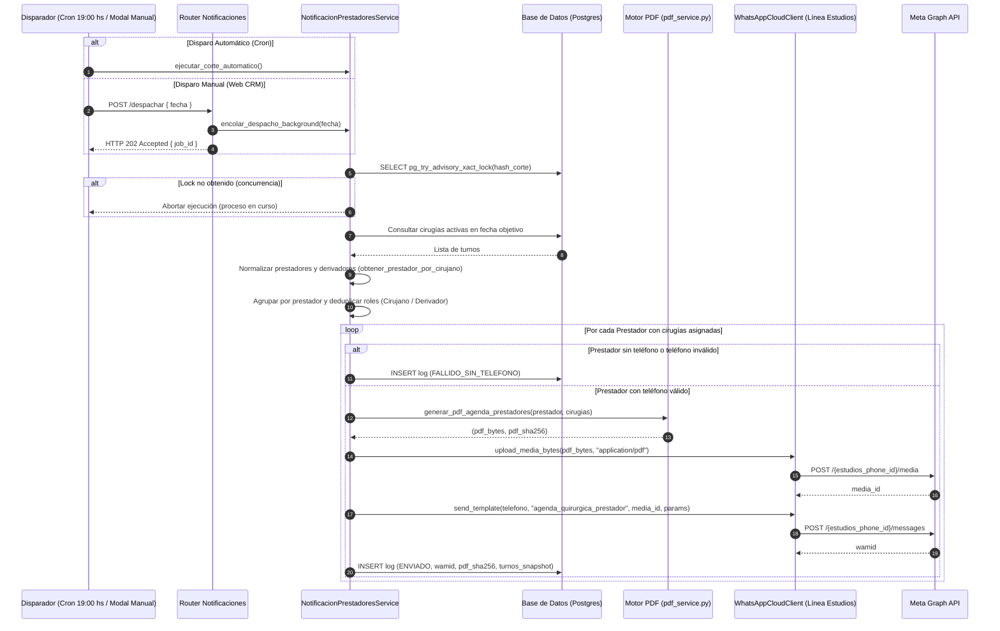

# Automatización de Envío de Agendas Quirúrgicas a Prestadores vía WhatsApp Cloud

* **Author:** malko
* **Status:** Approved (Remediado EGM Review)
* **Date:** 2026-11-08

---

## Overview

Sistema automatizado de corte diario para compilar y despachar el cronograma quirúrgico consolidado a prestadores médicos (cirujano principal y médico derivador) mediante WhatsApp Cloud API, utilizando la línea de la clínica (*Centrovisión - Unidad de Estudios Oftalmológicos*). El despacho se realiza adjuntando un documento PDF estructurado en el encabezado de una plantilla de categoría *Utility* aprobada en Meta. 

La cadencia y anticipación se basan en días hábiles quirúrgicos (predeterminado: 48 horas hábiles antes a las 19:00 hs, donde el corte del viernes procesa las intervenciones del lunes subsiguiente), contando además con un disparador manual bajo demanda desde la interfaz de usuario con procesamiento asíncrono.

---

## The Problem

Actualmente, los médicos cirujanos y profesionales derivadores requieren conocer con anticipación la programación de sus cirugías asignadas (pacientes, horarios, quirófanos asignados, lateralidad, clase de procedimiento y especificaciones biométricas de lentes intraoculares).

La comunicación manual actual introduce fricción operativa, riesgo de omisión de casos y consultas dispersas. Además, la utilización directa de mensajes de texto en WhatsApp Cloud API presenta limitaciones técnicas:
1. **Límite de longitud de plantilla:** El cuerpo de una plantilla de Meta admite un límite de 1024 caracteres, insuficiente para jornadas con múltiples pacientes y detalles de LIO u observaciones.
2. **Fragmentación y costo:** Enviar un mensaje individual por cada paciente multiplica el costo por conversación de servicio y dispersa la información en la bandeja de entrada del profesional.
3. **Roles solapados:** Un médico puede actuar como cirujano en ciertas intervenciones y como derivador en otras durante la misma jornada. La falta de consolidación genera duplicación de mensajes.

La solución consiste en un proceso automatizado que compila la agenda del día objetivo, consolida los roles del profesional en un único reporte PDF formal protegido por enmascaramiento de datos personales y lo despacha de forma programada a través de la línea oficial de Centrovisión Estudios.

---

## Goals

* **G1 - Despacho consolidado en PDF:** Generar un reporte PDF estructurado por prestador ("Cronograma Quirúrgico") y enviarlo como adjunto en el encabezado de una plantilla pre-aprobada de categoría *Utility* de Meta Cloud API.
* **G2 - Deduplicación de destinatarios:** Si un profesional interviene como cirujano en unos turnos y como derivador en otros el mismo día, unificar ambos listados en un único PDF y despachar un único mensaje de WhatsApp.
* **G3 - Filtro de roles:** Notificar exclusivamente a cirujanos y médicos derivadores. Excluir a anestesistas e instrumentadores quirúrgicos.
* **G4 - Parametrización operativa en días hábiles:** Permitir configurar desde Ajustes del CRM los días de anticipación (predeterminado: 2 días hábiles) y el horario de corte diario (predeterminado: 19:00 hs en zona horaria `America/Argentina/Buenos_Aires`). El corte del viernes contempla automáticamente las cirugías del lunes subsiguiente (72 hs hábiles).
* **G5 - Disparador manual bajo demanda asíncrono:** Proveer un endpoint y modal en la interfaz de Quirófano para forzar el envío inmediato de agendas correspondientes a una fecha seleccionada, operando en segundo plano (`HTTP 202 Accepted`) para evitar bloqueos o caídas por timeout de gateway.
* **G6 - Trazabilidad, idempotencia y auditoría:** Bloqueo transaccional contra ejecuciones concurrentes en base de datos (`pg_advisory_xact_lock`), restricción de unicidad para evitar dobles envíos accidentales, y almacenamiento del hash SHA-256 (`pdf_sha256`) junto con el snapshot de los turnos para consultas legales posteriores a los 30 días de expiración de Meta.

---

## Non-Goals

* **NG1 - Notificaciones reactivas en tiempo real:** No se emitirán mensajes de actualización pos-corte ante cancelaciones de último momento, reprogramaciones o sobreturnos introducidos con posterioridad al corte diario de las 19:00 hs.
* **NG2 - Soporte a personal auxiliar:** No contempla el envío de agendas a instrumentadoras, anestesiólogos, circulantes ni enfermería de quirófano (estos roles poseen columnas dedicadas `anestesista_id` e `instrumentador_id` en `turnos_quirofano` que no son destinatarios de esta notificación).
* **NG3 - Flujos conversacionales o interacción bidireccional:** El mensaje opera en sentido estrictamente informativo unidireccional. No procesa respuestas de confirmación de asistencia o botones de interacción del médico.
* **NG4 - Almacenamiento permanente de archivos PDF en bucket:** No se reservará almacenamiento binario cloud permanente en Supabase Storage ni S3; los PDFs se generan en memoria y se cargan efímeramente a Meta Cloud API (`upload_media_bytes`). La persistencia para fines de auditoría se garantiza mediante el hash SHA-256 y el snapshot JSON estructurado de los turnos en la base de datos.

---

## Glosario de Términos

* **LIO (Lente Intraocular):** Lente artificial implantado durante la cirugía de catarata o refractiva, caracterizado por modelo, potencia dióptrica, eje y condición de tórico.
* **WABA (WhatsApp Business Account):** Cuenta comercial de WhatsApp en Meta donde se gestionan las líneas telefónicas, tokens y plantillas autorizadas.
* **wamid:** Identificador único global de mensaje asignado por la infraestructura de Meta (`WhatsApp Message ID`) tras la recepción y enrutamiento del mensaje.
* **PHI (Protected Health Information):** Información de salud protegida y datos personales sensibles amparados por la Ley 25.326 de Protección de Datos Personales de la República Argentina.

---

## Critical User Journeys (CUJs)

### CUJ 1: Ejecución Automática Diaria del Cron (Corte en Días Hábiles a las 19:00 hs)
* **Given**: El sistema cuenta con cirugías programadas para el día objetivo calculado. La configuración indica anticipación de 2 días hábiles y hora de corte 19:00 hs (`America/Argentina/Buenos_Aires`).
* **When**: El programador en segundo plano del backend evalúa la hora corriente a las 19:00 hs:
  * Si hoy es lunes, proyecta las cirugías del miércoles (`T + 2`).
  * Si hoy es jueves, proyecta las cirugías del lunes subsiguiente (`T + 2` días hábiles si viernes es inhábil, o viernes `T + 1`).
  * Si hoy es viernes, proyecta automáticamente las cirugías del lunes subsiguiente (`T + 3` días calendario / `T + 1` día hábil).
* **Then**: 
  1. El sistema adquiere el bloqueo distribuido transaccional en PostgreSQL (`pg_try_advisory_xact_lock`). Si otra instancia lo tiene, la ejecución compradora finaliza sin duplicar.
  2. Identifica todas las cirugías activas (no canceladas) de la fecha calculada.
  3. Extrae los cirujanos y médicos derivadores involucrados resolviendo identidades mediante `obtener_prestador_por_cirujano`.
  4. Para cada prestador único con teléfono válido y sin envío exitoso previo para ese corte, renderiza el PDF en memoria (reutilizando estilos de `pdf_service.py` con DNI enmascarado).
  5. Sube los bytes del PDF a Meta Cloud API y envía la plantilla WABA por la línea de Centrovisión Estudios.
  6. Guarda el log de auditoría con `pdf_sha256`, el snapshot JSON de turnos, el `wamid` y el estado `ENVIADO`.

### CUJ 2: Disparo Manual Bajo Demanda desde la Interfaz de Quirófano
* **Given**: La supervisora de quirófano realiza ajustes en la grilla quirúrgica y necesita notificar de inmediato a los médicos sin esperar al corte de las 19:00 hs.
* **When**: Ingresa a la sección de Quirófano (`Programación Quirúrgica` o `Pizarra en Vivo`), selecciona la fecha y pulsa el botón *"Enviar Agendas a Prestadores"*.
* **Then**:
  1. El frontend realiza una llamada de pre-vuelo a `/destinatarios-status` para mostrar la cantidad de prestadores listos y destacar en rojo/ámbar los que carecen de teléfono o cuyos derivadores no pudieron resolverse.
  2. Al confirmar, el frontend dispara `POST /despachar` con `{ "fecha": "YYYY-MM-DD" }`.
  3. El backend valida, encola la ejecución en `BackgroundTasks`, responde de inmediato con `HTTP 202 Accepted` y el cliente realiza polling liviano de estado para reportar el avance en la barra de progreso sin riesgo de caídas por timeout HTTP.

### CUJ 3: Prestador con Roles Mixtos en la Misma Jornada
* **Given**: El Dr. Bonanno opera a 3 pacientes como cirujano titular y derivó a 1 paciente que será intervenido por otro profesional en la misma fecha.
* **When**: Se procesa el corte de la fecha.
* **Then**:
  1. El Dr. Bonanno no recibe dos mensajes de WhatsApp.
  2. Recibe un único mensaje con un único PDF que detalla sus 3 cirugías como cirujano principal y su paciente en calidad de derivador, diferenciados en la columna de rol.

---

## Technical Plan (Architecture)

### 1. High-Level Architecture Overview

El subsistema se compone de cinco módulos coordinados:

1. **Configuración en Base de Datos (`configuracion_sistema`):**
   Almacena en formato JSONB bajo la clave `notificaciones_cirugias_prestadores`:
   * `enabled` (boolean): Activa o desactiva la tarea automática.
   * `anticipacion_dias_habiles` (integer): Cantidad de días hábiles a proyectar (predeterminado: `2`).
   * `hora_corte` (string `HH:MM`): Hora local de corte en Buenos Aires (predeterminado: `"19:00"`).
   * `timezone` (string): `"America/Argentina/Buenos_Aires"`.
   * `linea_waba` (string): `"estudios"` (Línea Centrovisión - Unidad de Estudios Oftalmológicos).
   * `plantilla_nombre` (string): `"agenda_quirurgica_prestador"`.
   * `incluir_sabados` (boolean): `false`.

2. **Extractor, Deduplicador e Idempotencia (`NotificacionPrestadoresService`):**
   * Control de concurrencia: Adquiere `pg_try_advisory_xact_lock(hashtext('corte_agenda_' || fecha_objetivo))` para garantizar exclusión mutua en despliegues con múltiples workers.
   * Consulta en `turnos_quirofano` todas las cirugías activas para la fecha objetivo.
   * Resuelve prestadores:
     * Para cirujanos: `cirujano_id` y `cirujano_nombre`.
     * Para derivadores: invoca `obtener_prestador_por_cirujano(None, medico_derivador_nombre)` de `backend/app/db.py`, normalizando prefijos y nombres. Si no hay coincidencia unívoca, clasifica el turno con `derivador_no_resoluble: true`.
   * Excluye expresamente turnos vinculados únicamente como anestesista o instrumentador.
   * Consolida turnos por `prestador_id`: agrupa intervenciones del profesional distinguiendo su rol (`Cirujano` o `Derivador`).

3. **Motor de Renderizado PDF de Agenda (`generar_pdf_agenda_prestadores`):**
   * Ubicado en `backend/app/services/pdf_service.py` para reutilizar estilos institucionales, fuentes, y el helper `obtener_o_cachear_logo_local`.
   * Formato A4 vertical con membrete institucional de Centrovisión.
   * Enmascaramiento de datos personales (PHI): DNI formateado como `XX.XXX.123`.
   * Tabla estructurada:

| Columna | Campo de Origen | Descripción / Tratamiento |
| :--- | :--- | :--- |
| **Horario** | `hora_inicio` | Hora de inicio asignada (ej. `08:00 hs`) |
| **Quirófano** | `quirofano` | Sala asignada (ej. `Quirófano 1`) |
| **Paciente** | `paciente_nombre` | Apellido y Nombre del paciente |
| **DNI** | `paciente_dni` | Documento enmascarado (`XX.XXX.123`) |
| **Ojo** | `ojo` | Lateralidad (`OD`, `OI`, `AO`) |
| **Procedimiento** | `practica_nombre` | Cirugía o práctica programada |
| **Rol** | Discriminador calculado | `Cirujano Principal` o `Médico Derivador` |
| **Detalles LIO** | `lente_*`, `lente_incision_grados` | Modelo, dioptría, tórico/eje y grados de incisión |
| **Observaciones** | `observaciones_medicas` | Observaciones clínicas del caso (excluye notas operativas de sala) |

   * Pie de página legal: Sello con timestamp de emisión, leyenda de confidencialidad bajo Ley 25.326 y número de guardia de quirófano.
   * Retorna `(pdf_bytes, pdf_sha256)`.

4. **Despacho vía WhatsApp Cloud API (`WhatsAppCloudClient`):**
   * Reutiliza métodos existentes sin modificaciones en `backend/app/services/whatsapp_cloud/client.py`.
   * Invoca `upload_media_bytes(pdf_bytes, filename="Cronograma_Quirurgico.pdf", mime_type="application/pdf")` con las credenciales de la línea `estudios`.
   * Envía la plantilla Utility `agenda_quirurgica_prestador` adjuntando el `media_id` en el encabezado de documento y las variables de nombre y fecha en el cuerpo.

5. **Auditoría e Historial (`notificaciones_prestadores_logs`):**
   * Registra cada intento con clave de unicidad compuesta `(fecha_cirugia, fecha_corte, prestador_id)`.
   * Guarda el digest `pdf_sha256` y el snapshot `turnos_snapshot` (JSONB) para permitir peritaje médico independiente tras la eliminación del PDF en los servidores de Meta a los 30 días.

---

### 2. Flujo de Datos y Secuencia del Sistema



---

### 3. Especificación de Plantilla de Meta Cloud API (WABA)

La plantilla se registra en Meta Business Manager (o mediante el módulo existente `backend/app/services/whatsapp_cloud/templates.py`) bajo la categoría **Utility**:

* **Nombre de la plantilla:** `agenda_quirurgica_prestador`
* **Categoría:** `UTILITY`
* **Idioma:** `es_AR` (Español Argentina)
* **Componentes:**
  1. **HEADER:**
     * Tipo: `DOCUMENT`
     * Formato: Archivo PDF adjunto con el cronograma.
  2. **BODY:**
     * Texto: `"Estimado/a Dr./Dra. {{1}}, le adjuntamos su cronograma de cirugías programadas para el día {{2}} en Centrovisión. Para coordinar cualquier aspecto de la jornada, comuníquese con el equipo de Quirófano."`
     * Variables:
       * `{{1}}`: Nombre y apellido del prestador (ej. `Pablo Bonanno`).
       * `{{2}}`: Fecha formateada de la intervención (ej. `Lunes 10 de Noviembre de 2026`).
  3. **FOOTER:**
     * Texto: `"Centrovisión - Unidad de Cirugía Oftalmológica"`

---

### 4. Sistema de Alerta Visual en Frontend (Prestadores sin Teléfono)

1. **Endpoint de Pre-vuelo (`GET /api/turnos-quirofano/notificaciones-prestadores/destinatarios-status?fecha=YYYY-MM-DD`):**
   * Retorna la lista consolidada de prestadores con cirugías en la fecha y el estado de cada uno: `LISTO_PARA_ENVIO` (con teléfono válido), `SIN_TELEFONO` (teléfono ausente o inválido), o `DERIVADOR_NO_RESOLUBLE` (nombre en texto libre que no coincide con ningún profesional activo).
2. **Alerta Visual en la Grilla de Quirófano:**
   * En `frontend/src/app/programacion-quirurgica/page.tsx` y `frontend/src/components/quirofano/PizarraQuirofanoEnVivo.tsx`, cuando la fecha seleccionada contenga prestadores en estado `SIN_TELEFONO` o `DERIVADOR_NO_RESOLUBLE`, se renderiza una **Tarjeta de Advertencia Ámbar**:
     > ⚠️ **Atención Quirófano:** El Dr./Dra. *[Nombre Prestador]* tiene cirugías asignadas para esta fecha pero **no posee número de WhatsApp válido**. No recibirá su cronograma automático.
   * Incluye botón directo para editar los datos del prestador en Ajustes.
3. **Modal de Disparo Manual Asíncrono (`ModalEnvioAgendasPrestadores.tsx`):**
   * Lista los destinatarios clasificados entre listos para envío y excluidos por falta de teléfono.
   * Al accionar el envío, despacha a la API asíncrona, cierra el estado bloqueante y ofrece una barra de progreso basada en el log del corte.

---

### 5. Esquema de Base de Datos y Modelos Técnicos

#### A. Script DDL de Base de Datos (`database/migrations/027_notificaciones_prestadores_agenda.sql`):

```sql
-- Migración 027: Tabla de Auditoría y Trazabilidad de Agendas a Prestadores
CREATE TABLE IF NOT EXISTS public.notificaciones_prestadores_logs (
    id UUID PRIMARY KEY DEFAULT gen_random_uuid(),
    fecha_cirugia DATE NOT NULL,
    fecha_corte DATE NOT NULL,
    prestador_id TEXT NULL,
    prestador_nombre TEXT NOT NULL,
    telefono_destino TEXT NULL,
    cantidad_cirugias INTEGER NOT NULL DEFAULT 0,
    roles_incluidos TEXT[] NOT NULL DEFAULT '{}',
    estado TEXT NOT NULL CHECK (estado IN ('ENVIADO', 'FALLIDO_SIN_TELEFONO', 'ERROR_META', 'PLANTILLA_NO_APROBADA', 'DERIVADOR_NO_RESOLUBLE')),
    meta_media_id TEXT NULL,
    meta_wamid TEXT NULL,
    pdf_sha256 TEXT NULL,
    turnos_snapshot JSONB NULL,
    error_detalle TEXT NULL,
    created_at TIMESTAMPTZ NOT NULL DEFAULT timezone('utc'::text, now())
);

-- Índices de consulta rápida y auditoría
CREATE INDEX IF NOT EXISTS idx_notif_prest_fecha_cirugia ON public.notificaciones_prestadores_logs (fecha_cirugia);
CREATE INDEX IF NOT EXISTS idx_notif_prest_fecha_corte ON public.notificaciones_prestadores_logs (fecha_corte);
CREATE INDEX IF NOT EXISTS idx_notif_prest_prestador_id ON public.notificaciones_prestadores_logs (prestador_id);

-- Restricción de unicidad para garantizar idempotencia operativa
CREATE UNIQUE INDEX IF NOT EXISTS idx_notif_prest_unicidad_envio 
ON public.notificaciones_prestadores_logs (fecha_cirugia, fecha_corte, prestador_id)
WHERE estado = 'ENVIADO';

-- Inserción de configuración por defecto si no existe
INSERT INTO public.configuracion_sistema (clave, valor)
VALUES (
    'notificaciones_cirugias_prestadores',
    '{
        "enabled": true,
        "anticipacion_dias_habiles": 2,
        "hora_corte": "19:00",
        "timezone": "America/Argentina/Buenos_Aires",
        "linea_waba": "estudios",
        "plantilla_nombre": "agenda_quirurgica_prestador",
        "idioma_plantilla": "es_AR",
        "incluir_sabados": false
    }'::jsonb
)
ON CONFLICT (clave) DO NOTHING;
```

#### B. Contratos de API (Modelos Pydantic):

```python
from pydantic import BaseModel, Field
from typing import List, Optional, Dict, Any
from datetime import date

class PrestadorStatusItem(BaseModel):
    prestador_id: Optional[str]
    nombre: str
    rol_en_jornada: List[str]
    telefono: Optional[str]
    estado: str = Field(..., description="LISTO_PARA_ENVIO | SIN_TELEFONO | DERIVADOR_NO_RESOLUBLE")
    cantidad_cirugias: int

class DestinatariosStatusResponse(BaseModel):
    fecha_cirugia: date
    total_prestadores: int
    listos_para_envio: int
    sin_telefono: int
    derivadores_no_resolubles: int
    destinatarios: List[PrestadorStatusItem]

class DespachoManualPayload(BaseModel):
    fecha_cirugia: date
    forzar_reenvio: bool = False

class DespachoManualResponse(BaseModel):
    success: bool
    job_id: str
    mensaje: str
```

---

## Detailed Implementation Plan

### 1. Unified Step-by-Step Execution Sequence

1. **Paso 1: Persistencia y Migración DDL (Base de Datos):**
   * Ejecutar la migración `database/migrations/027_notificaciones_prestadores_agenda.sql` para crear la tabla de auditoría, índices de unicidad e inicializar la clave en `configuracion_sistema`.

2. **Paso 2: Extensión de Motor PDF en `pdf_service.py`:**
   * Implementar la función `generar_pdf_agenda_prestadores(prestador_info, cirugias_list)` en `backend/app/services/pdf_service.py` reutilizando membretes, tipografías, colores institucionales y enmascaramiento de DNI. Retornar `(pdf_bytes, pdf_sha256)`.

3. **Paso 3: Servicio de Negocio y Lógica de Días Hábiles (`notificacion_prestadores_service.py`):**
   * Crear `backend/app/services/notificacion_prestadores_service.py`.
   * Implementar cálculo de fecha objetivo en base a días hábiles (viernes proyecta lunes).
   * Implementar control de concurrencia mediante `pg_try_advisory_xact_lock`.
   * Implementar resolución de prestadores con `obtener_prestador_por_cirujano`.
   * Integrar subida a Meta con `WhatsAppCloudClient.upload_media_bytes` y envío con `send_template`.
   * Registrar resultados en `notificaciones_prestadores_logs`.

4. **Paso 4: Router Dedicado de Notificaciones (`notificaciones_prestadores_router.py`):**
   * Crear `backend/app/routers/notificaciones_prestadores_router.py` conteniendo:
     * `GET /destinatarios-status`: pre-vuelo para advertencias visuales y modal.
     * `POST /despachar`: ejecutor asíncrono vía `BackgroundTasks` respondiendo `202 Accepted`.
     * `GET /configuracion` y `PUT /configuracion`: consulta y actualización de parámetros.
     * `GET /logs`: historial de auditoría.
   * Registrar el router en `backend/app/main.py`.

5. **Paso 5: Tarea Automática Programada Diaria en `main.py`:**
   * En el evento de ciclo de vida (`lifespan`) de `backend/app/main.py`, añadir el bucle asíncrono con temporizador que comprueba la hora local en `America/Argentina/Buenos_Aires` a las 19:00 hs, llamando a `NotificacionPrestadoresService.ejecutar_corte_automatico()` de forma idempotente.

6. **Paso 6: Componentes de Frontend:**
   * Crear `frontend/src/components/quirofano/ModalEnvioAgendasPrestadores.tsx` para visualización previa y disparo manual utilizando `apiFetch`.
   * Incorporar la tarjeta de alerta preventiva y el botón de acción en `frontend/src/app/programacion-quirurgica/page.tsx` y `frontend/src/components/quirofano/PizarraQuirofanoEnVivo.tsx`.
   * Crear `frontend/src/components/settings/ConfiguracionNotificacionesCirugiasCard.tsx` e integrarlo en la pestaña de ajustes en `frontend/src/app/ajustes/page.tsx`.

7. **Paso 7: Pruebas y Aserciones de Verificación:**
   * Probar escenario de doble rol (cirujano y derivador en el mismo día): verificar que genera 1 solo PDF y 1 solo WhatsApp.
   * Probar corte de viernes: verificar que selecciona cirugías del lunes.
   * Probar prestador sin teléfono: verificar que se registra como `FALLIDO_SIN_TELEFONO` y activa la alerta ámbar.
   * Probar doble click simultáneo: verificar que el segundo request aborta con código de bloqueo de exclusión mutua.

---

### 2. Enumeration of Touched and Created Files

#### Archivos de Backend:

1. **`backend/app/services/notificacion_prestadores_service.py` (Nuevo):**
   * *Razón:* Lógica de agregación de turnos, cálculo de días hábiles, control de concurrencia, llamada a `pdf_service.py`, envío mediante `WhatsAppCloudClient` y guardado de auditoría.

2. **`backend/app/routers/notificaciones_prestadores_router.py` (Nuevo):**
   * *Razón:* Router FastAPI modular que expone los endpoints REST para pre-vuelo, despacho en segundo plano, configuración y logs de auditoría.

3. **`backend/app/main.py` (Modificación):**
   * *Razón:* Montar el nuevo router `notificaciones_prestadores_router` e inicializar el cron runner diario en el ciclo de vida de la aplicación con control de zona horaria de Buenos Aires.

4. **`backend/app/services/pdf_service.py` (Modificación):**
   * *Razón:* Incorporar la función `generar_pdf_agenda_prestadores` reutilizando el membrete, logo y estilos existentes, con cálculo de hash SHA-256 y enmascaramiento de DNI.

5. **`backend/app/db.py` (Modificación):**
   * *Razón:* Añadir helpers para registrar y consultar en `notificaciones_prestadores_logs` y leer/actualizar la configuración `notificaciones_cirugias_prestadores`.

#### Archivos de Base de Datos:

6. **`database/migrations/027_notificaciones_prestadores_agenda.sql` (Nuevo):**
   * *Razón:* Script SQL DDL con la creación de la tabla de auditoría, índices de búsqueda, restricción de unicidad para idempotencia e inserción de la configuración inicial.

#### Archivos de Frontend:

7. **`frontend/src/components/quirofano/ModalEnvioAgendasPrestadores.tsx` (Nuevo):**
   * *Razón:* Modal interactivo para visualizar prestadores listos vs no notificables y disparar el envío manual asíncrono con `apiFetch`.

8. **`frontend/src/app/programacion-quirurgica/page.tsx` (Modificación):**
   * *Razón:* Incorporar el botón *"Enviar Agendas a Prestadores"* y el banner de advertencia visual para profesionales sin teléfono registrado en la fecha activa.

9. **`frontend/src/components/quirofano/PizarraQuirofanoEnVivo.tsx` (Modificación):**
   * *Razón:* Añadir el indicador visual de alerta preventiva en la barra de herramientas de la pizarra de quirófano en vivo.

10. **`frontend/src/components/settings/ConfiguracionNotificacionesCirugiasCard.tsx` (Nuevo):**
    * *Razón:* Panel de control en Ajustes para editar la hora de corte, los días hábiles de anticipación y activar o pausar la automatización.

11. **`frontend/src/app/ajustes/page.tsx` (Modificación):**
    * *Razón:* Integrar el panel `ConfiguracionNotificacionesCirugiasCard` dentro de la sección de automatismos y quirófano en los ajustes del sistema.
