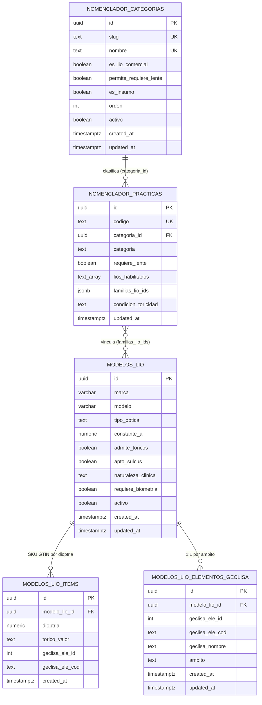
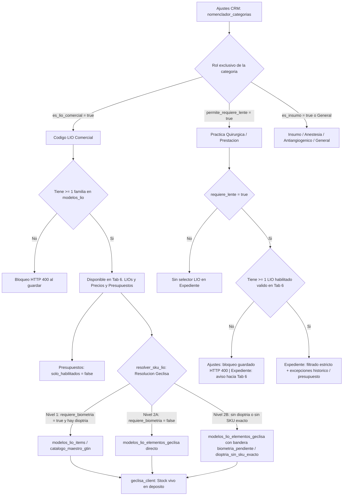

# Categorías Configurables del Nomenclador, Correlación Dual en Geclisa (`modelos_lio`) y Reglas de Filtrado LIO

*   **Author:** malko
*   **Status:** Proposed
*   **Date:** 2026-11-15

---

## Overview

Este documento especifica el diseño para normalizar la taxonomía del Nomenclador comercial, separar los roles entre prácticas quirúrgicas y lentes intraoculares (LIOs), habilitar la correlación dual con Geclisa (sistema externo de stock, depósito y facturación quirúrgica en MySQL) (**Elemento Genérico de Geclisa** y **SKU GTIN-14 por dioptría**) dentro de `modelos_lio`, exigir configuración clínica mínima antes de habilitar LIOs en una cirugía y diferenciar las reglas de selección entre **Expedientes de Pacientes** y **Presupuestos**.

Los cuatro módulos que participan en esta unificación son:

1.  **Configuración del Nomenclador (`NomencladorSettingsCard.tsx`, `nomenclador_categorias` y `nomenclador_practicas`)**: administra un catálogo editable de categorías que definen el comportamiento funcional de cada ítem en el CRM.
2.  **Catálogo Clínico de Lentes (`LioSettingsCard.tsx`, `modelos_lio`, `modelos_lio_items` y `modelos_lio_elementos_geclisa`)**: concentra todas las familias ópticas (catarata biométrica, lentes fáquicos `ICL` y lentes de sulcus o secundarios como `Expand` y `MA60AC`) y las correlaciona con Geclisa tanto por **Elemento Genérico de Geclisa** (`geclisa_ele_id` / `geclisa_ele_cod`) como por **SKU GTIN-14 por dioptría**.
3.  **Expediente Quirúrgico (`CasoFormularioActivo.tsx`)**: presenta únicamente los LIOs comerciales habilitados para la cirugía seleccionada (`34031`, `34091`, `FACOREF` —práctica de facorefractiva—, etc.) cuando la práctica requiere lente, preservando de forma visible selecciones históricas o provenientes de un presupuesto vinculado.
4.  **Armador de Presupuestos (`ModalCrearPresupuestoPaciente.tsx`)**: consulta todo el catálogo de LIOs comerciales activos sin filtrar por `lios_habilitados`, manteniendo abierta la combinación comercial de lentes y prácticas.

## The Problem

Al revisar un expediente en `asesorias_quirurgicas` (tabla de expedientes quirúrgicos) para la cirugía `34031` (*CATARATA CON FACOEMULSIFICACION E IMPL.LIO PLEGABLE*) en producción, el desplegable `Lente Intraocular (LIO) Comercial / Propuesto` exhibe la práctica quirúrgica `34091` (*COLOCACION LENTE FAQUICA UNILATERAL (ICL)*) por `ARS 2.335.000` y lentes no habilitados (`ICL`, `ICLT`, `ICLHE`, `ICLHT`) junto a los lentes de catarata. La inspección sobre el código, Supabase y Geclisa identifica seis fallas encadenadas:

1.  **Clasificación por texto libre en `obtener_lios_comerciales` y contaminación en `FACOREF`**:
    *   En `backend/app/db.py` (`obtener_lios_comerciales`), el universo de LIOs comerciales se obtiene buscando prácticas cuyo nombre contenga `%lente %`, excluyendo únicamente `34031`. Como `34091` incluye la palabra `"LENTE"` en su nombre, el sistema la clasifica como LIO comercial; además, `"34091"` quedó guardado dentro de `FACOREF.lios_habilitados`.
2.  **Categoría como texto libre fragmentado (80 prácticas activas en 13 variantes)**:
    *   `NomencladorSettingsCard.tsx` usa un `<input type="text">` sin catálogo controlado para `Categoría / Especialidad`. Esto generó 13 variantes en producción (`"Lentes Intraoculares"`, `"Lente"`, `"Prestaciones Oftalmológicas"`, `"CIRUGIA"`, `"Lasik"`, `"General"`, `"ANESTESIA"`, `"ANTIGEOGENICO"`, `"Antigeogenico"`, `"ANILLOS"`, `"MATERIAL"`, `"ELEMENTO"`, `"ELEMENTOS"`).
    *   `ICL`, `ICLT` e `ICLHT` quedaron en `"Lente"`, una cadena que `esCategoriaLioComercial` en `NomencladorSettingsCard.tsx` no reconoce: al editarlos en el Nomenclador no muestran el vínculo a `modelos_lio` y exhiben controles ajenos a un lente.
3.  **Falta de validación obligatoria y ambigüedad de `NULL` al activar `requiere_lente`**:
    *   Una cirugía puede guardarse con `requiere_lente = true` teniendo cero lentes activados en la pestaña `6. LIOs & Precios`. En `backend/app/db.py`, cuando `lios_habilitados` es `NULL`, la consulta asigna `lios_hab_set = None` y marca `habilitado_en_practica = True` para todos los LIOs del nomenclador.
    *   Al crear un LIO rápido (`POST /api/nomenclador/crear-lio-rapido`), `NomencladorSettingsCard.tsx` envía `familias_lio_ids` y `condicion_toricidad`, pero el esquema `CrearLioRapidoRequest` en `backend/app/main.py` omite ambos campos y los descarta antes de guardar.
4.  **Lentes sin correlación posible en `modelos_lio` ni enlace a Elementos Genéricos de Geclisa**:
    *   `ICL`, `ICLT`, `ICLHE`, `ICLHT` y `EXPAND` tienen `familias_lio_ids: []` en el Nomenclador.
    *   En `modelos_lio_items`, la columna `dioptria` es `numeric NOT NULL` y exige `geclisa_ele_id NOT NULL`, mientras `ResolverSkuPayload` y `OpcionLioItemPayload` exigen `dioptria` numérica. Esto bloquea la correlación y el guardado para elementos reales de Geclisa sin GTIN individual por dioptría: `39437` (`ICL`), `39438` (`ICLT`), `39463` (`IQ3 PIEZAS`), `40068` (`GEN-CLAREON P PRO`), `40071` (`GEN-CLAREON P PRO TORIC`), `39435` (`VIVITY`), `39436` (`GEN-VVIITY T`), `39434` (`PANOPTIXT`), `39328` (`GEN-PXYWT0`) y `39439` (`SY60WF`).
    *   En producción, `modelos_lio_items` contiene además dos filas con `geclisa_ele_id = 40082`: una inactiva desalineada en `AcrySof IQ Vivity` (`1e1d7176-e755-412e-a8ff-cdb68176e5ae`, `dioptria = 21.50`) y otra activa válida en `Clareon PanOptix Pro` (`4a071f4e-d7e1-4fc1-ae4f-1b163500aff4`, `dioptria = 20.50`, `torico_valor = "T4 (Cil 2.25 D)"`).
5.  **Filtrado roto en `Expedientes de Pacientes` (`CasoFormularioActivo.tsx`)**:
    *   El formulario consulta `/api/nomenclador/resumen-operativo/${targetCod}` (ruta inexistente; la ruta activa en `backend/app/main.py` es `/api/nomenclador/practica/{practica_id_or_codigo}/resumen-operativo`) y busca `data.resumen` en lugar de `data.practica`, cayendo en el fallback por texto `esCatarata` (heurístico de nombre de práctica en frontend).
    *   La petición a `/api/nomenclador/lios-comerciales` omite `solo_habilitados` y envía `practica_id` vacío cuando aún no se cargó el código, exhibiendo LIOs ajenos a `34031`.
6.  **Filtrado restrictivo en el armador de `Presupuestos` (`ModalCrearPresupuestoPaciente.tsx`)**:
    *   `ModalCrearPresupuestoPaciente.tsx` envía actualmente `&solo_habilitados=true` y filtra `habilitado_en_practica !== false`, además de depender de `esCatarata` y `practicaRequiereLente &&` para desplegar el selector de LIOs, impidiendo cotizar combinaciones comerciales abiertas.

## Goals

*   **G1 — Categorías Configurables con Comportamiento por Rol**: Reemplazar el campo de texto libre `Categoría / Especialidad` en **Ajustes -> Nomencladores & Aranceles** por una lista desplegable cargada desde un catálogo editable en los ajustes del CRM, donde cada categoría define un rol exclusivo (`es_lio_comercial`, `permite_requiere_lente` o `es_insumo`).
*   **G2 — Separación Estricta entre LIOs Comerciales y Prácticas Quirúrgicas**: Derivar el universo de LIOs comerciales exclusivamente de categorías con `es_lio_comercial = true` —impidiendo que prácticas quirúrgicas como `34091` aparezcan en la pestaña `6. LIOs & Precios` o en los selectores de lente— y ocultar `requiere_lente` y la pestaña `6. LIOs & Precios` cuando la categoría es LIO comercial.
*   **G3 — Validación Obligatoria al Activar LIO en Prácticas Quirúrgicas**: Impedir en todas las vías de escritura que una práctica guarde `requiere_lente = true` sin al menos un LIO comercial activo habilitado (respaldado por `modelos_lio`) dentro de la pestaña `6. LIOs & Precios`, y exigir al menos una familia clínica vinculada en todo LIO comercial.
*   **G4 — Familias Clínicas Completas en `modelos_lio` y Correlación Dual en Geclisa (`Elementos Genéricos` + `SKUs GTIN-14`)**: Dotar de familia clínica en `modelos_lio` a todos los implantes utilizados (catarata biométrica, fáquicos `ICL`, y secundarios `Expand` / `MA60AC`) y correlacionar cada familia con **Elementos Genéricos de Geclisa** y **SKUs GTIN-14 por dioptría**, habilitando cálculo, resolución de identificador Geclisa y validación en quirófano también para lentes con `requiere_biometria = false` o sin seguimiento GTIN por dioptría.
*   **G5 — Filtrado Estricto en Expedientes vs. Catálogo Abierto en Presupuestos**: Corregir `CasoFormularioActivo.tsx` para ofrecer en los tres selectores de lateralidad únicamente los LIOs habilitados de la práctica elegida (conservando visiblemente con badge cualquier código histórico guardado o incluido en el presupuesto vinculado del paciente), mientras `ModalCrearPresupuestoPaciente.tsx` lista todos los LIOs comerciales activos sin filtrar por `lios_habilitados`.

## Non-Goals

*   **NG1**: Renombrar códigos históricos de nomenclador ya referenciados en casos y presupuestos activos (por ejemplo `VIVTY` / `VIVTYT`).
*   **NG2**: Reescribir o migrar destructivamente las 336 filas válidas restantes en `modelos_lio_items` (incluido `4a071f4e-d7e1-4fc1-ae4f-1b163500aff4` para `Clareon PanOptix Pro`) ni las filas vigentes en `catalogo_maestro_gtin` (tabla maestra oficial de códigos GTIN-14). Se elimina únicamente la fila inactiva desalineada `1e1d7176-e755-412e-a8ff-cdb68176e5ae` (`AcrySof IQ Vivity`, `geclisa_ele_id = 40082`).
*   **NG3**: Restringir qué prácticas o lentes puede combinar el equipo comercial en `ModalCrearPresupuestoPaciente.tsx` o mediante la herramienta de cotización automatizada (`buscar_practicas_presupuesto` en `backend/app/db.py`).

## Open Questions

No quedan preguntas de diseño abiertas ni bloqueos pendientes. Las definiciones cerradas durante el relevamiento se registran a continuación:

*   **Decisión 1 — Granularidad clínica de `ICL` y familias secundarias en `modelos_lio`**: Se crean cuatro registros deterministas en `modelos_lio`:
    1.  `Staar Surgical — ICL Miópico (EVO)` (para `ICL` e `ICLT`, `requiere_biometria = false`, `admite_toricos = true`) vinculado en `modelos_lio_elementos_geclisa` a `39437` (`ICL`, `ambito = 'esferico'`) y `39438` (`ICLT`, `ambito = 'torico'`).
    2.  `Staar Surgical — ICL Hipermetrópico (EVO)` (para `ICLHE` e `ICLHT`, `requiere_biometria = false`, `admite_toricos = true`) vinculado en `modelos_lio_elementos_geclisa` a `39437` (`ICL`, `ambito = 'esferico'`) y `39438` (`ICLT`, `ambito = 'torico'`), manteniendo seguimiento clínico independiente respecto del modelo miópico.
    3.  `Genérico / Sulcus — Expand` (para `EXPAND`, `condicion_toricidad = 'esferico'`, `requiere_biometria = false`, `apto_sulcus = true`) sin elemento genérico presembrado hasta su alta en depósito Geclisa.
    4.  `Alcon — AcrySof IQ 3 Piezas (MA60AC)` (`requiere_biometria = false`, `apto_sulcus = true`) vinculado exclusivamente a `39463` (`IQ3 PIEZAS`, `ambito = 'esferico'`) en `modelos_lio_elementos_geclisa`.
*   **Decisión 2 — Saneamiento global de `lios_habilitados`**: Durante la migración SQL se limpia `"34091"` de `FACOREF.lios_habilitados` y, por consistencia global, se remueve de `nomenclador_practicas.lios_habilitados` en **todas** las prácticas cualquier código cuya categoría no tenga `es_lio_comercial = true`. Los restantes códigos LIO comerciales válidos de `FACOREF` (`ICLHE`, `ICLHT`, `CLAREON`, `CLAREONT`, `MULTIFOCAL`, `TRIFOCAL`, `TRIFOCALT`, `VIVTY`, `VIVTYT`) se conservan sin alterar.

## Critical User Journeys (CUJs)

### CUJ 1: Administración de Categorías y Reglas de Rol en Ajustes -> Nomencladores & Aranceles

*   **Given**: Un administrador abre **Ajustes -> Nomencladores & Aranceles**.
*   **When**: Abre el modal de administración de categorías, crea o edita categorías (por ejemplo `Lentes Intraoculares` con rol LIO comercial, o `Cirugías` con rol práctica quirúrgica) y luego abre una práctica en `Configuración Integral`.
*   **Then**: El campo `Categoría / Especialidad` funciona mediante una lista desplegable cargada desde esas categorías. Al elegir una categoría LIO comercial, el formulario habilita los vínculos a `modelos_lio` + condición de toricidad y oculta el switch `Requiere Selección de Lente Intraocular (LIO)` junto con la pestaña `6. LIOs & Precios`. Al elegir una categoría quirúrgica, habilita el switch de LIO y oculta los vínculos de familia LIO.

### CUJ 2: Validación Obligatoria en Pestaña `6. LIOs & Precios` al Habilitar LIO en una Cirugía

*   **Given**: Un administrador edita o da de alta una práctica quirúrgica (por ejemplo `FACOREF` o `34031`) y activa el switch `Requiere Selección de Lente Intraocular (LIO)`.
*   **When**: Intenta guardar la práctica teniendo cero lentes activados en la pestaña `6. LIOs & Precios`.
*   **Then**: El sistema bloquea el guardado definitivo, enfoca la pestaña `6. LIOs & Precios` mostrando un aviso inline para activar al menos un LIO comercial con familia clínica asociada antes de persistir el cambio.

### CUJ 3: Correlación Dual en `modelos_lio` (`Elemento Genérico de Geclisa` y `SKU GTIN-14`)

*   **Given**: Un administrador ingresa a **Ajustes -> Catálogo de Lentes Intraoculares (`LioSettingsCard.tsx`)** para configurar familias sin seguimiento GTIN por dioptría (`ICL Miópico (EVO)`, `ICL Hipermetrópico (EVO)`, `Expand`, `AcrySof IQ 3 Piezas (MA60AC)`) y familias biométricas Alcon (`Clareon PanOptix Pro`, `Clareon PanOptix Común`, `Clareon Vivity`, `AcrySof IQ SN60WF`).
*   **When**: Desde el modal de edición de familia LIO busca elementos mediante el autocompletado de Geclisa (`/api/geclisa/elementos/autocomplete`) y vincula un elemento por ámbito (`esferico`, `torico` o `general`) además de conservar los SKUs GTIN-14 por dioptría en `modelos_lio_items`.
*   **Then**: Cada familia almacena un vínculo único por ámbito en `modelos_lio_elementos_geclisa` sin colisionar con `modelos_lio_items`; la resolución de identificador Geclisa (`resolver_sku_lio`) devuelve el `geclisa_ele_id`/`geclisa_ele_cod` correspondiente tanto para dioptrías exactas como para familias con `requiere_biometria = false` o respaldo genérico, habilitando la consulta de stock vivo en `geclisa_client`.

### CUJ 4: Selección Estricta de LIO en Expedientes de Pacientes

*   **Given**: Un expediente quirúrgico en **Expedientes de Pacientes** tiene asignada la práctica `34031` (*CATARATA CON FACOEMULSIFICACION E IMPL.LIO PLEGABLE*), cuyos únicos LIOs habilitados son los 8 códigos definidos en `6. LIOs & Precios` (`CLAREON`, `CLAREONT`, `EXPAND`, `MULTIFOCAL`, `TRIFOCAL`, `TRIFOCALT`, `VIVTY`, `VIVTYT`), además de posibles expedientes heredados o nacidos de un presupuesto previo.
*   **When**: El usuario abre cualquiera de los tres selectores de `Lente Intraocular (LIO) Comercial / Propuesto` (unilateral, mismo lente bilateral o diferenciado OD/OI).
*   **Then**: El selector lista estrictamente los LIOs habilitados de `34031` (sin `34091` ni lentes fáquicos `ICL` no habilitados). Si el expediente ya tenía guardado históricamente un código hoy deshabilitado, lo conserva visible con badge `"Histórico / Deshabilitado"`; si proviene de un presupuesto vinculado con un LIO fuera del protocolo de la práctica, lo conserva visible con badge `"Presupuestado (Fuera de protocolo)"`.

### CUJ 5: Selección Abierta de LIOs Comerciales en Presupuestos

*   **Given**: Una asesora abre `ModalCrearPresupuestoPaciente.tsx` partiendo de `34031`, `34091`, `FACOREF` o un presupuesto sin cirugía de catarata preseleccionada.
*   **When**: Consulta y agrega ítems de LIO desde el selector de lentes del presupuesto.
*   **Then**: El selector expone todos los LIOs comerciales activos del nomenclador sin filtrar por `lios_habilitados` (excluyendo prácticas quirúrgicas como `34091`) y destaca con el badge `"Sugerido para esta práctica"` aquellos vinculados a la práctica principal cuando existe.

---

## Technical Plan (Architecture)

La arquitectura separa en forma estricta la **clasificación funcional del nomenclador**, las **familias clínicas en `modelos_lio`**, la **resolución dual de identificadores Geclisa** y las **reglas de filtrado por contexto de pantalla**.

### 1. Visión Estructural y Flujo de Decisión

---

### 2. Catálogo Configurable de Categorías del Nomenclador y Normalización Integral

1.  **Tabla `public.nomenclador_categorias`**:
    *   Almacena categorías configurables desde **Ajustes -> Nomencladores & Aranceles** (`NomencladorSettingsCard.tsx`): `id` (`uuid PK DEFAULT gen_random_uuid()`), `slug` (`text NOT NULL UNIQUE`), `nombre` (`text NOT NULL UNIQUE`), `es_lio_comercial` (`boolean NOT NULL DEFAULT false`), `permite_requiere_lente` (`boolean NOT NULL DEFAULT false`), `es_insumo` (`boolean NOT NULL DEFAULT false`), `orden` (`integer NOT NULL DEFAULT 100`), `activo` (`boolean NOT NULL DEFAULT true`), `created_at` (`timestamptz NOT NULL DEFAULT now()`) y `updated_at` (`timestamptz NOT NULL DEFAULT now()`).
    *   **Regla de exclusividad de rol y unicidad normalizada**:
        *   `CHECK ((es_lio_comercial::int + permite_requiere_lente::int + es_insumo::int) <= 1)` (validado también en `CategoriaNomencladorPayload`; la combinación `(false, false, false)` corresponde a la categoría base `General`): impide en esquema mezclar productos ópticos LIO con prácticas quirúrgicas o insumos generales. Las categorías con `es_insumo = true` clasifican anestesia, antiangiogénicos, anillos y materiales descartables: no aparecen como LIO comercial en `6. LIOs & Precios` ni habilitan `requiere_lente`.
        *   Índice único funcional `CREATE UNIQUE INDEX idx_nomenclador_categorias_nombre_norm ON public.nomenclador_categorias (lower(btrim(nombre)))` para evitar duplicados por mayúsculas o espacios.
2.  **FK `categoria_id` y Sincronización Atómica por Triggers en PostgreSQL**:
    *   Se agrega `categoria_id uuid REFERENCES public.nomenclador_categorias(id) ON DELETE RESTRICT` a `nomenclador_practicas` (inicialmente nullable durante la migración) junto con el índice compuesto `(categoria_id, activo)` y un índice GIN sobre `familias_lio_ids`.
    *   Se instalan dos triggers en PostgreSQL antes de imponer `SET NOT NULL`:
        *   `trg_sync_nomenclador_practica_categoria` (`BEFORE INSERT OR UPDATE ON public.nomenclador_practicas`): si una escritura heredada omite `categoria_id`, o si ocurre un `UPDATE` desde un backend revertido (`TG_OP = 'UPDATE' AND NEW.categoria IS DISTINCT FROM OLD.categoria AND NEW.categoria_id IS NOT DISTINCT FROM OLD.categoria_id` con guarda anti-recursión `pg_trigger_depth() = 1`), resuelve `categoria_id` normalizando `NEW.categoria` por el mapa de alias (con fallback a `'General'`); en el resto de escrituras con `categoria_id` definido, sincroniza `NEW.categoria` con el `nombre` vigente de `nomenclador_categorias`. Esto garantiza despliegue sin caída y rollback seguro del backend sin provocar errores `23502` ni descartar cambios.
        *   `trg_propagar_nombre_categoria` (`AFTER UPDATE OF nombre ON public.nomenclador_categorias`): propaga cualquier renombre de categoría hacia `nomenclador_practicas.categoria` dentro de la misma transacción.
    *   Todos los escritores Python de prácticas (`guardar_practica_crm_integral`, `crear_lio_comercial_rapido`, `bulk_import_practicas_aranceles`, `create_or_update_practica`, `guardar_practica_crm_con_arancel`) envían `categoria_id`: en altas/ediciones directas, una categoría desconocida devuelve `HTTP 400 Bad Request`; en `bulk_import_practicas_aranceles`, un alias no reconocido cae de forma controlada a `'General'` y en actualizaciones parciales sin columnas LIO preserva los valores existentes de `requiere_lente`, `lios_habilitados` y `familias_lio_ids`.
3.  **Normalización Canónica de los 13 Valores Actuales (Todas las Filas de `nomenclador_practicas`, Activas e Inactivas)**:

La migración normaliza las 80 filas activas y cualquier fila inactiva (`activo = false` o `NULL`), asignando cada categoría canónica con su `orden` determinista de sembrado (y fallback a `'General'` para textos heredados desconocidos):

| Valor Actual Observado | Cantidad Activa | Categoría Canónica Destino | `orden` | Flags (`es_lio_comercial` / `permite_requiere_lente` / `es_insumo`) |
| :--- | :---: | :--- | :---: | :--- |
| `Prestaciones Oftalmológicas` | 52 | `Prestaciones Oftalmológicas` | `10` | `false` / `true` / `false` |
| `CIRUGIA` (`FACOREF`) | 1 | `Cirugías` | `20` | `false` / `true` / `false` |
| `Lasik` | 1 | `Lasik` | `30` | `false` / `true` / `false` |
| `Lentes Intraoculares` | 9 | `Lentes Intraoculares` | `40` | `true` / `false` / `false` |
| `Lente` (`ICL`, `ICLHT`, `ICLT`) | 3 | `Lentes Intraoculares` | `40` | `true` / `false` / `false` |
| `ANTIGEOGENICO` / `Antigeogenico` | 4 | `Antiangiogénicos` | `50` | `false` / `false` / `true` |
| `ANESTESIA` | 3 | `Anestesia` | `60` | `false` / `false` / `true` |
| `MATERIAL` / `ELEMENTO` / `ELEMENTOS` | 4 | `Materiales y Elementos` | `70` | `false` / `false` / `true` |
| `ANILLOS` | 1 | `Anillos Intracorneales` | `80` | `false` / `false` / `true` |
| `General` (y fallback inactivas/desconocidas) | 2 | `General` | `90` | `false` / `false` / `false` |

4.  **Contratos REST y Guardias de Conflicto sobre Categorías**:
    *   Nuevos endpoints en `backend/app/main.py`:
        *   `GET /api/nomenclador/categorias`: devuelve todas las categorías ordenadas por `orden ASC, created_at ASC` junto con el conteo de prácticas activas asociadas.
        *   `POST /api/nomenclador/categorias` y `PUT /api/nomenclador/categorias/{categoria_id}`: reciben `CategoriaNomencladorPayload` (`nombre: str`, `slug: Optional[str] = None` autogenerado si se omite, `es_lio_comercial: bool = False`, `permite_requiere_lente: bool = False`, `es_insumo: bool = False`, `orden: int = 100`). Valida exclusividad de flags y unicidad normalizada de nombre (`HTTP 400` / `HTTP 409`).
        *   `PATCH /api/nomenclador/categorias/{categoria_id}/estado`: recibe `CategoriaEstadoPayload` (`activo: bool`). Ejecuta únicamente activación o desactivación lógica (`activo = false`), sin borrado físico.
    *   **Guardias de conflicto (`HTTP 409 Conflict`)**: Se bloquea desactivar (`activo = false`) una categoría cuando posee prácticas activas asociadas (y se protege siempre la categoría de sistema `slug = 'general'` frente a desactivación). En `PUT /api/nomenclador/categorias/{categoria_id}`, se bloquea cualquier cambio de flags de rol que deje inconsistentes a prácticas activas de esa categoría (activar `es_lio_comercial = true` sobre categorías con prácticas que tienen `requiere_lente = true` o carecen de `familias_lio_ids`, desactivar `permite_requiere_lente` si hay prácticas con `requiere_lente = true`, o desactivar `es_lio_comercial` si existen prácticas con `familias_lio_ids` o referenciadas en `lios_habilitados` de cirugías activas). La respuesta `409` devuelve siempre:
        `{ "detail": "...", "codigo": "CATEGORIA_EN_USO", "practicas_afectadas": [{ "id", "codigo", "nombre", "motivo" }] }`.
    *   En lecturas (`listar_catalogo_completo_crm`, `buscar_practicas_presupuesto`, `get_practica_resumen_operativo`), cada práctica proyecta `categoria_id`, `es_lio_comercial`, `permite_requiere_lente` y `es_insumo`. En `NomencladorSettingsCard.tsx`, el `<input type="text">` de `Categoría / Especialidad` se reemplaza por un selector conectado al catálogo más un modal de administración de categorías dentro de **Ajustes -> Nomencladores & Aranceles**.

---

### 3. Separación de Roles, Filtro de LIOs Comerciales y Validaciones de `requiere_lente`

1.  **Eliminación del Heurístico `nombre.ilike.%lente %` y Semántica de `obtener_lios_comerciales`**:
    *   En `backend/app/db.py` (`obtener_lios_comerciales`), se suprime por completo el filtro por texto `nombre.ilike.%lente %` y las referencias heredadas hacia el código obsoleto `'MONOFOCAL'`.
    *   El universo de LIOs comerciales se deriva únicamente de prácticas activas (`activo = true`) cuya categoría en `nomenclador_categorias` tiene `es_lio_comercial = true`.
2.  **Corrección de `lios_habilitados` en Estado `NULL` o `[]` y Tabla de Verdad (`obtener_lios_comerciales`)**:
    *   **Resolución de `practica_id`**: acepta UUID de `nomenclador_practicas.id` y, como fallback, busca por `codigo` exacto (`activo = true`).
    *   **Cuando `solo_habilitados = true`**: si `practica_id` falta, está vacío (`""`) o no coincide con una práctica activa, retorna `[]` (fail-closed). Si la práctica existe pero `lios_habilitados` es `NULL` o `[]`, retorna `[]` y `get_practica_resumen_operativo` informa `configuracion_lio_incompleta = bool(requiere_lente and len(lios_habilitados_validos) == 0)`. Solo los códigos LIO presentes en `lios_habilitados` obtienen `habilitado_en_practica = True`.
    *   **Cuando `solo_habilitados = false`**: retorna todos los LIOs comerciales activos, marcando `habilitado_en_practica = True` únicamente para los códigos incluidos en el `lios_habilitados` de la `practica_id` resuelta (y `False` para todos si `practica_id` falta, está vacío o `lios_habilitados` es `NULL`/`[]`).
3.  **Contrato Completo de `CrearLioRapidoRequest`**:
    *   `CrearLioRapidoRequest` en `backend/app/main.py` incorpora `familias_lio_ids: List[str]`, `condicion_toricidad: Literal['esferico', 'torico', 'ambos'] = 'esferico'` y `categoria_id: Optional[str] = None`.
    *   En `crear_lio_comercial_rapido`: exige al menos un ID activo válido en `familias_lio_ids`; si se envía `categoria_id`, valida que exista y tenga `es_lio_comercial = true` (`HTTP 400` en caso contrario); si se omite `categoria_id`, selecciona determinísticamente la categoría comercial activa mediante `ORDER BY orden ASC, created_at ASC LIMIT 1`.
4.  **Validaciones Bidireccionales Simétricas en Escritura (`db.py` y `main.py`)**:
    *   En los escritores completos de configuración (`guardar_practica_crm_integral`, `create_or_update_practica`, `guardar_practica_crm_con_arancel`, y en `bulk_import_practicas_aranceles` únicamente cuando crea una práctica nueva o recibe explícitamente columnas LIO):
        *   Si la categoría tiene `es_lio_comercial = true`: fuerza `requiere_lente = false` y `lios_habilitados = []`; exige que `familias_lio_ids` tenga al menos un UUID activo de `modelos_lio` y que `condicion_toricidad IN ('esferico', 'torico', 'ambos')` (`HTTP 400` en caso contrario).
        *   Si `requiere_lente = true`: valida que la categoría tenga `permite_requiere_lente = true` (`HTTP 400` si no aplica) y que `lios_habilitados` no esté vacío ni `NULL`, validando **cada código** del arreglo (debe ser práctica activa con `es_lio_comercial = true` y con al menos una familia activa en `familias_lio_ids`).
    *   En `guardar_lios_habilitados_practica`: valida que la categoría de la práctica permita `requiere_lente`, exige lista no vacía cuando `requiere_lente = true` y verifica cada código del arreglo (`es_lio_comercial = true`, `activo = true`, `familias_lio_ids` no vacío; y rechaza listas no vacías sobre prácticas `es_lio_comercial = true`). En `NomencladorSettingsCard.tsx`, si se activa cualquiera de los controles de `requiere_lente` sin lentes marcados en `6. LIOs & Precios`, se bloquea el guardado definitivo y se dirige el foco a la pestaña 6.
    *   **Guardias simétricas `HTTP 409 Conflict`**: Impiden desactivar o reclasificar fuera de `es_lio_comercial` un LIO comercial referenciado en `lios_habilitados` de cirugías activas (`codigo = "LIO_EN_USO"`), y desactivar o eliminar una familia de `modelos_lio` referenciada en `familias_lio_ids` de LIOs comerciales activos (`codigo = "FAMILIA_LIO_EN_USO"`).
    *   **Validación al guardar `asesorias_quirurgicas` (`POST/PUT /api/asesorias-quirurgicas`)**: Todo código LIO asignado en los tres campos de lateralidad (`lente_comercial_codigo`, `lente_comercial_od_codigo`, `lente_comercial_oi_codigo`) debe estar habilitado en el `lios_habilitados` de la práctica quirúrgica del caso (`HTTP 400` si no pertenece), exceptuando únicamente códigos presentes en el `presupuesto_id` vinculado o códigos históricos ya persistidos sin modificación **siempre que la práctica quirúrgica del expediente tampoco haya cambiado** (si cambia la práctica, se revalida contra el nuevo protocolo).

---

### 4. Familias Clínicas Completas en `modelos_lio` y Correlación Dual Geclisa

1.  **Extensión de `modelos_lio` sin Alterar `modelos_lio_items`**:
    *   `modelos_lio_items` conserva su esquema actual para SKUs GTIN-14 por dioptría.
    *   Sobre `public.modelos_lio` (donde ya existe `admite_toricos boolean` junto a `marca`, `modelo`, `tipo_optica`, `constante_a`, `apto_sulcus`, `activo`), se añaden `naturaleza_clinica` (`text NOT NULL DEFAULT 'pseudofaquico_biometrico' CHECK (naturaleza_clinica IN ('pseudofaquico_biometrico', 'faquico_icl', 'no_biometrico'))`) y `requiere_biometria` (`boolean NOT NULL DEFAULT true`). Se actualiza la lista blanca `COLUMNAS_VALIDAS_MODELO_LIO` en `backend/app/db.py`.
2.  **Nueva Tabla `public.modelos_lio_elementos_geclisa` (Cardinalidad `1:1` por `modelo_lio_id` y `ambito`)**:
    *   Correlaciona cada familia de `modelos_lio` con un **Elemento Genérico de Geclisa** por óptica/ámbito, reutilizando el autocompletado existente `GET /api/geclisa/elementos/autocomplete` en `LioSettingsCard.tsx`:
        *   `id uuid PRIMARY KEY DEFAULT gen_random_uuid()`
        *   `modelo_lio_id uuid NOT NULL REFERENCES public.modelos_lio(id) ON DELETE CASCADE`
        *   `geclisa_ele_id integer NOT NULL`
        *   `geclisa_ele_cod text NOT NULL`
        *   `geclisa_nombre text`
        *   `ambito text NOT NULL DEFAULT 'general' CHECK (ambito IN ('esferico', 'torico', 'general'))`
        *   `created_at timestamptz NOT NULL DEFAULT now()` y `updated_at timestamptz NOT NULL DEFAULT now()`
        *   Restricción única estricta `UNIQUE (modelo_lio_id, ambito)`, eliminando ambigüedades de multiplicidad `1:N` y desempates de elemento principal.
3.  **Sembrado Determinista, Mapeos Exactos Geclisa y Limpieza `40082`**:
    *   Semillas en `public.modelos_lio` y `public.modelos_lio_elementos_geclisa`:
        1.  `marca = 'Staar Surgical'`, `modelo = 'ICL Miópico (EVO)'`, `tipo_optica = 'Fáquico (ICL)'`, `constante_a = NULL`, `admite_toricos = true`, `apto_sulcus = false`, `activo = true`, `naturaleza_clinica = 'faquico_icl'`, `requiere_biometria = false` -> elementos `39437` (`ICL`, `ambito = 'esferico'`) y `39438` (`ICLT`, `ambito = 'torico'`).
        2.  `marca = 'Staar Surgical'`, `modelo = 'ICL Hipermetrópico (EVO)'`, `tipo_optica = 'Fáquico (ICL)'`, `constante_a = NULL`, `admite_toricos = true`, `apto_sulcus = false`, `activo = true`, `naturaleza_clinica = 'faquico_icl'`, `requiere_biometria = false` -> elementos `39437` (`ICL`, `ambito = 'esferico'`) y `39438` (`ICLT`, `ambito = 'torico'`).
        3.  `marca = 'Genérico / Sulcus'`, `modelo = 'Expand'`, `tipo_optica = 'Estándar'`, `constante_a = NULL`, `admite_toricos = false`, `apto_sulcus = true`, `activo = true`, `naturaleza_clinica = 'no_biometrico'`, `requiere_biometria = false` -> vinculado comercialmente a `EXPAND` (`condicion_toricidad = 'esferico'`), sin elemento Geclisa presembrado hasta su alta en depósito.
        4.  `marca = 'Alcon'`, `modelo = 'AcrySof IQ 3 Piezas (MA60AC)'`, `tipo_optica = 'Monofocal 3 Piezas'`, `constante_a = 118.4`, `admite_toricos = false`, `apto_sulcus = true`, `activo = true`, `naturaleza_clinica = 'no_biometrico'`, `requiere_biometria = false` -> elemento `39463` (`IQ3 PIEZAS`, `ambito = 'esferico'`).
        5.  Elementos genéricos de respaldo en familias biométricas Alcon existentes: `Clareon PanOptix Pro` (`40068` `GEN-CLAREON P PRO` `'esferico'`, `40071` `GEN-CLAREON P PRO TORIC` `'torico'`), `Clareon PanOptix Común` (`39328` `GEN-PXYWT0` `'esferico'`, `39434` `PANOPTIXT` `'torico'`), `Clareon Vivity` (`39435` `VIVITY` `'esferico'`, `39436` `GEN-VVIITY T` `'torico'`) y `AcrySof IQ SN60WF` (`39439` `SY60WF` `'esferico'`).
    *   En `nomenclador_practicas.familias_lio_ids`, se aplica unión idempotente (`merge`) para `ICL`/`ICLT`, `ICLHE`/`ICLHT` y `EXPAND`, previa auditoría SQL de que los LIOs comerciales activos restantes ya poseen al menos 1 familia activa vinculada.
    *   En `modelos_lio_items`, la migración ejecuta `DELETE FROM public.modelos_lio_items WHERE id = '1e1d7176-e755-412e-a8ff-cdb68176e5ae' AND geclisa_ele_id = 40082;` (conservando intacta la fila activa `4a071f4e-d7e1-4fc1-ae4f-1b163500aff4` de `Clareon PanOptix Pro`).
4.  **Resolución Dual de Identificador Geclisa (`resolver_sku_lio`) Frente a Consulta de Stock**:
    *   `resolver_sku_lio` resuelve **exclusivamente** el par `(geclisa_ele_id, geclisa_ele_cod)` y los metadatos de resolución; el endpoint llama posteriormente a `geclisa_client.obtener_resumen_stock_lotes(ele_id)` para obtener las existencias reales en depósito.
    *   En `ResolverSkuPayload` / `ResolverSkuItemPayload`, `dioptria: Optional[Union[str, float]] = None` (normalizando `"" -> None`) permite consultar stock tanto en familias no biométricas como en biométricas pendientes de cálculo, y añade `condicion_toricidad: Optional[str] = None` junto a `es_torico`. En `OpcionLioItemPayload` (`guardar_calculo_lio_endpoint`), `dioptria: Optional[Union[str, float]] = None` se acepta únicamente cuando `modelo_lio.requiere_biometria = false` (devolviendo `HTTP 400` si `dioptria` es `None`/vacía con `requiere_biometria = true`).
    *   Flujo en `db.resolver_sku_lio` (deduciendo `ambito = 'torico'` si `es_torico == True` o `condicion_toricidad == 'torico'`; en caso contrario —incluido `condicion_toricidad == 'ambos'` con `es_torico` omitido/falso— busca `'esferico'` con fallback `'general'`):
        *   **Nivel 1 (`sku_dioptria`)**: Si `requiere_biometria = true` y `dioptria is not None`, busca coincidencia exacta en `modelos_lio_items` y `catalogo_maestro_gtin`. Si encuentra SKU exacto, devuelve `resolucion_tipo = 'sku_dioptria'`, `biometria_pendiente = False`, `dioptria_sin_sku_exacto = False`.
        *   **Nivel 2A (`elemento_generico` directo no biométrico)**: Si `requiere_biometria = false`, consulta `modelos_lio_elementos_geclisa` según el `ambito` deducido. Si existe vínculo, devuelve `mapeado = True`, `resolucion_tipo = 'elemento_generico'`, `biometria_pendiente = False`, `dioptria_sin_sku_exacto = False`. Si la familia aún no tiene elemento mapeado (caso `Expand` hasta su alta en depósito), devuelve `mapeado = False`, `resolucion_tipo = 'elemento_generico_pendiente'`, `geclisa_ele_id = None`, `biometria_pendiente = False`, permitiendo confirmar el plan clínico con indicador `"Sin correlación Geclisa"`.
        *   **Nivel 2B (`elemento_generico` de respaldo en familia biométrica)**: Si `requiere_biometria = true` y falta `dioptria` o falta el SKU por dioptría, consulta `modelos_lio_elementos_geclisa` por el `ambito` deducido devolviendo `resolucion_tipo = 'elemento_generico'` junto con `biometria_pendiente = (dioptria is None)` y `dioptria_sin_sku_exacto = (dioptria is not None)` para que UI y quirófano distingan un lente no biométrico de un cálculo incompleto.
5.  **Adaptación de Cálculo LIO, Quirófano, Consistencia Comercial y Validador GS1**:
    *   **Mesa Biométrica (`calculo-lio/page.tsx`) y Quirófano (`TabProgramacionLio.tsx`, `FichaTurnoModal.tsx`)**: Cuando la familia elegida opera con `requiere_biometria = false`, permiten resolver stock Geclisa y confirmar/guardar el plan quirúrgico sin requerir dioptría calculada ni inyectar valores biométricos por defecto (`19.50` / `20.00`), propagando `es_torico` / `condicion_toricidad`. En `FichaTurnoModal.tsx`, la detección de si un turno lleva LIO se apoya en `requiere_lente` / rol de categoría y no en texto libre.
    *   **Backend (`_evaluar_discrepancia_comercial_clinica` y `_inferir_familias_por_defecto` en `db.py`)**: Aceptan familias `faquico_icl` y `no_biometrico` en validación comercial-clínica sin exigir potencia dióptrica biométrica cuando `requiere_biometria = false`, evaluando coincidencia entre `familias_lio_ids`, `condicion_toricidad` y la familia calculada en expediente/cálculo.
    *   **Validador GS1 (`validar_lente_blister_contra_turno` y `validar_lente_gs1_endpoint`)**: Mantiene `buscar_info_lio_por_gtin(gtin)` sin cambios. En `validar_lente_blister_contra_turno(turno, datos_gs1)`, todos los estados de retorno (`COINCILIACION` / `COINCIDENCIA_TOTAL`, `DISCREPANCIA`, `GTIN_NO_CATALOGADO`, `LENTE_VENCIDO`) incluyen `requiere_confirmacion_manual: False` por defecto. Cuando `buscar_info_lio_por_gtin` devuelve `None` (no vencido), el turno tiene `modelo_lio_id` informado y ese modelo posee elemento genérico en `modelos_lio_elementos_geclisa` para `ambito = 'torico' if turno.get('es_torico') else 'esferico'` (con fallback `'general'`), devuelve `estado_validacion = "CONCILIACION_ELEMENTO_GENERICO"`, `coincide = False`, `requiere_confirmacion_manual = True`, `elemento_generico` y `escaneado`, habilitando la verificación manual guiada en quirófano (indicando verificar el signo dióptrico `-` vs `+` en el blíster físico cuando se concilia `ICL` / `ICLT` con `39437`/`39438`). Si el turno heredado carece de `modelo_lio_id` o no tiene elemento mapeado, conserva `GTIN_NO_CATALOGADO`.

---

### 5. Consumo Diferenciado por Pantalla

| Contexto | Archivo Principal | Llamada al Backend | Regla de Filtrado Aplicada | Excepciones y Guardas |
| :--- | :--- | :--- | :--- | :--- |
| **Ajustes — Categorías y LIOs por Práctica (`6. LIOs & Precios`)** | `frontend/src/components/settings/NomencladorSettingsCard.tsx` | `GET /api/nomenclador/categorias` y `GET /api/nomenclador/lios-comerciales?practica_id=...&solo_habilitados=false` | Muestra únicamente códigos con categoría `es_lio_comercial = true`; oculta Tab 6 si la práctica editada es un LIO comercial. | Bloquea el guardado si `requiere_lente = true` tiene 0 LIOs encendidos en Tab 6; muestra badge por LIO sin familia en `modelos_lio`. |
| **Ajustes — Catálogo de Lentes Intraoculares (`modelos_lio`)** | `frontend/src/components/settings/LioSettingsCard.tsx` | `GET/POST/PUT /api/modelos-lio`, `GET /api/geclisa/elementos/autocomplete` y `GET/POST/DELETE /api/modelos-lio/{id}/elementos-geclisa/{elemento_id}` | Administra `naturaleza_clinica`, `requiere_biometria`, `admite_toricos` y el Elemento Genérico de Geclisa `1:1` por ámbito (`esferico`, `torico`, `general`). | Cuando `requiere_biometria = false`, no exige `constante_a` ni listado previo en `modelos_lio_items`. |
| **Expediente Clínico / Lateralidad (3 selectores)** | `frontend/src/components/asesoria/CasoFormularioActivo.tsx` | `GET /api/nomenclador/practica/{codigo}/resumen-operativo` y `GET /api/nomenclador/lios-comerciales?practica_id=...&solo_habilitados=false` | En cliente limita las opciones seleccionables en OD, OI y único exclusivamente a `habilitado_en_practica === true`. | Usa `AbortController` ante cambios de práctica; conserva selecciones históricas guardadas (`"Histórico / Deshabilitado"`, sintetizando opción fallback si el LIO fue desactivado) o del presupuesto vinculado (`"Presupuestado (Fuera de protocolo)"`); alerta hacia Tab 6 si `configuracion_lio_incompleta`. |
| **Armador de Presupuestos** | `frontend/src/components/ModalCrearPresupuestoPaciente.tsx` | `GET /api/nomenclador/lios-comerciales?practica_id=...&solo_habilitados=false` | Catálogo completo de LIOs comerciales activos (`es_lio_comercial = true`) sin filtrar por `lios_habilitados` ni depender de `esCatarata`. | Destaca con el badge `"Sugerido para esta práctica"` los LIOs con `habilitado_en_practica === true` cuando existe práctica principal. |

---

## Alternatives Considered

### Alternativa A: Categorías en JSONB dentro de `configuracion_nomenclador` y columna `dioptria` nullable en `modelos_lio_items`

Consistiría en guardar las categorías en `configuracion_sistema` / `configuracion_nomenclador` como JSONB y relajar `modelos_lio_items.dioptria` para almacenar ahí también los elementos genéricos.

*   **Pros**: Reduce el número inicial de tablas DDL en Supabase.
*   **Contras**: Pierde la llave foránea SQL (`ON DELETE RESTRICT`) entre `nomenclador_practicas` y `nomenclador_categorias`, dificulta consultas relacionales con conteo/guardias `409` y expone al lector de SKUs (`modelos_lio_items`, actualmente 336 filas válidas biométricas) a manejar filas heterogéneas sin `dioptria` mediante índices parciales y ramas condicionales en el pipeline GS1.
*   **Motivo de descarte**: Se prioriza integridad referencial estricta mediante `categoria_id` + `ON DELETE RESTRICT` y aislamiento limpio entre SKUs GTIN por dioptría y elementos genéricos `1:1`.

### Alternativa B: Única familia clínica indiferenciada para `ICL` en `modelos_lio`

Consistiría en modelar un solo registro `Staar Surgical — ICL (EVO)` al que apunten indistintamente los códigos comerciales `ICL`, `ICLT`, `ICLHE` e `ICLHT`.

*   **Pros**: Un registro menos en `modelos_lio`.
*   **Contras**: Agrupa implantes miópicos (`ICL` / `ICLT`) e hipermetrópicos (`ICLHE` / `ICLHT`) bajo el mismo `modelo_lio_id`, impidiendo registrar parámetros clínicos independientes (`constante_a` / propiedades ópticas), trazabilidad diferenciada en estadísticas de quirófano y correlación Geclisa separada cuando se incorporen códigos específicos para hipermetropía.
*   **Motivo de descarte**: Mantener dos familias separadas (`ICL Miópico (EVO)` e `ICL Hipermetrópico (EVO)`) conserva la trazabilidad clínica sin impedir compartir el elemento Geclisa genérico actual `39437` / `39438`.

### Alternativa C: Catálogo polimórfico único reemplazando `modelos_lio_items` y `catalogo_maestro_gtin`

Consistiría en fusionar GTIN-14 de Alcon, SKUs por dioptría y elementos genéricos Geclisa en una sola tabla unificada.

*   **Pros**: Unifica todas las tablas de lentes en una única estructura de consulta.
*   **Contras**: Obliga a migrar más de 2.100 registros en `catalogo_maestro_gtin` y reescribir la lectura GS1 existente en quirófano (`gs1_lio_validator.py`) y la sincronización masiva Alcon, con alto riesgo de regresión operativa.
*   **Motivo de descarte**: Añadir `modelos_lio_elementos_geclisa` de forma aditiva resuelve el caso genérico y no biométrico sin tocar la lectura GTIN en producción.

### Alternativa D: Sincronización exclusiva en Python y tablas puente M:N en lugar de triggers PostgreSQL y arreglos validados

Consistiría en delegar la sincronización `categoria_id <-> categoria` únicamente a las funciones de `backend/app/db.py` y reemplazar las columnas `lios_habilitados` (`text[]`) y `familias_lio_ids` (`jsonb`) por tablas puente `practica_lio_habilitado` y `practica_familia_lio`.

*   **Pros**: Elimina arreglos en `nomenclador_practicas` y lógica de triggers en base de datos.
*   **Contras**: Sin trigger PostgreSQL (`BEFORE INSERT OR UPDATE`), cualquier despliegue escalonado o rollback a una versión previa de FastAPI rompe escrituras por violación `NOT NULL` en `categoria_id`; además, sustituir `lios_habilitados` y `familias_lio_ids` ahora obligaría a migrar todos los lectores existentes de nomenclador, presupuestos y expediente que consumen directamente esos arreglos.
*   **Motivo de descarte**: Los triggers en base blindan el despliegue/rollback y la validación simétrica en todos los escritores Python cubre las reglas de negocio sobre los arreglos actuales sin reescribir consumidores heredados.

---

## Non-Functional Requirements

*   **Secuencia de despliegue sin tiempo de inactividad**:
    1.  Ejecutar `supabase/migrations/20261116_categorias_nomenclador_geclisa_elementos_lio.sql` creando tablas, políticas RLS, columnas nuevas (`categoria_id` inicialmente nullable), **triggers de sincronización `trg_sync_nomenclador_practica_categoria` y `trg_propagar_nombre_categoria`**, backfill completo de **todas** las prácticas (activas e inactivas), fijación de `categoria_id NOT NULL`, limpieza global de códigos no-LIO en `lios_habilitados`, semillas en `modelos_lio` / `modelos_lio_elementos_geclisa` y eliminación de `1e1d7176-e755-412e-a8ff-cdb68176e5ae` (`40082`).
    2.  Desplegar el backend FastAPI con endpoints de categorías, `elementos-geclisa`, validaciones simétricas, resolución dual en `resolver_sku_lio`, cálculo sin dioptría para `requiere_biometria = false` y conciliación genérica en `validar_lente_blister_contra_turno`.
    3.  Desplegar el frontend Next.js (`NomencladorSettingsCard.tsx`, `LioSettingsCard.tsx`, `calculo-lio/page.tsx`, `TabProgramacionLio.tsx`, `FichaTurnoModal.tsx`, `CasoFormularioActivo.tsx`, `ModalCrearPresupuestoPaciente.tsx`).
*   **Retrocompatibilidad y preservación de históricos**:
    *   `nomenclador_practicas.categoria` permanece sincronizada automáticamente con el nombre canónico normalizado en cada alta, edición o renombre de categoría para compatibilidad con reportes existentes (reemplazando las 13 variantes fragmentadas por nombres canónicos consistentes).
    *   Los registros históricos en `asesorias_quirurgicas` e `items_presupuesto` (incluidos `VIVTY` / `VIVTYT`) permanecen válidos; en `CasoFormularioActivo.tsx`, un código guardado hoy deshabilitado se conserva visible con el badge `"Histórico / Deshabilitado"`.
*   **Integridad transaccional y guardias de operación**:
    *   Las mutaciones incompatibles sobre categorías, LIOs en uso o familias `modelos_lio` en uso devuelven `HTTP 409 Conflict` estructurado (`{ detail, codigo, practicas_afectadas }`).
    *   Configuraciones inválidas de `requiere_lente`, `familias_lio_ids`, `condicion_toricidad` o asignación no autorizada de LIOs al guardar `asesorias_quirurgicas` devuelven `HTTP 400 Bad Request`.
*   **Observabilidad y diagnóstico**:
    *   `resolver_sku_lio` expone `resolucion_tipo` (`'sku_dioptria'` frente a `'elemento_generico'`), `biometria_pendiente` y `dioptria_sin_sku_exacto`.
    *   `get_practica_resumen_operativo` proyecta `configuracion_lio_incompleta = bool(requiere_lente and len(lios_habilitados_validos) == 0)`.
*   **Plan de rollback sin pérdida de datos**:
    *   Todas las tablas y columnas son aditivas (excepto la fila inválida inactiva `1e1d7176-e755-412e-a8ff-cdb68176e5ae` de `40082`). Si se revierte el backend FastAPI a la versión anterior mientras la migración SQL está aplicada, `trg_sync_nomenclador_practica_categoria` resuelve `categoria_id` automáticamente a partir de `categoria` texto evitando fallos `23502` al insertar o actualizar prácticas.

---

## Risks & Mitigations

1.  **Exposición de tablas nuevas en Supabase (`public.nomenclador_categorias` y `public.modelos_lio_elementos_geclisa`) vía PostgREST**:
    *   **Riesgo**: Tablas nuevas en esquema `public` sin RLS quedan abiertas a mutaciones directas desde clientes con clave pública `anon`.
    *   **Mitigación**: Habilitar `ENABLE ROW LEVEL SECURITY` en ambas tablas desde la migración inicial, permitiendo `SELECT` únicamente a usuarios autenticados y restringiendo `INSERT`/`UPDATE`/`DELETE` a `service_role` (utilizado exclusivamente por el backend FastAPI).
2.  **Caída o latencia en la conexión MySQL hacia Geclisa**:
    *   **Riesgo**: Al resolver un elemento genérico o SKU en `calculo-lio` / `TabProgramacionLio`, un timeout en `geclisa_client.obtener_resumen_stock_lotes` podría impedir seleccionar o confirmar el lente.
    *   **Mitigación**: Mantener la resolución de identificador (`resolver_sku_lio` en Supabase) desacoplada de la consulta en vivo de depósito: si `geclisa_client` falla o vence su timeout, el endpoint devuelve `mapeado = True`, el `item` resuelto (`geclisa_ele_id`, `geclisa_ele_cod`) y `stock = None` con indicador de depósito no disponible sin bloquear el cálculo clínico ni el expediente.
3.  **Condiciones de carrera (TOCTOU) en categorías, arreglos desnormalizados y UI**:
    *   **Riesgo**: Dos administradores editando flags mientras otro asigna prácticas, o respuestas tardías de `fetch` al cambiar de práctica quirúrgica en `CasoFormularioActivo.tsx`; además, mantener `lios_habilitados` (`text[]`) y `familias_lio_ids` (`jsonb`) sin FK SQL deja una ventana TOCTOU residual si un administrador vincula un LIO/familia mientras otro lo desactiva simultáneamente.
    *   **Mitigación**: Índices únicos normalizados y triggers atómicos en PostgreSQL, validación re-verificada en servidor en toda escritura, cancelación por `AbortController` en frontend al cambiar la práctica del expediente e indicador de salud en `NomencladorSettingsCard.tsx` para detectar prácticas con `configuracion_lio_incompleta = true` o sin familia vinculada.
4.  **Volumen de lote e importaciones Excel (`bulk_import_practicas_aranceles`, `/api/modelos-lio/resolver-sku-lote`)**:
    *   **Riesgo**: Importaciones grandes sin mapa en memoria podrían generar N+1 consultas contra `nomenclador_categorias`, o lotes excesivos saturar hilos contra Geclisa.
    *   **Mitigación**: Pre-cargar el mapa completo de categorías y familias activas en memoria al inicio de `bulk_import_practicas_aranceles` y limitar el `ThreadPoolExecutor` de `/api/modelos-lio/resolver-sku-lote` a máximo 8 workers y 50 opciones por petición.

---

## Detailed Implementation Plan

> **Nota operativa de despliegue incremental**: Las tres fases forman un plan integrado; sin embargo, si el despliegue completo se extiende más de un ciclo, la limpieza de `"34091"` + `obtener_lios_comerciales` + `CasoFormularioActivo.tsx` puede liberarse de forma temprana e independiente para destrabar el caso `34031` en producción.

### Fase 1: Migración SQL, Seguridad RLS y Saneamiento de Datos

1.  **`supabase/migrations/20261116_categorias_nomenclador_geclisa_elementos_lio.sql`** `[Create]`
    *   **Propósito**: Ejecutar de forma idempotente la evolución de esquema, triggers de sincronización, RLS y saneamiento determinista en Supabase sin superponerse con `20261115_unificacion_flujo_lio_nomenclador_quirofano.sql`.
    *   **Cambios incluidos**:
        *   Crear `public.nomenclador_categorias` con `CHECK ((es_lio_comercial::int + permite_requiere_lente::int + es_insumo::int) <= 1)`, índice único normalizado `idx_nomenclador_categorias_nombre_norm` sobre `(lower(btrim(nombre)))`, habilitar `ROW LEVEL SECURITY` (lectura autenticados, escritura `service_role`) y sembrar las 9 categorías canónicas con `orden` `10..90`.
        *   Agregar `categoria_id uuid REFERENCES public.nomenclador_categorias(id) ON DELETE RESTRICT` a `public.nomenclador_practicas`, índices `(categoria_id, activo)` y GIN (`familias_lio_ids`), crear `trg_sync_nomenclador_practica_categoria` (incluyendo manejo `UPDATE` con `pg_trigger_depth() = 1`) y `trg_propagar_nombre_categoria`, migrar **todas** las prácticas (activas e inactivas, con fallback `'General'`), y fijar `categoria_id NOT NULL`.
        *   Depurar en **todas** las filas de `nomenclador_practicas` cualquier código dentro de `lios_habilitados` cuya categoría no tenga `es_lio_comercial = true` (incluido `"34091"` en `FACOREF`) y ejecutar auditoría pre-migración verificando que ningún LIO comercial activo quede con `familias_lio_ids` vacío.
        *   Agregar `ADD COLUMN IF NOT EXISTS naturaleza_clinica text NOT NULL DEFAULT 'pseudofaquico_biometrico'` (`CHECK`) y `requiere_biometria boolean NOT NULL DEFAULT true` en `public.modelos_lio` (conservando `admite_toricos` existente).
        *   Crear `public.modelos_lio_elementos_geclisa` (`id`, `modelo_lio_id`, `geclisa_ele_id`, `geclisa_ele_cod`, `geclisa_nombre`, `ambito`, `created_at`, `updated_at`) con `UNIQUE (modelo_lio_id, ambito)` y `ROW LEVEL SECURITY`.
        *   Sembrar en `modelos_lio` (`marca`, `modelo`, `tipo_optica`, `constante_a`, `apto_sulcus`, `activo`, `admite_toricos`, `naturaleza_clinica`, `requiere_biometria`) las familias `Staar Surgical — ICL Miópico (EVO)`, `Staar Surgical — ICL Hipermetrópico (EVO)`, `Genérico / Sulcus — Expand` y `Alcon — AcrySof IQ 3 Piezas (MA60AC)` (nota: `MA60AC` no posee aún código comercial activo en `nomenclador_practicas`); insertar en `modelos_lio_elementos_geclisa` los pares `39437`/`39438` (`ICL Miópico` e `ICL Hipermetrópico`), `39463` (`MA60AC`) y los 7 elementos genéricos Alcon (`40068`, `40071`, `39328`, `39434`, `39435`, `39436`, `39439`); hacer merge idempotente de `familias_lio_ids` en `ICL`/`ICLT`, `ICLHE`/`ICLHT` y `EXPAND` (fijando `condicion_toricidad = 'esferico'` únicamente en `EXPAND`); y ejecutar `DELETE FROM public.modelos_lio_items WHERE id = '1e1d7176-e755-412e-a8ff-cdb68176e5ae' AND geclisa_ele_id = 40082;`.
    *   **Checkpoint Fase 1**: Ejecutar los checks SQL de migración (0 prácticas activas o inactivas con `categoria_id IS NULL`, 0 violaciones de `CHECK`, `FACOREF` limpio, semillas y RLS activos) antes de pasar a Backend.

### Fase 2: Backend FastAPI y Lógica de Negocio

2.  **`backend/app/db.py`** `[Modify]`
    *   **Propósito**: Centralizar categorías normalizadas, validaciones simétricas de rol/LIO, listas blancas, resolución Geclisa de 2 niveles y resguardo en expediente.
    *   **Cambios incluidos**:
        *   Implementar CRUD de categorías (`listar_categorias_nomenclador`, `crear_categoria_nomenclador`, `actualizar_categoria_nomenclador`, `cambiar_estado_categoria_nomenclador`) con guardias `HTTP 409` estructuradas (`practicas_afectadas`), incluyendo bloqueo al activar `es_lio_comercial = true` sobre categorías con prácticas `requiere_lente = true`.
        *   Extender proyecciones y `select(...)` en `listar_catalogo_completo_crm`, `buscar_practicas_presupuesto`, `get_practica_resumen_operativo` (filtrando `.eq("activo", True)` y calculando `configuracion_lio_incompleta = bool(requiere_lente and len(lios_habilitados_validos) == 0)`), `_cargar_mapa_modelos_lio_activos` y `COLUMNAS_VALIDAS_MODELO_LIO` (añadiendo `"naturaleza_clinica"` y `"requiere_biometria"`).
        *   Actualizar los **cinco** escritores de prácticas (`guardar_practica_crm_integral`, `crear_lio_comercial_rapido`, `bulk_import_practicas_aranceles`, `create_or_update_practica`, `guardar_practica_crm_con_arancel`) más `guardar_lios_habilitados_practica` para resolver `categoria_id`, rechazar desconocidas (`ValueError` en directas, `'General'` en importación masiva), validar cada código de `lios_habilitados`, exigir `familias_lio_ids` en `es_lio_comercial = true`, validar `condicion_toricidad IN ('esferico', 'torico', 'ambos')` y bloquear `409` al desactivar/reclasificar LIOs o familias `modelos_lio` en uso.
        *   Refactorizar `obtener_lios_comerciales`: eliminar `nombre.ilike.%lente %` y fallbacks `'MONOFOCAL'`, filtrar por `es_lio_comercial = true`, implementar resolución UUID/código y comportamiento fail-closed (`[]` cuando `solo_habilitados=true` y `practica_id` está vacío/desconocido).
        *   Validar en `crear_asesoria_quirurgica` y `actualizar_asesoria_quirurgica` que todo código LIO nuevo pertenezca a `lios_habilitados` (respetando códigos históricos invariantes y códigos del `presupuesto_id` vinculado).
        *   Agregar CRUD de `modelos_lio_elementos_geclisa` (`upsert` por `(modelo_lio_id, ambito)` y eliminación por ID); actualizar `resolver_sku_lio` con guarda `dioptria is not None`, soporte `es_torico`/`condicion_toricidad` y banderas `resolucion_tipo`, `biometria_pendiente` y `dioptria_sin_sku_exacto`; y actualizar `_evaluar_discrepancia_comercial_clinica` y `_inferir_familias_por_defecto` para validar familias `faquico_icl` y `no_biometrico`.

3.  **`backend/app/main.py`** `[Modify]`
    *   **Propósito**: Exponer endpoints REST de categorías y elementos Geclisa, corregir esquemas Pydantic y traducir errores `ValueError`/`Conflict`.
    *   **Cambios incluidos**:
        *   Exponer `/api/nomenclador/categorias` (`GET`, `POST`), `/api/nomenclador/categorias/{categoria_id}` (`PUT`) y `/api/nomenclador/categorias/{categoria_id}/estado` (`PATCH`), más `/api/modelos-lio/{modelo_id}/elementos-geclisa` (`GET`, `POST`) y `DELETE /api/modelos-lio/{modelo_id}/elementos-geclisa/{elemento_id}` usando `service_role`, y extender los endpoints `GET/POST/PUT /api/modelos-lio` para `naturaleza_clinica`, `requiere_biometria` y `elementos_geclisa`.
        *   Traducir `ValueError -> HTTP 400` y conflictos de integridad `-> HTTP 409` en `guardar_practica_arancel_api`, `guardar_practica`, `guardar_practica_integral_api`, `guardar_lios_habilitados_api`, `crear_modelo_lio_endpoint`, `actualizar_modelo_lio_endpoint` y `eliminar_modelo_lio_endpoint`.
        *   Ampliar `CrearLioRapidoRequest` (`familias_lio_ids`, `condicion_toricidad`, `categoria_id`), `ResolverSkuPayload` / `ResolverSkuItemPayload` (`dioptria: Optional[Union[str, float]] = None` con normalización `"" -> None`, `condicion_toricidad: Optional[str] = None`), y `OpcionLioItemPayload` (`dioptria: Optional[Union[str, float]] = None`), ajustando `guardar_calculo_lio_endpoint` y `validar_y_normalizar_dioptria` para aceptar `None` solo cuando `requiere_biometria = false` (retornando `HTTP 400` si falta dioptría con `requiere_biometria = true`).
        *   Actualizar `validar_lente_gs1_endpoint` para devolver la respuesta de conciliación genérica sin errores 500, y reemplazar el heurístico textual `requiere_calculo_lio(nombre_practica, lleva_lente_flag)` para apoyarse en `nomenclador_practicas.requiere_lente` / asignación LIO existente en lugar de palabras clave en el nombre.

4.  **`backend/app/services/gs1_lio_validator.py`** `[Modify]`
    *   **Propósito**: Evitar falsos bloqueos `GTIN_NO_CATALOGADO` cuando en quirófano se escanea un blíster perteneciente a una familia con elemento genérico vinculado en Geclisa.
    *   **Cambios incluidos**:
        *   Mantener `buscar_info_lio_por_gtin(gtin)` intacto y `requiere_confirmacion_manual: False` por defecto en el resto de estados de retorno. Actualizar `validar_lente_blister_contra_turno(turno, datos_gs1)` para consultar `modelos_lio_elementos_geclisa` por `(modelo_lio_id, ambito)` (derivando `ambito = 'torico' if turno.get('es_torico') else 'esferico'` con fallback `'general'`, y conservando `GTIN_NO_CATALOGADO` si `modelo_lio_id` falta o no tiene elemento) cuando `buscar_info_lio_por_gtin` devuelve `None` y el blíster no está vencido, retornando `estado_validacion = "CONCILIACION_ELEMENTO_GENERICO"`, `coincide = False`, `requiere_confirmacion_manual = True` y los metadatos de `elemento_generico` (con recordatorio de verificar signo `-`/`+` para `39437`/`39438`).
    *   **Checkpoint Fase 2**: Ejecutar las pruebas backend (`pytest` de módulos LIO) antes de modificar Frontend.

### Fase 3: Frontend Next.js, Quirófano y Suite de Pruebas

5.  **`frontend/src/components/settings/NomencladorSettingsCard.tsx`** `[Modify]`
    *   **Propósito**: Gestionar categorías configurables, ocultar controles incompatibles y validar `6. LIOs & Precios`.
    *   **Cambios incluidos**:
        *   Reemplazar el `<input type="text">` de `Categoría / Especialidad` por selector alimentado desde `/api/nomenclador/categorias` y añadir modal de administración CRUD de categorías con manejo de respuestas `HTTP 409 Conflict`.
        *   Reemplazar `esCategoriaLioComercial` y comparaciones de strings sueltos por flags (`es_lio_comercial`, `permite_requiere_lente`, `es_insumo`); actualizar **ambos** toggles de `requiere_lente` (Datos Generales y Tab 6), eliminar los valores legacy por defecto `'Oftalmología'` y el badge fijo `'6'` en la pestaña `6. LIOs & Precios`, evitar llamar `loadLiosPractica` con `practicaId` vacío, ocultar Tab 6 cuando `es_lio_comercial = true`, mostrar indicador de salud si `configuracion_lio_incompleta` y bloquear guardado enfocando Tab 6 si `requiere_lente = true` carece de LIOs válidos (exigiendo también familia en `modelos_lio` al crear LIO rápido).

6.  **`frontend/src/components/settings/LioSettingsCard.tsx`** `[Modify]`
    *   **Propósito**: Configurar familias no biométricas y su Elemento Genérico de Geclisa en **Ajustes -> Catálogo de Lentes Intraoculares**.
    *   **Cambios incluidos**:
        *   Extender `ModeloLio` (`constante_a?: number | null`, `naturaleza_clinica`, `requiere_biometria`) y `cleanPayload`, permitiendo guardar sin `constante_a` ni ítems por dioptría cuando `requiere_biometria = false`.
        *   Añadir sección `"Correlación por Elemento Genérico de Geclisa"` en el modal de edición de familia LIO conectada al buscador existente `GET /api/geclisa/elementos/autocomplete` para asociar o quitar vínculos por `ambito` (`'esferico' | 'torico' | 'general'`).

7.  **`frontend/src/app/calculo-lio/page.tsx`** `[Modify]`
    *   **Propósito**: Permitir calcular, resolver SKU/stock y confirmar planes con `requiere_biometria = false`.
    *   **Cambios incluidos**:
        *   Levantar el bloqueo por dioptría numérica (`isNaN(parseFloat(op.dioptria))`) tanto al invocar `/api/modelos-lio/resolver-sku` como en `handleConfirmarCalculo` cuando `requiere_biometria = false` (enviando `dioptria: null`, propagando `es_torico`/`condicion_toricidad` y omitiendo defaults `'19.50'`/`'20.00'` y texto `"+null D"`). Mostrar indicador de resolución genérica o advertencia si `biometria_pendiente` / `dioptria_sin_sku_exacto` en familias biométricas.

8.  **`frontend/src/components/quirofano/modal/TabProgramacionLio.tsx` y `frontend/src/components/quirofano/FichaTurnoModal.tsx`** `[Modify]`
    *   **Propósito**: Desbloquear la preparación/validación en quirófano para lentes sin dioptría numérica y eliminar heurísticos por texto en turnos.
    *   **Cambios incluidos**:
        *   En ambos componentes, permitir invocar `/api/modelos-lio/resolver-sku` sin `lente_dioptria` numérica cuando la familia del turno tiene `requiere_biometria = false` y reemplazar la detección textual (`catarata`/`faco`/`lio`) en `FichaTurnoModal.tsx` por `requiere_lente` / flags estructurados.

9.  **`frontend/src/components/asesoria/CasoFormularioActivo.tsx`** `[Modify]`
    *   **Propósito**: Corregir el resumen operativo y aplicar filtrado estricto con preservación histórica/presupuestaria y `AbortController`.
    *   **Cambios incluidos**:
        *   Corregir URL a `/api/nomenclador/practica/${encodeURIComponent(targetCod)}/resumen-operativo` (evitando llamadas con `targetCod` vacío), leer `data.practica`, quitar el fallback textual `esCatarata` y actualizar `handleAdoptarLioDelPresupuesto` para identificar ítems LIO por `es_lio_comercial === true` o coincidencia contra el catálogo comercial cargado (en lugar de buscar subcadenas como `'lente'`/`'clareon'`/`'trifocal'`/`'vivity'`).
        *   Consultar `/api/nomenclador/lios-comerciales?practica_id=${encodeURIComponent(targetCod)}&solo_habilitados=false` (únicamente cuando `targetCod` no esté vacío) con `AbortController`; limpiar selecciones incompatibles al cambiar activamente la práctica; y filtrar en cliente los 3 selectores de lateralidad dejando únicamente ítems con `habilitado_en_practica === true`, más excepciones etiquetadas `"Histórico / Deshabilitado"` (código ya persistido, sintetizando opción fallback si fue desactivado) y `"Presupuestado (Fuera de protocolo)"` (código presente en `presupuesto_id` vinculado).

10. **`frontend/src/components/ModalCrearPresupuestoPaciente.tsx`** `[Modify]`
    *   **Propósito**: Mantener el armador de presupuestos abierto sin filtrar LIOs por `lios_habilitados`.
    *   **Cambios incluidos**:
        *   Solicitar `/api/nomenclador/lios-comerciales?practica_id=...&solo_habilitados=false`, eliminar filtros `habilitado_en_practica !== false`, `practicaRequiereLente &&` y detección `esCatarata`, actualizar el fallback de lectura directa a Supabase para filtrar estrictamente por `es_lio_comercial = true` vía `nomenclador_categorias` (o retirarlo si no se requiere modo offline), extender el tipo `LioComercial` y mostrar badge `"Sugerido para esta práctica"` cuando `habilitado_en_practica === true`.

11. **`backend/tests/test_categorias_nomenclador_geclisa_lio.py` `[Create]` y `backend/tests/test_lios_comerciales.py` `[Modify]`**
    *   **Propósito**: Garantizar cobertura automatizada de las nuevas reglas y alinear las aserciones heredadas.
    *   **Cambios incluidos**:
        *   Actualizar `mock_lios_si_offline` y `test_guardar_practica_integral_requiere_lente` en `test_lios_comerciales.py` para exigir categoría quirúrgica y al menos 1 LIO habilitado con familia al activar `requiere_lente = true`.
        *   Implementar en `test_categorias_nomenclador_geclisa_lio.py` pruebas aisladas con fixtures in-memory de Supabase para: CRUD y `409` de categorías, triggers/sincronización, rechazo de `34091`, fail-closed de `obtener_lios_comerciales` (`NULL`/`[]`/vacío), guardias de `guardar_lios_habilitados_practica` y `asesorias_quirurgicas`, `CrearLioRapidoRequest`, `resolver_sku_lio` (Nivel 1, Nivel 2A con toricidad `ICL`/`ICLT` y `Expand` sin elemento mapeado, Nivel 2B con `biometria_pendiente`, lotes) y `validar_lente_blister_contra_turno` (`CONCILIACION_ELEMENTO_GENERICO`). Confirmar que `test_calculo_lio.py` y `test_gs1_pausa_oms.py` permanecen compatibles sin modificaciones.

---

### Verification Plan

1.  **Verificación SQL post-migración en Supabase**:
    *   Confirmar `SELECT COUNT(*) FROM public.nomenclador_practicas WHERE categoria_id IS NULL` = `0` (sobre filas activas e inactivas).
    *   Confirmar `SELECT COUNT(*) FROM public.nomenclador_categorias WHERE (es_lio_comercial::int + permite_requiere_lente::int + es_insumo::int) > 1` = `0`.
    *   Confirmar `SELECT COUNT(*) FROM public.nomenclador_practicas WHERE '34091' = ANY(lios_habilitados)` = `0`, `SELECT COUNT(*) FROM public.modelos_lio_items WHERE id = '1e1d7176-e755-412e-a8ff-cdb68176e5ae'` = `0`, `SELECT COUNT(*) FROM public.modelos_lio_items WHERE id = '4a071f4e-d7e1-4fc1-ae4f-1b163500aff4'` = `1`, `SELECT COUNT(*) FROM public.modelos_lio_elementos_geclisa` = `12` (`39437`/`39438` x2 familias ICL, `39463` MA60AC, y 7 genéricos Alcon), y `SELECT relrowsecurity FROM pg_class WHERE relname IN ('nomenclador_categorias', 'modelos_lio_elementos_geclisa')` = `true` en ambas tablas.
2.  **Suite automatizada de Backend**:
    *   Ejecutar `pytest backend/tests/test_categorias_nomenclador_geclisa_lio.py backend/tests/test_lios_comerciales.py backend/tests/test_calculo_lio.py backend/tests/test_gs1_pausa_oms.py` verificando aprobación del 100% de los casos.
3.  **Compilación y lint de Frontend**:
    *   Ejecutar `npm --prefix frontend run lint` y `npm --prefix frontend run build` sin errores de tipos ni lint.
4.  **Verificación funcional end-to-end (E2E en UI)**:
    *   **Ajustes -> Nomencladores & Aranceles**: verificar alta/edición de categoría, bloqueo `HTTP 409` al desactivar categoría en uso, selección de categoría en `34031` y bloqueo visual hacia `6. LIOs & Precios` al guardar cirugía con `requiere_lente = true` y 0 LIOs.
    *   **Ajustes -> Catálogo de Lentes Intraoculares y Cálculo LIO**: asociar `39437` (`esferico`) / `39438` (`torico`) en `ICL Miópico (EVO)` y confirmar resolución de código/stock y guardado de cálculo LIO sin exigir dioptría biométrica.
    *   **Expedientes (`CasoFormularioActivo.tsx`)**: abrir paciente con `34031` confirmando ausencia de `34091` y badges `"Histórico / Deshabilitado"` y `"Presupuestado (Fuera de protocolo)"`.
    *   **Presupuestos (`ModalCrearPresupuestoPaciente.tsx`)**: verificar listado completo de LIOs comerciales activos con badge `"Sugerido para esta práctica"` y sin filtro bloqueante.

*Drafted & Resolved with EGM*
