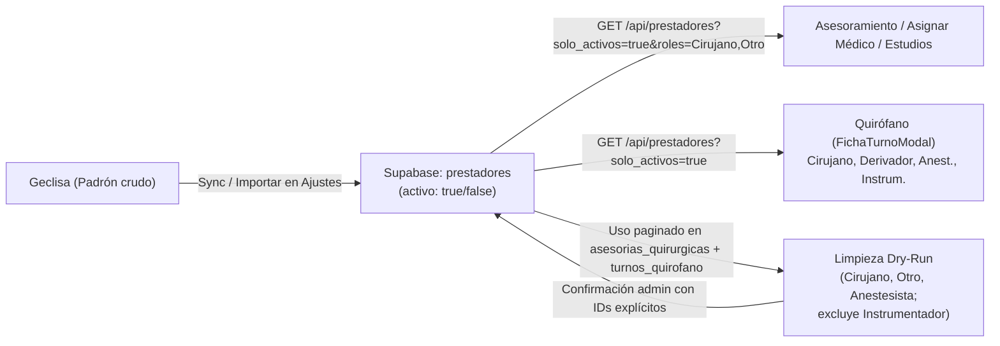

# Centralización de Búsquedas de Prestadores en el Catálogo de Ajustes

*   **Author:** malko
*   **Status:** Draft (Hallazgos de revisión resueltos)
*   **Date:** 2026-11-15

--------------------------------------------------------------------------------

## Overview

Este diseño centraliza todas las búsquedas de prestadores clínicos del CRM sobre la tabla local `prestadores` de Supabase, administrada desde la tarjeta **Gestión de Prestadores & Firmas Digitales** en **Ajustes > Equipo & Prestadores** (`PrestadoresSettingsCard.tsx`). Esto reemplaza las consultas al padrón crudo de **Geclisa** (sistema hospitalario externo) y corrige los selectores actuales en Asesoramiento Quirúrgico (`CasoFormularioActivo.tsx`), Quirófano (`FichaTurnoModal.tsx`), asignación médica (`ModalAsignarMedico.tsx`) y Estudios Técnicos (`estudios-tecnicos/page.tsx`).

Un único indicador booleano (`prestadores.activo`) determina la visibilidad en todas las búsquedas activas (`rol IN ('Cirujano', 'Otro')` para Médico Derivador y Médico Cirujano), mientras que los expedientes y turnos históricos conservan intactos los nombres ya guardados. Además, se agregan buscador, filtros por estado/rol y una limpieza asistida con vista previa (`dry_run`) que deshabilita prestadores sin uso real sin afectar a los `Instrumentador` cargados manualmente ni reactivar bajas tras nuevas sincronizaciones con Geclisa.

## The Problem

1. **Ruido operativo y duplicados desde Geclisa:** Al buscar un Médico Derivador o Médico Cirujano en Asesoramiento Quirúrgico, el sistema intenta consultar el padrón crudo de Geclisa (donde conviven registros administrativos como `"A RECEPCION - PEDIDOS MEDICOS"`, `"ASESORAMIENTO"`, técnicos como `"BENITEZ, JUAN PABLO (TECNICO)"` y médicos duplicados).
2. **Endpoints rotos, consumidores dispersos y valores fijos en el código actual:**
   * `CasoFormularioActivo.tsx` y `ModalAsignarMedico.tsx` llaman a `/api/geclisa/prestadores/buscar`, mientras `estudios-tecnicos/page.tsx` consulta `/api/geclisa/prestadores`, en lugar de usar el catálogo curado en Supabase.
   * `FichaTurnoModal.tsx` carga desde `/api/prestadores?solo_activos=true` únicamente `Instrumentador` y `Anestesista`, pero deja `cirujano_nombre` y `medico_derivador_nombre` como campos de texto libre con valores iniciales fijos (`cirujano_id: 1067`, `cirujano_nombre: 'ABRAHAM, IRINA'`).
3. **Falta de herramientas de curación en Ajustes:** La tarjeta **Gestión de Prestadores & Firmas Digitales** (en **Ajustes > Equipo & Prestadores**) muestra más de 171 registros sin buscador de texto, sin filtro por estado (`Activos` / `Deshabilitados`), sin pestaña para el rol `Otro`, sin switch rápido de habilitación y sin forma de depurar masivamente los registros de Geclisa que nunca se utilizan en expedientes quirúrgicos.

## Goals

*   **Fuente única de verdad en búsquedas clínicas:** Que todos los selectores y buscadores de prestadores del CRM (`CasoFormularioActivo.tsx`, `FichaTurnoModal.tsx`, `ModalAsignarMedico.tsx`, `estudios-tecnicos/page.tsx`) consuman `GET /api/prestadores?solo_activos=true` en lugar de consultar el padrón crudo de Geclisa.
*   **Unificación Derivador / Cirujano (`Cirujano + Otro`):** Que tanto la búsqueda de **Médico Derivador** como la de **Médico Cirujano (Qx)** filtren `activo = true` y `rol IN ('Cirujano', 'Otro')`.
*   **Preservación de bajas ante re-sincronizaciones con Geclisa:** Que `POST /api/prestadores/sincronizar-geclisa` inserte nuevos prestadores de Geclisa con `activo = true` (salvo ruido administrativo evidente), pero nunca sobrescriba `activo` ni `rol` en registros existentes.
*   **Limpieza inicial basada en uso real sin romper Quirófano:** Proveer una limpieza con vista previa (`dry_run`) que verifique qué prestadores tienen uso real en `asesorias_quirurgicas` y `turnos_quirofano` (por `geclisa_pre_id` y nombre normalizado), detecte posibles duplicados de Geclisa, deshabilite los no utilizados dentro de `Cirujano`, `Otro` y `Anestesista`, y **excluya estrictamente a `Instrumentador`** (cargados manualmente).
*   **Curación rápida en Ajustes:** Agregar buscador por texto, filtro de estado (`Todos` / `Activos` / `Deshabilitados`), pestaña `'Otro'` y toggle inline de `activo` en `PrestadoresSettingsCard.tsx`.
*   **Continuidad histórica en solo lectura:** Que los expedientes y turnos ya guardados con un prestador posteriormente deshabilitado sigan mostrando su nombre y permitan editar otros campos del caso sin bloqueos ni pérdida de datos; y que `/calculo-lio` (Cálculo de Lente Intraocular, **LIO**) conserve en su filtro a los cirujanos presentes en los casos cargados.

## Non-Goals

*   **Habilitación independiente por rol Derivador vs. Cirujano:** No se agregarán dos flags separados (`visible_derivador` / `visible_cirujano`); un único flag `activo` controla ambos lados.
*   **Modificación o borrado en Geclisa:** El CRM no escribirá, fusionará ni eliminará registros en la base externa de Geclisa.
*   **Reescritura histórica de expedientes cerrados:** No se reemplazarán ni migrarán automáticamente los strings `medico_derivador_nombre` / `medico_cirujano_nombre` ya guardados en casos históricos.

## Critical User Journeys (CUJs)

### CUJ 1: Búsqueda curada de Médico Derivador y Cirujano en Asesoramiento
*   **Given**: Existen prestadores activos (`rol IN ('Cirujano', 'Otro')`) y prestadores deshabilitados (`activo = false`, como duplicados o registros operativos de Geclisa) en la tabla `prestadores`.
*   **When**: El usuario abre un expediente quirúrgico en `CasoFormularioActivo.tsx` y escribe en **Médico Derivador** o **Médico Cirujano (Qx)**.
*   **Then**: El desplegable filtra en cliente (sin tildes) sobre la lista obtenida desde `GET /api/prestadores?solo_activos=true&roles=Cirujano,Otro` y muestra exclusivamente prestadores activos.

### CUJ 2: Curación y limpieza por uso en Ajustes (`dry_run` + reactivación manual)
*   **Given**: El administrador ingresa a **Ajustes > Equipo & Prestadores** con 171+ registros sincronizados desde Geclisa.
*   **When**: Ejecuta **"Limpiar no utilizados"**, revisa la vista previa (`dry_run`) que muestra los candidatos sin uso y posibles duplicados en `asesorias_quirurgicas` y `turnos_quirofano` (excluyendo `Instrumentador`), ajusta los checkboxes, confirma la acción y luego busca un médico específico por nombre para reactivarlo con el toggle inline.
*   **Then**: Los registros confirmados de `Cirujano`, `Otro` y `Anestesista` pasan a `activo = false`, los `Instrumentador` permanecen intactos, y el médico reactivado manualmente vuelve a aparecer de inmediato en todas las búsquedas del CRM.

### CUJ 3: Re-sincronización con Geclisa sin revertir bajas manuales
*   **Given**: Un prestador duplicado de Geclisa (`geclisa_pre_id = 999`) fue marcado como `activo = false` en Ajustes, y posteriormente se da de alta un médico nuevo en Geclisa (`geclisa_pre_id = 2500`).
*   **When**: El administrador presiona **"Sincronizar con Geclisa"**.
*   **Then**: El médico nuevo (`2500`) se inserta con `activo = true` y aparece en las búsquedas, mientras el registro `999` conserva `activo = false`.

### CUJ 4: Visualización histórica en solo lectura y Quirófano (`FichaTurnoModal`)
*   **Given**: Un expediente quirúrgico o turno de quirófano antiguo tiene guardado un prestador que posteriormente pasó a `activo = false`.
*   **When**: Un usuario abre ese expediente en Asesoramiento, abre el turno en `FichaTurnoModal`, o filtra la cola de `/calculo-lio`.
*   **Then**: El nombre histórico sigue mostrándose correctamente (con `<option>` huérfana de solo lectura en `FichaTurnoModal` y sin valores fijos `1067` / `'ABRAHAM, IRINA'`), editar otros campos no borra `*_id`/`*_nombre` previos, y las nuevas búsquedas solo ofrecen prestadores activos.

## Technical Plan (Architecture)

### 1. Modelo de Datos y Reglas de Visibilidad
Se reutiliza la columna existente `prestadores.activo` (`boolean`, default `true`) como **único interruptor de visibilidad** para búsquedas clínicas en todo el CRM:
*   **Búsquedas unificadas de Derivador y Cirujano:** Todas las búsquedas médicas (`CasoFormularioActivo.tsx`, `FichaTurnoModal.tsx`, `ModalAsignarMedico.tsx`, `estudios-tecnicos/page.tsx`) consumen `GET /api/prestadores?solo_activos=true&roles=Cirujano,Otro` (o `solo_activos=true` particionado en cliente en `FichaTurnoModal.tsx`).
*   **Restricción de identidad dual (`geclisa_pre_id` / nombre):** Las tablas `asesorias_quirurgicas` y `turnos_quirofano` guardan `*_id` (ID numérico de Geclisa, que será `null` para prestadores creados manualmente) y `*_nombre`. Al editar campos no relacionados en un expediente o turno, se preservan intactos los valores `*_id` y `*_nombre` ya guardados.
*   **Selectores de Quirófano (`FichaTurnoModal.tsx`):**
    *   `Cirujano Principal` y `Médico Derivador` consumen `prestadores` activos con `rol IN ('Cirujano', 'Otro')`, eliminando el fallback fijo `cirujano_id: 1067` / `cirujano_nombre: 'ABRAHAM, IRINA'` (iniciando `cirujano_id: null`, `cirujano_nombre: ''`).
    *   `Instrumentador` y `Anestesista` mantienen `rol = 'Instrumentador'` y `rol = 'Anestesista'` con `activo = true`. Los cuatro selectores preservan `<option value={nombre}>{nombre} (Inactivo / Histórico)</option>` si un turno existente tiene un valor fuera de la lista activa.
*   **Re-sincronización segura con Geclisa (`POST /api/prestadores/sincronizar-geclisa`):**
    *   El endpoint actual (`main.py:7130`) ya evita sobrescribir `activo` y `rol` en registros existentes. Se refuerza emparejando por `geclisa_pre_id` o nombre normalizado sin tildes, completando solo `geclisa_pre_id` (si faltaba y no colisiona) o `matricula`.
    *   Los registros nuevos de Geclisa autodetectan `Anestesista` (si especialidad contiene `ANEST`) o `Cirujano` en el resto de los casos (sin autodetectar `Instrumentador`, que es de carga manual). Si el registro nuevo coincide con patrones administrativos obvios (`RECEPCION`, `ASESORAMIENTO`, `PEDIDOS MEDICOS`, `TECNICO`), se inserta con `activo = false` para evitar re-contaminar las búsquedas.
*   **Búsqueda directa en Geclisa solo para Ajustes:** `GET /api/geclisa/prestadores` se mantiene exclusivamente para el autocompletado de importación/vinculación manual dentro de `PrestadoresSettingsCard.tsx`.

### 2. Backend (`backend/app/db.py` y `backend/app/main.py`)
1.  **`GET /api/prestadores` (`get_prestadores`):**
    *   Agregar parámetro opcional `roles: Optional[str] = None` (lista separada por comas, ej. `Cirujano,Otro`) manteniendo compatibilidad con `rol` y `solo_activos`. (Al tener ~170–300 filas, el filtrado por texto se realiza en cliente en una sola carga, evitando peticiones por tecla).
2.  **`PUT /api/prestadores/{prestador_id}` (`actualizar_prestador_endpoint`):**
    *   Confirmar y cubrir con test que `actualizar_prestador` ejecuta un `UPDATE` parcial únicamente sobre las claves enviadas en el payload (ej. `{"activo": False}`), sin sobrescribir `rol`, `matricula` ni `firma_url`, y protegido con autenticación + validación de permisos administrativos.
3.  **`POST /api/prestadores/sincronizar-geclisa` (`sincronizar_prestadores_geclisa_endpoint`):**
    *   Mantener preservación de `activo` y `rol` en existentes; aplicar normalización sin tildes en el matching por nombre y `activo = False` para patrones administrativos obvios en altas nuevas; sin autodetección de `Instrumentador`.
4.  **`POST /api/prestadores/limpiar-no-usados` (`limpiar_prestadores_no_usados`):**
    *   Recibe `{ dry_run: bool = True, ids_a_deshabilitar?: Optional[List[str]] = None }` (mismo nombre de parámetro en API y lógica).
    *   Obtiene prestadores con `activo = true` y `rol IN ('Cirujano', 'Otro', 'Anestesista')` (**excluye estrictamente `Instrumentador`**).
    *   **Lectura completa sin truncamiento:** Consulta `asesorias_quirurgicas` (`medico_derivador_id`, `medico_cirujano_id`, `medico_derivador_nombre`, `medico_cirujano_nombre`) y `turnos_quirofano` (`cirujano_id`, `cirujano_nombre`, `medico_derivador_nombre`, `anestesiologo_nombre`) paginando en bloques de 1,000 filas con `.range()` hasta agotar ambas tablas (evitando el límite por defecto de 1,000 filas de PostgREST).
    *   **Emparejamiento multi-nivel y detección de duplicados:**
        *   Normaliza tokens (minúsculas, sin tildes, sin prefijos `dr.`/`dra.`/`lic.`/`prof.`, sin sufijos entre paréntesis como `(TECNICO)`, exigiendo `>= 2` tokens para evitar falsos positivos por apellido único).
        *   Un prestador está "en uso" si su `geclisa_pre_id` coincide con algún `*_id` usado, o si sus tokens de nombre coinciden con algún nombre usado **y** no existe otro prestador activo con el mismo nombre cuyo `geclisa_pre_id` sí esté en uso. Si su `geclisa_pre_id` no aparece usado pero otro homónimo activo sí tiene `geclisa_pre_id` en uso, se incluye en `candidatos_deshabilitar` marcado con `posible_duplicado: true`.
    *   **Contrato estricto de `dry_run=false`:**
        *   Si `ids_a_deshabilitar is not None`: operar estrictamente sobre esa lista; si `ids_a_deshabilitar == []`, retornar `actualizados: 0` sin modificar la BD.
        *   Solo si `ids_a_deshabilitar is None`, deshabilitar todos los candidatos sin uso.
        *   El `UPDATE` en Supabase siempre incluye `.in_("rol", ["Cirujano", "Otro", "Anestesista"])` como guarda de seguridad en backend.
        *   Registra auditoría con `log_event` (`backend/app/services/logger_service.py`: `nivel="INFO"`, `modulo="SISTEMA"`, `accion="LIMPIEZA_PRESTADORES"`, incluyendo los `ids` deshabilitados para permitir rollback puntual).

### 3. Frontend (`Ajustes`, `Asesoramiento`, `Quirófano`, `Cálculo LIO`, `Asignar Médico`, `Estudios`)
1.  **Ajustes (`frontend/src/components/settings/PrestadoresSettingsCard.tsx`):**
    *   Usar `apiFetch` de `@/lib/api` (adjunta Bearer token requerido por `AuthSecurityMiddleware`) en el toggle inline, en la limpieza y en los llamados del componente.
    *   Agregar buscador en cliente (`nombre_apellido`, `matricula`, `especialidad`, `geclisa_pre_id`), filtro de estado (`Todos` / `Activos` / `Deshabilitados`), pestaña `'Otro'`, badge visual para `Otro` y `activo === false`, y switch inline en cada tarjeta (`PUT /api/prestadores/{id}` con `{ activo: !p.activo }`).
    *   Agregar botón **"Limpiar no utilizados"** que llama a `POST /api/prestadores/limpiar-no-usados` (`dry_run: true`), abre modal con checkboxes (botones "Seleccionar todos / Deseleccionar todos", destacando `posible_duplicado` y `tiene_firma`), y envía `ids_a_deshabilitar` seleccionados al confirmar (`dry_run: false`).
2.  **Asesoramiento (`frontend/src/components/asesoria/CasoFormularioActivo.tsx`):**
    *   Cargar `apiFetch('/api/prestadores?solo_activos=true&roles=Cirujano,Otro')` (en lugar de `/api/geclisa/prestadores/buscar`) y filtrar en cliente normalizando diacríticos (`NFD`).
    *   Usar tipo `PrestadorCatalogo` con `key={p.id}` (UUID local, evitando colisión en `geclisa_pre_id = null`), asignando `geclisa_pre_id ?? null` en `medicoDerivador.id` / `medicoCirujano.id`, actualizando placeholders `"en el catálogo"`, y conservando válidos los valores históricos ya guardados.
3.  **Quirófano (`frontend/src/components/quirofano/FichaTurnoModal.tsx`):**
    *   Eliminar `1067` y `'ABRAHAM, IRINA'`, iniciando `cirujano_id: null`, `cirujano_nombre: ''`.
    *   Particionar en cliente la respuesta de `GET /api/prestadores?solo_activos=true` en `cirujanosActivos` (`Cirujano` + `Otro`), `anestesistas` e `instrumentadores`.
    *   Convertir `Cirujano Principal` y `Médico Derivador` en `<select>` con `<option>` huérfana de solo lectura cuando corresponda (aplicando el mismo criterio a `Anestesista` e `Instrumentador`).
4.  **Otros consumidores (`ModalAsignarMedico.tsx`, `estudios-tecnicos/page.tsx`, `calculo-lio/page.tsx`):**
    *   `ModalAsignarMedico.tsx` y `estudios-tecnicos/page.tsx` migran a `apiFetch('/api/prestadores?solo_activos=true&roles=Cirujano,Otro')`.
    *   `calculo-lio/page.tsx` construye su `<select>` exclusivamente desde los casos cargados por `/api/calculo-lio/pacientes` para no ocultar casos pendientes históricos de cirujanos deshabilitados.

## Alternatives Considered

### Alternativa A: Agregar una columna booleana separada (`visible_busquedas`) en `prestadores`
*   **Pros**: Desacoplaría completamente la visibilidad en buscadores de Asesoramiento respecto del flag `activo` usado en Quirófano o firmas digitales.
*   **Cons**: Duplica el estado de habilitación en Ajustes (dos switches por tarjeta) y obliga a migrar el esquema SQL.
*   **Motivo de rechazo**: Rechazada por el autor: un único flag `activo` mantiene simple la gestión en Ajustes, siempre que la limpieza excluya explícitamente el rol `Instrumentador` (cargado manualmente).

### Alternativa B: Seguir consultando Geclisa en vivo y aplicar una lista negra (`denylist`) local en CRM
*   **Pros**: Evitaría migrar los buscadores hacia `GET /api/prestadores`.
*   **Cons**: Mantiene la dependencia de latencia y disponibilidad contra Geclisa, duplica estructuras y no centraliza la curación con matrícula, rol y firma digital.
*   **Motivo de rechazo**: Rechazada por el autor: la tabla `prestadores` en Supabase ya sincroniza el padrón con `geclisa_pre_id`, `activo`, `rol` y `firma_url`.

### Alternativa C: Deshabilitación automática silenciosa en un clic sin vista previa (`dry_run`)
*   **Pros**: Un paso menos al ejecutar la limpieza inicial.
*   **Cons**: Riesgo de ocultar médicos en uso si un expediente tiene `*_id = NULL` o un nombre con formato distinto.
*   **Motivo de rechazo**: Rechazada por el autor: la vista previa `dry_run` con confirmación explícita permite auditar candidatos y desmarcar excepciones antes de modificar la base.

--------------------------------------------------------------------------------

## Non-Functional Requirements

*   **Seguridad y Permisos:** `PUT /api/prestadores/{id}` y `POST /api/prestadores/limpiar-no-usados` deben requerir usuario autenticado (`Depends(get_current_user)`) con permisos administrativos de Ajustes (retornando `403 Forbidden` si no corresponde), y registrar auditoría en `log_event` con los `ids` deshabilitados cuando `dry_run=false`.
*   **Rendimiento y Latencia:** `GET /api/prestadores` opera sobre ~170–300 filas en Supabase (< 50 ms) y se filtra en memoria en el cliente sin peticiones por tecla. La limpieza por uso lee con paginación completa (`.range()`) solo las columnas necesarias y actualiza en lote únicamente los IDs confirmados.
*   **Compatibilidad y Rollback:** Al no eliminar filas ni alterar `asesorias_quirurgicas` / `turnos_quirofano`, cualquier baja es reversible reactivando `activo = true` en Ajustes o revirtiendo un lote puntual mediante los `ids` registrados en `log_event` (`UPDATE prestadores SET activo = true WHERE id = ANY(...)`).

--------------------------------------------------------------------------------

## Detailed Implementation Plan

### Target Files to Create/Modify

#### 1. `backend/app/db.py` (Modify)
*   **Type / Scope**: Capa de acceso a datos Python / Supabase.
*   **Proposed Changes**:
    *   Extender `get_prestadores(rol: Optional[str] = None, solo_activos: bool = False, roles: Optional[List[str]] = None)`:
        *   Si se recibe `roles`, aplicar filtro `.in_("rol", roles)` manteniendo compatibilidad con `rol`.
    *   Agregar helper `_fetch_all_rows(table: str, columns: str, page_size: int = 1000) -> List[Dict[str, Any]]`: itera con `.range(offset, offset + page_size - 1)` hasta leer todas las filas sin truncamiento.
    *   Agregar helper `_normalizar_tokens_prestador(nombre: str) -> List[str]` / `set[str]`: normaliza minúsculas, elimina tildes (`unicodedata.normalize('NFKD', ...)`), remueve sufijos entre paréntesis (`(...)`) y prefijos honoríficos (`dr.`, `dra.`, `lic.`, `prof.`), y tokeniza separando comas/espacios. Para matching por nombre exigir `len(tokens) >= 2`.
    *   Agregar función `limpiar_prestadores_no_usados(dry_run: bool = True, ids_a_deshabilitar: Optional[List[str]] = None) -> Dict[str, Any]`:
        *   Leer `prestadores` con `activo = True`.
        *   Separar `Instrumentador` (siempre excluidos) y evaluar únicamente `rol IN ('Cirujano', 'Otro', 'Anestesista')`.
        *   Leer con `_fetch_all_rows` las columnas `medico_derivador_id, medico_cirujano_id, medico_derivador_nombre, medico_cirujano_nombre` de `asesorias_quirurgicas` y `cirujano_id, cirujano_nombre, medico_derivador_nombre, anestesiologo_nombre` de `turnos_quirofano`.
        *   Construir conjuntos `ids_usados` y `nombres_tokens_usados`, además del subconjunto de `nombres_tokens_con_id_usado` (nombres que ya tienen al menos un `geclisa_pre_id` usado).
        *   Clasificar como "en uso" si `geclisa_pre_id in ids_usados`, o si `tokens in nombres_tokens_usados` y `tokens not in nombres_tokens_con_id_usado`. Si `geclisa_pre_id not in ids_usados` pero `tokens in nombres_tokens_con_id_usado`, incluirlo en `candidatos_deshabilitar` con `posible_duplicado: True`.
        *   Si `dry_run=True`, retornar `{ total_evaluados, usados_count, excluidos_instrumentador_count, candidatos_deshabilitar }`.
        *   Si `dry_run=False`: si `ids_a_deshabilitar is not None`: si `len(ids_a_deshabilitar) == 0`, retornar `{"actualizados": 0, "ids_deshabilitados": []}`; si tiene elementos, filtrar `target_ids` contra los IDs válidos. Si `ids_a_deshabilitar is None`, usar todos los IDs de `candidatos_deshabilitar`. Ejecutar `.update({"activo": False, "updated_at": "now()"}).in_("id", target_ids).in_("rol", ["Cirujano", "Otro", "Anestesista"])`.

#### 2. `backend/app/main.py` (Modify)
*   **Type / Scope**: Endpoints FastAPI.
*   **Proposed Changes**:
    *   Actualizar `GET /api/prestadores` (`listar_prestadores_endpoint`) para aceptar `roles: Optional[str] = None` (parseado por coma) y delegar en `get_prestadores`.
    *   En `PUT /api/prestadores/{prestador_id}` (`actualizar_prestador_endpoint`): agregar dependencia de autenticación/permiso administrativo (`Depends(get_current_user)` + verificación de acceso a Ajustes).
    *   Agregar endpoint `POST /api/prestadores/limpiar-no-usados` protegido con `Depends(get_current_user)` + verificación administrativa, recibiendo `{ dry_run: bool = True, ids_a_deshabilitar: Optional[List[str]] = None }`. Cuando `dry_run=False` y `actualizados > 0`, registrar auditoría vía `log_event(nivel="INFO", modulo="SISTEMA", accion="LIMPIEZA_PRESTADORES", mensaje=..., detalles={"ids": ...})`.
    *   En `POST /api/prestadores/sincronizar-geclisa` (`sincronizar_prestadores_geclisa_endpoint`):
        *   Emparejar existentes por `geclisa_pre_id` o nombre normalizado (`_normalizar_tokens_prestador`), preservando intactos `activo` y `rol`.
        *   En inserciones nuevas, autodetectar `Anestesista` (si especialidad contiene `ANEST`) o `Cirujano` (nunca `Instrumentador`), marcando `activo = False` si el nombre/especialidad coincide con ruido administrativo obvio (`RECEPCION`, `ASESORAMIENTO`, `PEDIDOS MEDICOS`, `TECNICO`).

#### 3. `frontend/src/components/settings/PrestadoresSettingsCard.tsx` (Modify)
*   **Type / Scope**: Componente React / UI de Ajustes.
*   **Proposed Changes**:
    *   Migrar las llamadas `fetch` del componente a `apiFetch` (`@/lib/api`) para enviar el token Bearer exigido por `AuthSecurityMiddleware`.
    *   Agregar `busquedaTexto` (filtrando por `nombre_apellido`, `matricula`, `especialidad`, `geclisa_pre_id` sin tildes), `filtroEstado` (`'todos' | 'activos' | 'deshabilitados'`), pestaña `'Otro'`, estilos visuales para `Otro` y estado `activo === false`, y switch inline por tarjeta (`PUT /api/prestadores/{id}` con `{ activo: !p.activo }`).
    *   Agregar botón **"Limpiar no utilizados"** que invoque `POST /api/prestadores/limpiar-no-usados` (`dry_run: true`) y abra un modal de confirmación con acciones "Seleccionar todos / Deseleccionar todos", badges de `posible_duplicado` y `tiene_firma`, y confirmación (`dry_run: false`, `ids_a_deshabilitar`).

#### 4. `frontend/src/components/asesoria/CasoFormularioActivo.tsx` (Modify)
*   **Type / Scope**: Componente React / Formulario de Asesoramiento Quirúrgico.
*   **Proposed Changes**:
    *   Reemplazar la consulta a `/api/geclisa/prestadores/buscar` por una carga única con `apiFetch('/api/prestadores?solo_activos=true&roles=Cirujano,Otro')` y filtrar en cliente en `derivadoresFiltrados` / `cirujanosFiltrados` normalizando acentos (`NFD`).
    *   Actualizar el tipo `PrestadorGeclisa` a `PrestadorCatalogo` (`id: string`, `geclisa_pre_id: number | null`, `nombre_apellido: string`, `matricula?: string | null`, `especialidad?: string | null`), usar `key={p.id}` en ambos dropdowns, asignar `id: p.geclisa_pre_id ?? null` al seleccionar, cambiar textos `"en Geclisa"` a `"en el catálogo"`, y mantener válidos los valores históricos ya guardados en el expediente.

#### 5. `frontend/src/components/quirofano/FichaTurnoModal.tsx` (Modify)
*   **Type / Scope**: Componente React / Modal de Programación de Quirófano.
*   **Proposed Changes**:
    *   Eliminar `1067` y `'ABRAHAM, IRINA'` en `formData`, iniciando `cirujano_id: null` y `cirujano_nombre: ''` si no vienen heredados.
    *   Desde `GET /api/prestadores?solo_activos=true`, particionar en cliente `cirujanosActivos` (`Cirujano` + `Otro`), `anestesistas` e `instrumentadores`.
    *   Reemplazar `<input type="text">` de **Cirujano Principal** y **Médico Derivador** por `<select>` respaldados por `cirujanosActivos` (actualizando `cirujano_id: selected?.geclisa_pre_id ?? null` al cambiar cirujano) y preservar `<option value={valor}>{valor} (Inactivo / Histórico)</option>` en los 4 selectores si un turno histórico tiene un valor fuera del catálogo activo.

#### 6. `frontend/src/components/ModalAsignarMedico.tsx` y `frontend/src/app/estudios-tecnicos/page.tsx` (Modify) y `frontend/src/app/calculo-lio/page.tsx` (Verify)
*   **Type / Scope**: Otros consumidores de prestadores en el CRM.
*   **Proposed Changes**:
    *   En `ModalAsignarMedico.tsx`: reemplazar `/api/geclisa/prestadores/buscar` por `apiFetch('/api/prestadores?solo_activos=true&roles=Cirujano,Otro')` con filtrado en cliente.
    *   En `estudios-tecnicos/page.tsx`: reemplazar `apiFetch('/api/geclisa/prestadores')` por `apiFetch('/api/prestadores?solo_activos=true&roles=Cirujano,Otro')` (filtrando `p.geclisa_pre_id != null`).
    *   En `calculo-lio/page.tsx`: verificar que la lista de `cirujanos` siga derivándose exclusivamente de `/api/calculo-lio/pacientes`.

#### 7. `backend/tests/test_prestadores_catalogo.py` (Create)
*   **Type / Scope**: Suite de pruebas unitarias Pytest.
*   **Proposed Changes**:
    *   `test_get_prestadores_filtra_roles_y_activos`: verifica `solo_activos=True` y `roles=['Cirujano', 'Otro']`.
    *   `test_actualizar_prestador_parcial_preserva_campos`: verifica que `{ "activo": False }` no sobrescribe `rol`, `matricula` ni `firma_url`.
    *   `test_sincronizar_geclisa_no_reactiva_ni_sobrescribe_rol`: verifica preservación de `activo=False` y `rol='Otro'`, y que registros administrativos nuevos entren con `activo=False` sin autodetectar `Instrumentador`.
    *   `test_limpiar_no_usados_paginacion_duplicados_y_guardas`: verifica lectura paginada > 1,000 filas, uso de columna `anestesiologo_nombre`, exclusión estricta de `Instrumentador`, detección de `posible_duplicado`, y que `ids_a_deshabilitar=[]` actualiza `0` filas sin hacer fallback a todos los candidatos.

### Verification Plan

*   **Consumer Audit**: Ejecutar búsqueda en `frontend/src` sobre `geclisa/prestadores` para confirmar que ningún selector clínico activo sigue consultando el padrón crudo (solo `PrestadoresSettingsCard.tsx` para importación manual).
*   **Compilation/Build**: `cd frontend; npm run build` (0 errores de TypeScript/Next.js).
*   **Unit Tests**: `python -m pytest backend\tests\test_prestadores_catalogo.py -v` (todos los casos nuevos pasando) + suite quirúrgica existente.
*   **Manual / E2E Check**:
    *   En **Ajustes > Equipo & Prestadores**: probar buscador, filtro `Activos`/`Deshabilitados`, pestaña `Otro`, toggle inline y vista previa de **"Limpiar no utilizados"**.
    *   En **Pacientes > Asesoramiento** y **ModalAsignarMedico**: verificar que **Médico Derivador** y **Médico Cirujano** devuelven solo prestadores activos (`Cirujano + Otro`), y que un caso antiguo con médico deshabilitado conserva su nombre visible.
    *   En **Quirófano (`FichaTurnoModal`)**: verificar que al abrir un turno nuevo no precarga `ABRAHAM, IRINA` ni `1067`, y que los selectores muestran prestadores activos + opción huérfana si es histórico.

--------------------------------------------------------------------------------

*Drafted & Refined with EGM*