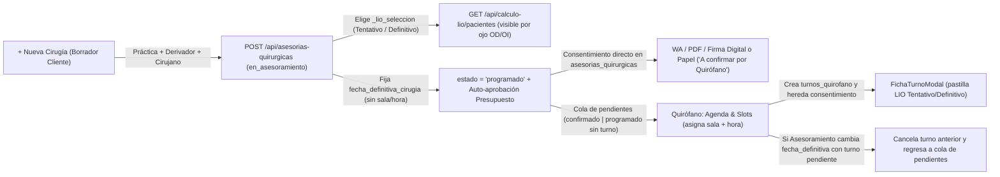

# Rediseño del Flujo Quirúrgico: Alta Diferida, Desacoplamiento Asesoramiento-Quirófano y Propagación de LIO

*   **Author:** malko
*   **Status:** Proposed
*   **Date:** 2026-11-14

--------------------------------------------------------------------------------

## Overview

Este diseño corrige el ciclo de vida de los casos quirúrgicos (`asesorias_quirurgicas`) y su integración con **Quirófano** (`turnos_quirofano`) y **Cálculo de LIO** (`/calculo-lio`). Se elimina la creación prematura de casos vacíos en base de datos, se desacopla la asignación de `fecha_definitiva_cirugia` (responsabilidad de Asesoramiento) de la asignación de sala y horario (responsabilidad de Quirófano), y se propaga la selección de lente intraocular (`_lio_seleccion` en `checklist_prequirurgico`) con su estado (`Tentativo` o `Definitivo`) hacia el equipo médico y el equipo de quirófano.

## The Problem

1. **Casos huérfanos y dropdown bloqueante en Asesoramiento:** Al pulsar `+ Nueva Cirugía / Procedimiento`, `PanelAsesoriaQuirurgica.tsx` inserta de inmediato un registro con `'Nueva Cirugía / Procedimiento'` en `asesorias_quirurgicas`, contaminando el pipeline con casos incompletos cuando el usuario cancela o abandona el alta. Además, el buscador de `Práctica Quirúrgica (Nomenclador CRM)` en `CasoFormularioActivo.tsx` permanece desplegado al hacer clic fuera o tabular hacia otros campos, tapando los selectores de `Médico Derivador` y `Médico Cirujano`. Asimismo, en el modal de firma en papel existe un botón duplicado para segundo ojo y la selección de LIO no dispara detección de cambios sin guardar.
2. **Acoplamiento de Sala/Horario y riesgo de turnos fantasma:** `CasoFormularioActivo.tsx` expone y envía campos de sala (`quirofano_id`) y horario (`hora_inicio`) que Asesoramiento no define. A su vez, el `Consentimiento Informado` depende hoy de `asegurar_turno_para_consentimiento_asesoria(..., crear_si_no_existe=True)`, que inserta un turno ficticio a las `08:00:00` en `turnos_quirofano` si no existe turno previo, mientras las plantillas fabrican `"Quirófano Central"` y `"08:00"`.
3. **Invisibilidad en Quirófano y precedencia invertida de fechas:** `get_asesorias_confirmadas_pendientes` excluye casos en estado `programado` para cirugías unilaterales o simultáneas, impidiendo que Quirófano asigne sala y horario si Asesoramiento ya pasó el caso a `programado` al fijar `fecha_definitiva_cirugia`. Además, varias consultas priorizan `fecha_probable_cirugia` sobre `fecha_definitiva_cirugia`.
4. **Falta de visibilidad del LIO elegido en Cálculo de LIO y Quirófano:** `_lio_seleccion` (unilateral o bilateral `OD`/`OI`) no llega a `GET /api/calculo-lio/pacientes` ni a la sección `¿Lleva Lente Intraocular (LIO)?` de `FichaTurnoModal.tsx`, y los casos en etapas iniciales (`en_asesoramiento`, `en_analisis`) quedan ocultos para el médico calculista aunque ya tengan lente seleccionado.

## Goals

*   Mantener el alta de una nueva cirugía como borrador en cliente hasta completar `Práctica Quirúrgica`, `Médico Derivador` y `Médico Cirujano`, validando ambos extremos (`POST` y `PUT` en backend, sin fallback directo a Supabase en frontend).
*   Replegar el dropdown del Nomenclador CRM (y buscadores equivalentes) al hacer clic fuera, perder foco o presionar `Escape`, bloqueando el guardado cuando falten campos obligatorios.
*   Quitar la selección y obligatoriedad de sala/horario en Asesoramiento, permitiendo guardar `fecha_probable_cirugia` y `fecha_definitiva_cirugia` de forma independiente.
*   Transicionar automáticamente a `estado = 'programado'` y habilitar `Consentimiento Informado` apenas se fije `fecha_definitiva_cirugia`, usando **Consentimiento directo en `asesorias_quirurgicas`** (por ojo `OD`/`OI`) como única fuente de verdad sin crear turnos fantasma en `turnos_quirofano`.
*   Incluir en la cola de pendientes de Quirófano todo caso en estado `confirmado` o `programado` con `fecha_definitiva_cirugia` que aún no tenga sala y horario asignados, y cancelar el turno previo si Asesoramiento cambia o limpia `fecha_definitiva_cirugia` posteriormente.
*   Mostrar `_lio_seleccion` (emparejado por ojo `OD`/`OI` o unilateral, mapeado a `Tentativo` o `Definitivo`) en `/calculo-lio` desde que se elige en Asesoramiento —con alerta por ojo si cambia el modelo tras un cálculo previo— y en la pastilla informativa de `FichaTurnoModal.tsx` en Quirófano.

## Non-Goals

*   Rediseñar el módulo de Presupuestos ni cambiar la regla vigente de auto-aprobación automática al fijar `fecha_definitiva_cirugia` o pasar a `programado`.
*   Modificar el contenido aprobado de plantillas en Meta WhatsApp Business API (WABA).
*   Alterar el comportamiento de Recepción del Día o Pizarra en Vivo más allá de evitar que reciban turnos ficticios generados por Consentimiento.

## Open Questions

*   Ninguna pendiente; todas las decisiones de producto quedaron cerradas en el brief conceptual de la sesión ([concepts_brief.md](file:///C:/Users/Malko/.gemini/antigravity/brain/fa7bb0df-4f0c-4994-a766-19f60e3b34f4/concepts_brief.md)).

## Critical User Journeys (CUJs)

### CUJ 1: Alta Diferida de Caso Quirúrgico en Asesoramiento
*   **Given**: Un paciente en `/pacientes` sin un caso nuevo iniciado y con el usuario en Asesoramiento Quirúrgico.
*   **When**: El usuario pulsa `+ Nueva Cirugía / Procedimiento`, busca en `Práctica Quirúrgica (Nomenclador CRM)`, hace clic fuera del desplegable sin elegir o intenta guardar sin completar `Práctica`, `Médico Derivador` o `Médico Cirujano`.
*   **Then**: El desplegable se repliega al perder foco, hacer clic fuera o presionar `Escape`; no se crea ninguna fila en `asesorias_quirurgicas` ni se habilitan acciones hijas (Presupuesto, Evoluciones, Consentimiento, Recordatorios) hasta completar los 3 campos obligatorios y guardar. Si el usuario intenta cerrar o recargar la pestaña con cambios en el borrador, el navegador advierte antes de descartar.

### CUJ 2: Fijación de Fecha Definitiva y Consentimiento sin Turno Fantasma
*   **Given**: Un caso guardado en Asesoramiento con `Práctica`, `Derivador` y `Cirujano`.
*   **When**: Asesoramiento carga `fecha_definitiva_cirugia` (sin sala ni horario) y guarda.
*   **Then**: El caso pasa a `estado = 'programado'`, el presupuesto vinculado mantiene su auto-aprobación, el panel de `Consentimiento Informado` se habilita para envío por WhatsApp / PDF / firma física sobre `asesorias_quirurgicas` mostrando `"A confirmar por Quirófano"` en lugar de `"08:00"`, y el caso aparece en la cola de pendientes de Quirófano sin haber insertado filas en `turnos_quirofano`.

### CUJ 3: Reasignación de Sala/Horario y Cambio de Fecha Definitiva
*   **Given**: Un caso en estado `programado` con `fecha_definitiva_cirugia` y consentimiento enviado/firmado.
*   **When**: Quirófano asigna sala y horario desde `Agenda & Slots`; posteriormente Asesoramiento cambia `fecha_definitiva_cirugia` a otra fecha.
*   **Then**: Al asignar sala/hora, el turno en `turnos_quirofano` hereda el estado del consentimiento ya firmado desde `asesorias_quirurgicas`; si luego Asesoramiento cambia `fecha_definitiva_cirugia`, el turno previo pendiente en `turnos_quirofano` pasa a `cancelado`, el consentimiento firmado permanece intacto en `asesorias_quirurgicas`, y el caso regresa a la cola de pendientes de Quirófano (con indicador de reprogramación por Asesoramiento) para la nueva fecha.

### CUJ 4: Propagación de LIO Comercial a Cálculo de LIO y Quirófano
*   **Given**: Un caso activo en Asesoramiento (en cualquier etapa desde `en_asesoramiento`) con `_lio_seleccion` cargado para `OD`, `OI` o unilateral como `Tentativo` (`a_definir`) o `Definitivo` (`confirmado`).
*   **When**: El médico abre `/calculo-lio` o Quirófano abre `FichaTurnoModal.tsx` desde la agenda o al programar un caso pendiente.
*   **Then**: `/calculo-lio` muestra el caso y el LIO correspondiente a cada ojo con su badge `Tentativo` o `Definitivo` (y alerta visual por ojo si Asesoramiento modificó el modelo de lente luego de un cálculo ya guardado); `FichaTurnoModal.tsx` muestra esa misma información como pastilla informativa bajo `¿Lleva Lente Intraocular (LIO)?`.

--------------------------------------------------------------------------------

## Technical Plan (Architecture)

### 1. Flujo de Estados y Desacoplamiento entre Módulos

### 2. Alta Diferida y Comportamiento de Buscadores en Asesoramiento
*   **Borrador en cliente:** Al pulsar `+ Nueva Cirugía / Procedimiento`, la ficha se abre como borrador local en memoria sin ejecutar `POST` ni inserción directa a Supabase. Mientras el caso no tenga `id` persistido, se omiten consultas de consentimiento/presupuestos contra el backend, el borrado descarta localmente el ítem, y las acciones dependientes de un registro real (Presupuestos vinculados, Evoluciones, Consentimiento, Recordatorio Qx y Seguimiento Automatizado) quedan deshabilitadas. Se enlaza el estado sucio de cambios sin guardar (incluyendo selección de LIO) al evento `beforeunload` para evitar pérdida accidental al recargar o cerrar la pestaña.
*   **Validación simétrica (`POST` y `PUT`):** La validación obligatoria de `practica_nombre` (no vacío ni placeholder `'Nueva Cirugía / Procedimiento'`), `medico_derivador_nombre` y `medico_cirujano_nombre` se comparte entre creación y actualización (`HTTP 400` ante `ValueError`). Se eliminan los fallbacks directos a Supabase en creación y actualización de casos desde el frontend.
*   **Repliegue de buscadores y limpieza UI:** Los buscadores de Nomenclador CRM, Médico Derivador y Médico Cirujano se repliegan al hacer clic fuera, perder foco (respetando la selección por clic antes del blur) o presionar `Escape`. Se corrige además el botón duplicado de segundo ojo en el modal de firma en papel.

### 3. Desacoplamiento de Sala/Horario y Máquina de Estados
*   **Eliminación de Sala/Horario en Asesoramiento:** El formulario de Asesoramiento gestiona únicamente `fecha_probable_cirugia` y `fecha_definitiva_cirugia` (y `fecha_definitiva_2do_ojo` en bilateral escalonada), omitiendo cualquier selector o clave de sala/horario en `checklist_prequirurgico`.
*   **Transición a `programado` y casos borde:**
    *   Al fijar `fecha_definitiva_cirugia` (unilateral/simultánea o 1.º ojo en escalonada), `estado` transiciona automáticamente a `'programado'` salvo que el caso ya esté en `'operado'` o `'cancelado'`.
    *   En bilaterales escalonadas donde el 1.º ojo ya fue operado (`estado == 'operado'` o progreso `1er_ojo` completado), fijar `fecha_definitiva_2do_ojo` mantiene el caso en la cola de Quirófano para el 2.º ojo sin bloquearse por la guarda del 1.º ojo.
    *   Si Asesoramiento borra `fecha_definitiva_cirugia` (`null`) desde `programado`/`confirmado`, o retrocede a una etapa previa (incluyendo `'en_asesoramiento'`), se limpia `fecha_definitiva_cirugia` y se cancela el turno pendiente en `turnos_quirofano` si existía.
*   **Cola de Quirófano (`get_asesorias_confirmadas_pendientes`):** Incluye casos en `'confirmado'` y `'programado'` mientras el acto quirúrgico no tenga un `turno_quirofano` activo (no cancelado), usando la precedencia `fecha_definitiva_cirugia or fecha_probable_cirugia`.
*   **Liberación explícita de slot al cambiar `fecha_definitiva_cirugia`:** Si cambia `fecha_definitiva_cirugia` o `fecha_definitiva_2do_ojo` respecto del valor previo y existe un `turno_quirofano` vinculado en estado no ejecutado (`programado`, `en_espera`, `pre_quirofano` — nunca `operado` ni `en_operacion`), el backend marca ese turno como `estado = 'cancelado'` (con `motivo_cancelacion = 'reprogramado_asesoramiento'`) y omite re-agendarlo en `sincronizar_turno_quirofano_desde_asesoria`, devolviendo el caso a la cola de pendientes con indicador visual `"Reprogramado por Asesoramiento"`.

### 4. Consentimiento Informado Directo en `asesorias_quirurgicas` (Propiedad Canónica Única)
*   **Esquema de almacenamiento por ojo:** Para evitar migraciones de columnas rígidas y respetar el patrón existente en `asesorias_quirurgicas.checklist_prequirurgico`, los consentimientos sin turno asignado (y los nuevos consentimientos) se persisten por ojo dentro de `checklist_prequirurgico`:
    *   `_consentimiento_qx_OD` y `_consentimiento_qx_OI` (para bilaterales escalonadas), y `_consentimiento_qx` (para unilaterales o AO simultáneas), cada uno conteniendo `{ token, estado, enviado_at, firmado_at, modo, template, enlace_firma, pdf_url, wamid, firma_base64, ip_origen }`.
*   **Propiedad canónica única:** `asesorias_quirurgicas` es la fuente de verdad autoritativa para todo consentimiento nuevo. `enviar_consentimiento_whatsapp_endpoint` y `descargar_consentimiento_asesoria_pdf` dejan de crear turnos ficticios a las `08:00:00`. `get_consentimiento_by_token` busca primero en `asesorias_quirurgicas` (evaluando los objetos `_consentimiento_qx`, `_consentimiento_qx_OD` y `_consentimiento_qx_OI` en `checklist_prequirurgico` y, como respaldo de solo lectura para enlaces previos a esta migración, `turnos_quirofano.consentimiento_token`). Al firmar en `registrar_firma_consentimiento`, se actualiza el objeto correspondiente en `asesorias_quirurgicas` y, si existe un turno activo vinculado, se refleja el estado de solo lectura en `turnos_quirofano`. Cuando Quirófano crea un turno nuevo (o tras reprogramar fecha), hereda automáticamente el token y firma ya asentados en `asesorias_quirurgicas`.
*   **Supresión de datos fabricados y bloqueo WABA:** Cuando no exista turno real en `turnos_quirofano`, `render_consent_template` y `get_datos_recordatorio_quirurgico` muestran `"A confirmar por Quirófano"` en lugar de `"Quirófano Central"`, `"08:00"`, `"07:30 hs (a confirmar)"` o `"08:15"`. En `ModalRecordatorioCirugiaWhatsApp.tsx`, si el acto seleccionado no tiene turno con hora asignada (`!turno_id` o sin `hora_citacion`), el botón de envío de recordatorio WABA (WhatsApp Business API) permanece deshabilitado indicando que requiere turno asignado en Quirófano.

### 5. Propagación de `_lio_seleccion` a `/calculo-lio` y Quirófano
*   **Mapeo de estado:** Se mantiene el almacenamiento interno existente en `_lio_seleccion.estado` (`'a_definir' | 'confirmado'`) mapeado en backend/UI a las etiquetas `'Tentativo'` (`a_definir`) y `'Definitivo'` (`confirmado`).
*   **Contrato en `GET /api/calculo-lio/pacientes` y `POST /api/calculo-lio/guardar`:**
    *   `listar_pacientes_calculo_lio` amplía `q_asesorias` a `['en_asesoramiento', 'en_analisis', 'confirmado', 'programado']` cuando cumpla `requiere_calculo_lio(practica_nombre)` **o** tenga `_lio_seleccion` cargado, ordenando fechas con `fecha_definitiva_cirugia or fecha_probable_cirugia`.
    *   Para cada tarjeta/ojo (`OD`, `OI`, o unilateral), resuelve `lio_propuesto` desde `_lio_seleccion` (soportando `modalidad_bilateral: 'mismo_lente' | 'diferenciado'` para resolver `lente_od` / `lente_oi`) exponiendo `{ modelo, tipo, estado_label: 'Tentativo' | 'Definitivo', huella_clinica }`.
    *   **Huella y alerta de recálculo:** `huella_clinica` se calcula **por ojo** exclusivamente sobre la identidad clínica del lente elegido (modelo/tipo, excluyendo `estado` `a_definir` vs `confirmado` para evitar falsos positivos al confirmar el mismo lente). Al guardar un cálculo en `POST /api/calculo-lio/guardar`, se persiste `lio_propuesto_ref = huella_clinica` dentro de `checklist_prequirurgico["_lio_calculo_{ojo}"]`. En `GET /api/calculo-lio/pacientes`, `lio_cambio_post_calculo` es `true` únicamente cuando existe `lio_propuesto_ref` previo no nulo y difiere de la `huella_clinica` actual del mismo ojo (registros históricos sin `lio_propuesto_ref` no disparan falsas alertas).
*   **Pastilla informativa en Quirófano (`FichaTurnoModal.tsx`):** Al abrir `FichaTurnoModal.tsx` sobre un turno vinculado a `asesorias_quirurgicas` (o al pre-cargar desde la agenda/cola de pendientes), la sección `¿Lleva Lente Intraocular (LIO)?` lee `_lio_seleccion` para el ojo del turno (`OD`/`OI` o unilateral) y muestra una pastilla informativa con el lente elegido y su badge `Tentativo` o `Definitivo`.

--------------------------------------------------------------------------------

## Alternatives Considered

### Alternative A: Crear `turnos_quirofano` placeholder con flag `sin_horario = true` para Consentimiento
*   **Pros**: Requeriría menos cambios iniciales en `get_consentimiento_by_token` y `registrar_firma_consentimiento`, ya que todo seguiría leyendo `turnos_quirofano`.
*   **Cons**: Introduce filas artificiales con sala y hora ficticias (`08:00:00`) en la tabla operativa de Quirófano. Cualquier consulta, reporte, cálculo de colisiones, emisión de pulseras o vista de Recepción del Día que omita filtrar `sin_horario = false` volvería a exponer turnos inexistentes.
*   **Reason for Rejection**: Desacoplar el consentimiento directamente sobre `asesorias_quirurgicas` por ojo evita contaminar `turnos_quirofano` y respeta la separación real entre Asesoramiento y Quirófano.

### Alternative B: Mantener el alta inicial en DB como borrador vacío al pulsar `+ Nueva Cirugía / Procedimiento`
*   **Pros**: Permite usar `asesoria_id` inmediatamente en subcomponentes (Presupuestos, Evoluciones) sin esperar al primer guardado.
*   **Cons**: Genera registros huérfanos en el pipeline (`'Nueva Cirugía / Procedimiento'`) cada vez que un usuario abre el formulario y abandona o navega hacia otro paciente sin completar los datos mínimos.
*   **Reason for Rejection**: El caso no debe persistirse en base de datos hasta completar `Práctica Quirúrgica`, `Médico Derivador` y `Médico Cirujano`.

### Alternative C: Mover automáticamente el turno de Quirófano al cambiar `fecha_definitiva_cirugia`
*   **Pros**: Evita que Quirófano tenga que volver a intervenir cuando cambia la fecha.
*   **Cons**: Mantiene la misma sala y horario de la fecha anterior sin validar disponibilidad real del bloque quirúrgico, pudiendo generar superposiciones con otros pacientes ya agendados en la nueva fecha.
*   **Reason for Rejection**: Cancelar el turno pendiente anterior y devolver el caso a la cola de pendientes de Quirófano evita colisiones silenciosas y mantiene la asignación de sala/horario bajo control de Quirófano.

### Alternative D: Mostrar casos en `/calculo-lio` únicamente en estado `confirmado` o `programado`
*   **Pros**: Limita la lista del médico solo a cirugías ya confirmadas.
*   **Cons**: Impide que el médico calcule la dioptría del lente apenas Asesoramiento registra la elección del paciente en etapas previas (`en_asesoramiento`, `en_analisis`), generando cuellos de botella antes de confirmar fecha definitiva.
*   **Reason for Rejection**: `/calculo-lio` debe reflejar el LIO elegido apenas se seleccione en Asesoramiento, indicando visualmente si es `Tentativo` o `Definitivo` y alertando si cambia el lente después de un cálculo previo.

--------------------------------------------------------------------------------

## Risks & Mitigations

*   **Seguridad en resolución pública de tokens de consentimiento:** Los tokens generados sobre `asesorias_quirurgicas` deben mantener la misma entropía criptográfica (`secrets.token_urlsafe`) que los tokens de `turnos_quirofano`, sin exponer datos clínicos sensibles más allá del documento de consentimiento y el estado de firma.
*   **Fallas parciales y concurrencia entre firma y creación de turno:** Al ser `asesorias_quirurgicas.checklist_prequirurgico` la fuente canónica, si la actualización secundaria de `turnos_quirofano` falla transitoriamente tras firmar, la firma queda persistida en `asesorias_quirurgicas` y puede re-sincronizarse; al crear un turno nuevo en `sincronizar_turno_quirofano_desde_asesoria`, se lee el último estado de `checklist_prequirurgico` para heredar la firma vigente.
*   **Rendimiento de búsqueda de tokens en `checklist_prequirurgico`:** `get_consentimiento_by_token` puede consultar primero los registros recientes/activos o usar filtro JSONB en PostgREST sobre `checklist_prequirurgico` para evitar lecturas completas de tabla al crecer el historial, manteniendo fallback de solo lectura sobre `turnos_quirofano.consentimiento_token` para enlaces históricos.
*   **Ampliación de consulta en `GET /api/calculo-lio/pacientes`:** Incluir 4 estados (`en_asesoramiento`, `en_analisis`, `confirmado`, `programado`) incrementa el volumen de filas evaluadas en memoria; se filtra en la consulta por `estado.in.(...)` y se excluyen casos cerrados (`operado`, `cancelado`, `no_apto`) para mantener acotado el conjunto de resultados.
*   **Casos huérfanos históricos en producción:** Los registros `'Nueva Cirugía / Procedimiento'` creados antes de este cambio no se eliminan automáticamente para no perder auditoría; `PUT` seguirá exigiendo completar los 3 campos obligatorios al intentar guardar cambios sobre ellos.

--------------------------------------------------------------------------------

## Non-Functional Requirements

*   **Integridad de datos y compatibilidad retroactiva:** Los casos existentes en `asesorias_quirurgicas` que ya posean un `turno_quirofano` con consentimiento tokenizado/firmado deben seguir resolviéndose sin romper enlaces públicos de firma ya enviados por WhatsApp.
*   **Prevención de condiciones de carrera en borrador cliente:** El botón de guardado inicial debe deshabilitarse mientras el `POST /api/asesorias-quirurgicas` esté en curso para evitar doble creación ante clics repetidos.

--------------------------------------------------------------------------------

## Detailed Implementation Plan

### Phasing & Checkpoints

*   **Fase 1 — Backend Validaciones, Máquina de Estados y Cola de Quirófano:** `backend/app/db.py` (validación `POST`/`PUT`, transición a `programado`, cancelación de turno al cambiar/limpiar `fecha_definitiva_cirugia`, `retrocedio_desde_programado` con `en_asesoramiento`, `get_asesorias_confirmadas_pendientes`) y `backend/app/main.py` (`crear_nueva_asesoria` HTTP 400).
    *   *Checkpoint 1:* Ejecutar `pytest backend/tests/test_actualizar_asesoria_quirurgica.py backend/tests/test_reprogramacion_cancelacion_qx.py` en verde.
*   **Fase 2 — Consentimiento Desacoplado y Bloqueo de Recordatorios sin Turno:** `backend/app/db.py`, `backend/app/main.py` (persistencia por ojo en `checklist_prequirurgico`, `get_consentimiento_by_token`, `registrar_firma_consentimiento`, herencia en `sincronizar_turno_quirofano_desde_asesoria`, supresión de `"08:00"`/`"Quirófano Central"`) y `frontend/src/components/ModalRecordatorioCirugiaWhatsApp.tsx`.
    *   *Checkpoint 2:* Ejecutar `pytest backend/tests/test_creacion_caso_sin_turno_automatico.py backend/tests/test_bilateralidad_consentimiento.py backend/tests/test_consentimiento_bilateral_escalonado.py` en verde.
*   **Fase 3 — Propagación de `_lio_seleccion` a `/calculo-lio` y Quirófano:** `backend/app/main.py` (`listar_pacientes_calculo_lio`, `guardar_calculo_lio_endpoint`), `frontend/src/app/calculo-lio/page.tsx` y `frontend/src/components/quirofano/FichaTurnoModal.tsx`.
    *   *Checkpoint 3:* Ejecutar `pytest backend/tests/test_calculo_lio.py` en verde.
*   **Fase 4 — Alta Diferida y UX de Asesoramiento:** `frontend/src/components/PanelAsesoriaQuirurgica.tsx`, `frontend/src/components/ItemCasoQuirurgicoAcordeon.tsx` y `frontend/src/components/asesoria/CasoFormularioActivo.tsx`.
    *   *Checkpoint 4:* Ejecutar `npm run build` en `frontend/` sin errores de TypeScript ni compilación.

### Target Files to Create/Modify

#### 1. `backend/app/db.py` (Modify)
*   **Type / Scope**: Capa de acceso a datos y lógica de negocio (Python / Supabase).
*   **What & Why**:
    *   Extraer un validador compartido para campos obligatorios (`practica_nombre` distinto de vacío y de `'Nueva Cirugía / Procedimiento'`, `medico_derivador_nombre` y `medico_cirujano_nombre`) y aplicarlo en `crear_asesoria_quirurgica` y `actualizar_asesoria_quirurgica`.
    *   En `actualizar_asesoria_quirurgica`: transicionar a `estado = 'programado'` al fijar `fecha_definitiva_cirugia` (si no está en `operado`/`cancelado`); incluir `"en_asesoramiento"` en `retrocedio_desde_programado` (`line 3230`); si cambia o se limpia `fecha_definitiva_cirugia` o `fecha_definitiva_2do_ojo` con un `turno_quirofano` activo en estado no ejecutado (`programado`, `en_espera`, `pre_quirofano` — nunca `operado` ni `en_operacion`), actualizar ese turno a `estado = 'cancelado'` (`motivo_cancelacion = 'reprogramado_asesoramiento'`) y evitar que `sincronizar_turno_quirofano_desde_asesoria` re-escriba el turno en esa misma llamada.
    *   En `get_asesorias_confirmadas_pendientes`: incluir estados `confirmado` y `programado` cuando el acto quirúrgico (incluido el 2.º ojo en escalonada aun si el 1.º está operado) no tenga `turno_quirofano` activo, usando `fecha_definitiva_cirugia or fecha_probable_cirugia`, y marcar indicador de reprogramación si tuvo turno cancelado por cambio de fecha.
    *   Consentimiento directo en `asesorias_quirurgicas`: dejar de crear turnos ficticios en `asegurar_turno_para_consentimiento_asesoria`; guardar y consultar por ojo (`_consentimiento_qx`, `_consentimiento_qx_OD`, `_consentimiento_qx_OI`) en `checklist_prequirurgico`; actualizar `get_consentimiento_by_token` (leyendo `asesorias_quirurgicas` primero y `turnos_quirofano` como fallback histórico de solo lectura) y `registrar_firma_consentimiento` (escribiendo en `asesorias_quirurgicas` como fuente canónica y sincronizando `turnos_quirofano` si existe turno activo); heredar token/firma en `sincronizar_turno_quirofano_desde_asesoria`.
    *   En `render_consent_template` y `get_datos_recordatorio_quirurgico`: reemplazar `"Quirófano Central"`, `"08:00"`, `"07:30 hs (a confirmar)"` y `"08:15"` por `"A confirmar por Quirófano"` cuando no exista sala/hora real.

#### 2. `backend/app/main.py` (Modify)
*   **Type / Scope**: Endpoints FastAPI.
*   **What & Why**:
    *   En `crear_nueva_asesoria` (`POST /api/asesorias-quirurgicas`): capturar `ValueError` y devolver `HTTPException(status_code=400)` simétrico a `actualizar_asesoria`.
    *   En `enviar_consentimiento_whatsapp_endpoint`, `descargar_consentimiento_asesoria_pdf`, `obtener_datos_consentimiento_publico` (`GET /api/consentimiento-publico/{token}`) y `firmar_consentimiento_publico` (`POST /api/consentimiento-publico/{token}/firmar`): operar directamente sobre `asesorias_quirurgicas` cuando no exista `turno_quirofano`, sin crear turnos a las `08:00`.
    *   En `listar_pacientes_calculo_lio` (`GET /api/calculo-lio/pacientes`): ampliar `q_asesorias` a `['en_asesoramiento', 'en_analisis', 'confirmado', 'programado']` si cumple `requiere_calculo_lio` o tiene `_lio_seleccion` cargado; usar `fecha_definitiva_cirugia or fecha_probable_cirugia`; devolver `lio_propuesto` por ojo (`OD`/`OI`/unilateral, resolviendo `modalidad_bilateral: 'mismo_lente' | 'diferenciado'`) mapeando `'a_definir' -> 'Tentativo'` y `'confirmado' -> 'Definitivo'`, y calcular `lio_cambio_post_calculo` comparando la huella clínica por ojo contra `lio_propuesto_ref` guardado en `_lio_calculo_{ojo}` (sin falsa alerta cuando `lio_propuesto_ref` es nulo o solo cambia `Tentativo -> Definitivo` sobre el mismo lente).
    *   En `guardar_calculo_lio_endpoint` (`POST /api/calculo-lio/guardar`): persistir `lio_propuesto_ref` (huella clínica del lente propuesto para `ojo_guardar`) dentro de `checklist_prequirurgico[f"_lio_calculo_{ojo_guardar}"]`.

#### 3. `frontend/src/components/PanelAsesoriaQuirurgica.tsx` (Modify)
*   **Type / Scope**: Contenedor del listado y alta de cirugías en Expediente de Paciente (React / TypeScript).
*   **What & Why**:
    *   Cambiar `handleCrearNuevaCirugia` para inicializar un borrador local en memoria (bandera `esBorrador: true` / ID temporal) en lugar de ejecutar `POST /api/asesorias-quirurgicas` inmediato.
    *   Eliminar el fallback directo `supabase.from('asesorias_quirurgicas').insert(...)` y reemplazar el borrador en estado por el registro persistido tras el primer guardado exitoso.

#### 4. `frontend/src/components/ItemCasoQuirurgicoAcordeon.tsx` (Modify)
*   **Type / Scope**: Ítem acordeón de cada caso quirúrgico en el expediente (React / TypeScript).
*   **What & Why**:
    *   Omitir `fetchConsentimiento()` y `fetchPresupuestos()` cuando el ítem esté en modo borrador (`esBorrador === true`).
    *   En `handleGuardarCambios`: cuando `esBorrador` sea `true`, enviar `POST /api/asesorias-quirurgicas` (en lugar de `PUT`) y propagar la nueva asesoría persistida al padre; eliminar el fallback directo `supabase.from('asesorias_quirurgicas').update(...)` en `PUT`.
    *   En `handleEliminarCaso`: si `esBorrador` es `true`, descartar localmente sin llamar a `DELETE /api/asesorias-quirurgicas/{id}` ni a Supabase.

#### 5. `frontend/src/components/asesoria/CasoFormularioActivo.tsx` (Modify)
*   **Type / Scope**: Formulario activo de caso quirúrgico en Asesoramiento (React / TypeScript).
*   **What & Why**:
    *   Deshabilitar acciones hijas (Presupuestos, Evoluciones, Consentimiento, Recordatorios, Seguimiento) mientras el caso esté en modo borrador sin `id` persistido, y bloquear doble envío mientras guarda.
    *   Conectar `hasUnsavedChanges` (agregando `JSON.stringify(lioSeleccion)` vs valor inicial en `useMemo`) al evento `beforeunload` del navegador.
    *   Implementar cierre `click-outside` (`mousedown` sobre `practicaCardRef`, `derivadorCardRef`, `cirujanoCardRef`), `onBlur` y tecla `Escape` para replegar los buscadores al salir del campo.
    *   Bloquear el guardado si faltan `Práctica Quirúrgica`, `Médico Derivador` o `Médico Cirujano`.
    *   Remover selectores de sala/horario y eliminar `_agenda_qx` y claves de sala/hora de 2.º ojo del payload; actualizar `esProgramadoQx` / estado automático a `'programado'` y habilitar `Consentimiento Informado` apenas exista `fecha_definitiva_cirugia`.
    *   Eliminar el botón duplicado `segundo_ojo` dentro de `mostrandoModalFirmaPapel`.

#### 6. `frontend/src/components/ModalRecordatorioCirugiaWhatsApp.tsx` (Modify)
*   **Type / Scope**: Modal de envío de recordatorio quirúrgico WABA (React / TypeScript).
*   **What & Why**:
    *   Si el ojo/acto seleccionado carece de turno asignado con horario real en Quirófano (`!turno_id` o sin `hora_citacion`), deshabilitar el botón de envío WABA y mostrar un aviso claro indicando que requiere turno asignado en Quirófano.

#### 7. `frontend/src/app/calculo-lio/page.tsx` (Modify)
*   **Type / Scope**: Vista médica de Cálculo de LIO (Next.js / React / TypeScript).
*   **What & Why**:
    *   Renderizar en cada tarjeta/turno de ojo (`OD`/`OI` o unilateral) el `lio_propuesto` con su badge visual `Tentativo` o `Definitivo`.
    *   Mostrar una alerta visual de recálculo cuando `lio_cambio_post_calculo` sea `true`.

#### 8. `frontend/src/components/quirofano/FichaTurnoModal.tsx` (Modify)
*   **Type / Scope**: Modal de programación y detalle de turno en Quirófano (React / TypeScript).
*   **What & Why**:
    *   En la sección `¿Lleva Lente Intraocular (LIO)?`, consumir `_lio_seleccion` del caso quirúrgico vinculado (emparejado por el ojo del turno `OD`/`OI` o unilateral) y mostrar una pastilla informativa con el lente elegido y su estado (`Tentativo` o `Definitivo`).

#### 9. Suite de Pruebas (`backend/tests/test_actualizar_asesoria_quirurgica.py`, `backend/tests/test_creacion_caso_sin_turno_automatico.py`, `backend/tests/test_calculo_lio.py`, `backend/tests/test_bilateralidad_consentimiento.py`, `backend/tests/test_reprogramacion_cancelacion_qx.py`) (Modify / Extend)
*   **Type / Scope**: Suite de pruebas unitarias e integración backend (`pytest`).
*   **What & Why (Casos concretos a implementar)**:
    *   `POST /api/asesorias-quirurgicas` con `practica_nombre = 'Nueva Cirugía / Procedimiento'` o sin derivador/cirujano devuelve HTTP 400 (y caso válido devuelve 200).
    *   Fijar `fecha_definitiva_cirugia` transiciona a `estado = 'programado'` y mantiene el caso visible en `get_asesorias_confirmadas_pendientes` cuando no hay turno en `turnos_quirofano` (incluyendo 2.º ojo en bilateral escalonada con 1.º ojo operado).
    *   Cambiar o limpiar `fecha_definitiva_cirugia` / `fecha_definitiva_2do_ojo` cancela turnos pendientes (`programado`/`en_espera`/`pre_quirofano`) y preserva intacto un turno ya `operado`.
    *   Envío/descarga/firma pública de consentimiento por ojo (`OD`/`OI`) sobre `asesorias_quirurgicas` sin insertar filas en `turnos_quirofano`, reemplazo de `"08:00"` / `"Quirófano Central"` por `"A confirmar por Quirófano"`, y herencia automática de firma al crear turno posteriormente.
    *   `GET /api/calculo-lio/pacientes` incluye casos desde `en_asesoramiento` con `_lio_seleccion`, mapea `'a_definir' -> 'Tentativo'` y `'confirmado' -> 'Definitivo'`, y activa `lio_cambio_post_calculo` solo cuando cambia el modelo del lente del mismo ojo respecto de `lio_propuesto_ref` guardado en `POST /api/calculo-lio/guardar` (sin falsa alerta en registros históricos sin `lio_propuesto_ref` ni al confirmar el mismo lente).
