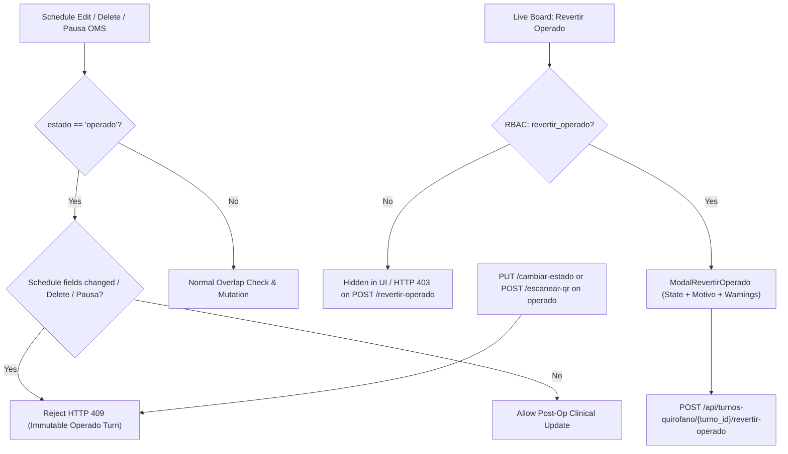

# Guarding `operado` Surgical Turns, Role-Gated Reversal & Data Sanitization

*   **Author:** malko
*   **Status:** Approved
*   **Date:** 2026-11-19

--------------------------------------------------------------------------------

## Overview

Surgical turns in `public.turnos_quirofano` previously marked `operado` can appear on future dates in the Live Operating Room Board (`Pizarra en Vivo`) already flagged as `operado` before the patient arrives. This happens when `fecha_cirugia` is edited on an already-concluded turn, carrying the prior `operado` status and `fin_cirugia_at` into the new date, while the Live Board UI hides all rollback actions once `estado === 'operado'`.

This design locks scheduling identity fields on `operado` turns across all mutation paths, introduces a role-configurable `revertir_operado` permission in Settings (`ajustes/roles`) enforced in both React and FastAPI, provides a single audited reversal flow from the Live Board, and runs an evidence-based triage pass on existing inconsistent `operado` rows whose local `fin_cirugia_at` precedes `fecha_cirugia`.

## The Problem

1. **Schedule edits on `operado` turns preserve `operado`:** `PUT /api/turnos-quirofano/{turno_id}` (`actualizar_turno_quirofano` in `backend/app/db.py`) and `sincronizar_turno_quirofano_desde_asesoria` update scheduling fields (`fecha_cirugia`, `hora_inicio`, `quirofano_id`, `duracion_minutos`) without checking `estado` or rejecting edits on `operado` turns. Additionally, `DELETE /api/turnos-quirofano/{turno_id}` and `POST /api/turnos-quirofano/{turno_id}/confirmar-pausa-oms` do not guard against mutating `operado` records.
2. **No UI path to revert an `operado` turn:** Although `cambiar_estado_turno_quirofano` in `backend/app/db.py` supports transitioning out of `operado`, `PizarraQuirofanoEnVivo.tsx` and `ConsolaCabeceraIntraoperatoria.tsx` hide all rollback and rescheduling actions once `estado === 'operado'`.
3. **No backend RBAC check:** `backend/app/auth.py` validates only the Supabase JWT without checking `rol_permisos`, so a frontend-only permission flag would leave API endpoints unprotected.

## Goals

*   Prevent any modification of `fecha_cirugia`, `hora_inicio`, `quirofano_id`, or `duracion_minutos`, as well as deletion or surgical re-entry, on `turnos_quirofano` records whose `estado === 'operado'`, enforced across UI (`FichaTurnoModal`, `TabProgramacionLio`) and all backend mutation paths, while keeping post-operative clinical fields (`observaciones_intraoperatorias`, intraocular lens [`LIO`] lot/serial traceability, and Geclisa electronic health record [`EHR`] document uploads) editable.
*   Add a role-configurable permission (`quirofano-en-vivo` → `revertir_operado`) manageable in `ajustes/roles` and enforced in both frontend (`usePermissions`) and backend (`auth.py` / `main.py`).
*   Provide a single canonical guided reversal flow (`POST /api/turnos-quirofano/{turno_id}/revertir-operado`) from the Live Board (`PizarraQuirofanoEnVivo` and `ConsolaCabeceraIntraoperatoria`) via a shared modal that requires a non-empty reason, clears `fin_cirugia_at` (and intermediate timestamps per target state), clears stale `parte_quirurgico_pdf_url` safely, optionally unlinks the Geclisa protocol, re-syncs `asesorias_quirurgicas` and `presupuestos` via `evaluar_y_sincronizar_estado_caso_quirurgico` (which reconciles unilateral and bilateral `AO` case state and linked budgets), surfaces Post-Qx (post-operative WhatsApp indications) and Geclisa warnings, and writes an audit trail.
*   Run a read-only evidence-scored diagnostic on existing `operado` turns where `(fin_cirugia_at AT TIME ZONE 'America/Argentina/Buenos_Aires')::date < fecha_cirugia` and apply cleanup only to human-approved `turno_id` records.

## Non-Goals

*   Rewriting RBAC enforcement for unrelated CRM modules outside the reusable backend permission helper.
*   Automatically deleting WhatsApp messages already delivered to patients when a turn is reverted.
*   Locking post-op clinical fields (`observaciones_intraoperatorias`, `lente_lote`, `lente_serie`, `lente_vencimiento`, Geclisa uploads) on `operado` turns.

## Open Questions

*   **Question 1 (Data Sanitization Triage):** After running the read-only diagnostic query for rows where `fin_cirugia_at` (ART) precedes `fecha_cirugia`, confirm the explicit list of `turno_id`s to revert to `programado` (Case B: no clinical artifacts) versus any rows with clinical artifacts (Case A) requiring manual date restoration.

## Critical User Journeys (CUJs)

### CUJ 1: Blocking Direct Schedule Edits on an `operado` Turn
*   **Given**: A surgical turn exists with `estado = 'operado'`.
*   **When**: A coordinator opens the turn in `FichaTurnoModal` or `ModalDetalleCirugiaEnVivo` (`TabProgramacionLio`) and attempts to change `fecha_cirugia`, `hora_inicio`, `quirofano_id`, or `duracion_minutos` (or sends a `PUT /api/turnos-quirofano/{turno_id}` payload modifying those fields).
*   **Then**: The UI disables the available scheduling inputs (`fecha_cirugia`, `hora_inicio`, `quirofano_id`, `duracion_minutos` in `FichaTurnoModal`; `quirofano_id` in `TabProgramacionLio`) with an explanatory lock notice while keeping clinical post-op fields editable, and the backend rejects any scheduling field diff on an `operado` turn with HTTP `409`.

### CUJ 2: Role-Authorized Reversal of an `operado` Turn from the Live Board
*   **Given**: A user whose role has `quirofano-en-vivo:revertir_operado` enabled (or `admin`/`superadmin`) views an `operado` turn in `PizarraQuirofanoEnVivo` or `ConsolaCabeceraIntraoperatoria`.
*   **When**: The user clicks "Revertir Operado", selects the target state (`programado` ["Por Llegar"], `en_espera`, `pre_quirofano`, or `en_operacion`), enters a mandatory reason, reviews any Geclisa/PDF/Post-Qx warnings, and confirms.
*   **Then**: The backend verifies the role permission, clears `fin_cirugia_at` (and intermediate timestamps per target state) and `parte_quirurgico_pdf_url`, optionally unlinks the Geclisa protocol if selected, re-syncs `asesorias_quirurgicas` and `presupuestos`, writes an audit entry, and updates the Live Board. An unauthorized user does not see the button and receives HTTP `403` if calling `POST /api/turnos-quirofano/{turno_id}/revertir-operado`.

### CUJ 3: Sanitizing Existing Inconsistent `operado` Turns
*   **Given**: Existing `turnos_quirofano` records have `estado = 'operado'` with local `fin_cirugia_at` strictly earlier than `fecha_cirugia`.
*   **When**: The read-only evidence-scored diagnostic query is reviewed and explicit human sign-off is given for the target `turno_id` list.
*   **Then**: Approved anomalous turns with no clinical execution artifacts are reverted to `programado` (with timestamps cleared and `asesorias_quirurgicas` synchronized), removing false `operado` flags from Live Board views.

## Technical Plan (Architecture)

### 1. Immutable Scheduling Identity Guard Across All Mutation Paths
*   **`actualizar_turno_quirofano` (`backend/app/db.py`):** Unconditionally fetch the persisted row before applying any update. If `estado == "operado"`, compare only scheduling identity fields that are **explicitly present and non-`None`** in the incoming payload (`fecha_cirugia`, `hora_inicio`, `quirofano_id`, `duracion_minutos`), normalizing formats/types (`str(fecha)`, `str(hora)[:5]`, `str(quirofano_id)`, `int(duracion)`). If any present scheduling field differs, raise `CrmConflictError` (mapped to HTTP `409` in `PUT /api/turnos-quirofano/{turno_id}` before `verificar_solapamiento_turno_quirofano` runs). Partial clinical-only payloads omitting scheduling fields succeed without false `409` errors.
*   **Other Mutation Guards:** Block mutating or deleting `operado` turns in `eliminar_turno_quirofano` (`DELETE /api/turnos-quirofano/{turno_id}`), `POST /api/turnos-quirofano/{turno_id}/confirmar-pausa-oms`, and `sincronizar_turno_quirofano_desde_asesoria` (in addition to `suspender_o_reprogramar_turno_quirofano`, which already blocks `operado`).
*   **Frontend Locks:** Disable `fecha_cirugia`, `hora_inicio`, `quirofano_id`, and `duracion_minutos` in `FichaTurnoModal.tsx`, and disable `quirofano_id` in `TabProgramacionLio.tsx` (`ModalDetalleCirugiaEnVivo.tsx`), when `turno?.estado === 'operado'` with an explanatory lock banner.

### 2. Role-Based Reversal Permission (`quirofano-en-vivo:revertir_operado`)
*   **Module & Role Sync:** Add `{ code: 'revertir_operado', label: 'Revertir Cirugía Operada', description: '...' }` to `quirofano-en-vivo` in `frontend/src/config/modules.ts`. `ajustes/roles/page.tsx` and `ensureModulesSynced()` automatically expose and persist this permission in `public.modulos` / `public.rol_permisos`.
*   **Backend RBAC Helper:** Add `verificar_permiso_usuario(user_payload, modulo_codigo, accion_codigo)` in `backend/app/auth.py` using a **lazy** `from app.db import supabase` import (preventing circular imports) and enforcing fail-closed (`False`) semantics when `sub` is absent, `usuarios_perfil` is missing/inactive, or `rol_permisos` lacks the granted action. Bypass only when `roles.codigo.lower() in ("admin", "superadmin")` (matching `PermissionsContext.tsx`). Enforce RBAC in `backend/app/main.py`.

### 3. Single Canonical Reversal Flow & Side-Effect Orchestration
*   **Single Reversal Entry Point:** `POST /api/turnos-quirofano/{turno_id}/revertir-operado` is the sole path allowed to transition a turn out of `operado`. `cambiar_estado_turno_quirofano` (`PUT/POST /api/turnos-quirofano/{turno_id}/cambiar-estado`, `PUT /api/turnos-quirofano/{turno_id}/estado`, `/revertir-recepcion`) and `procesar_escaneo_qr_turno` (`POST /api/turnos-quirofano/escanear-qr`) unconditionally reject transitions out of `operado` with HTTP `409` directing callers to `POST /api/turnos-quirofano/{turno_id}/revertir-operado`.
*   **Timestamp Clearing Matrix & Side Effects (`revertir_turno_operado`):**
    *   Validate non-empty `motivo.strip()` and `estado_destino` in `("programado", "en_espera", "pre_quirofano", "en_operacion")`.
    *   Clear timestamps according to `estado_destino`:
        *   `programado` ("Por Llegar"): clear `llegada_at`, `ingreso_pre_quirofano_at`, `inicio_cirugia_at`, `fin_cirugia_at`.
        *   `en_espera`: clear `ingreso_pre_quirofano_at`, `inicio_cirugia_at`, `fin_cirugia_at`.
        *   `pre_quirofano`: clear `inicio_cirugia_at`, `fin_cirugia_at`.
        *   `en_operacion`: clear `fin_cirugia_at`.
    *   Clear `parte_quirurgico_pdf_url = None` on `turnos_quirofano`, and clear `asesorias_quirurgicas.parte_quirurgico_pdf_url = None` only if no other sibling `operado` turn shares that `asesoria_id`.
    *   Call `evaluar_y_sincronizar_estado_caso_quirurgico` to re-sync `asesorias_quirurgicas` and `presupuestos`, write audit entries to `system_logs` and `asesoria_evoluciones`, and if `desvincular_geclisa=True`, invoke `desvincular_documento_geclisa_turno(turno_id, "parte_quirurgico")` safely (returning a non-fatal warning if external Geclisa unlinking fails after local state has been persisted).
*   **Shared Frontend Modal:** Create `frontend/src/components/quirofano/ModalRevertirOperado.tsx`, invoked from both `PizarraQuirofanoEnVivo.tsx` and `ConsolaCabeceraIntraoperatoria.tsx` when `can('quirofano-en-vivo', 'revertir_operado')`, and register its open state in `hayModalAbiertoEnPizarra` to suspend the QR scanner.

### 4. Evidence-Scored Data Sanitization
*   Run a read-only SQL diagnostic query for all `turnos_quirofano` where `estado = 'operado'` and `(fin_cirugia_at AT TIME ZONE 'America/Argentina/Buenos_Aires')::date < fecha_cirugia`.
*   Classify rows by clinical evidence (`parte_quirurgico_geclisa_archivo_id`, `lente_lote`, `observaciones_intraoperatorias`, `indicaciones_postqx_enviadas`, `inicio_cirugia_at`, `llegada_at`) and apply cleanup `UPDATE`s only to explicitly approved `turno_id`s.

## Non-Functional Requirements

*   **Security (Backend RBAC):** Permission enforcement is fail-closed server-side in `backend/app/main.py` using `verificar_permiso_usuario` against `usuarios_perfil` → `roles` → `rol_permisos`.
*   **Auditability:** Every `operado` reversal persists operator identity, previous state, target state, and non-empty `motivo` in `system_logs` and `asesoria_evoluciones`.

## Alternatives Considered

### Alternative A: Auto-reset `estado` to `programado` when `fecha_cirugia` changes on an `operado` turn
*   **Pros**: Requires minimal UI changes because existing date-edit forms continue to work without locking inputs.
*   **Cons**: Allows coordinators to silently erase a completed surgical record (`operado` and `fin_cirugia_at`) merely by editing a date in `Agenda & Slots`.
*   **Reason for Rejection**: Rejected by author: direct schedule editing on `operado` turns must be blocked rather than silently resetting `estado`.

### Alternative B: Lock the entire `operado` turn record read-only
*   **Pros**: Simple boolean guard in both UI and `actualizar_turno_quirofano`.
*   **Cons**: Blocks legitimate post-operative completion workflows (`observaciones_intraoperatorias`, LIO lot/serial traceability, Geclisa protocol upload).
*   **Reason for Rejection**: Partitioning immutable scheduling identity fields from mutable post-op clinical fields prevents schedule corruption without breaking clinical documentation.

### Alternative C: Enforce `revertir_operado` only in the frontend (`usePermissions`)
*   **Pros**: Avoids adding a role-permission lookup helper in `backend/app/auth.py`.
*   **Cons**: Leaves backend reversal endpoints open to direct API calls bypassing Settings role configuration.
*   **Reason for Rejection**: Role restrictions must be enforced server-side against `rol_permisos` as well as in the UI.

--------------------------------------------------------------------------------

## Detailed Implementation Plan

### Target Files to Create/Modify

#### 1. `frontend/src/config/modules.ts` (Modify)
*   **Type / Scope**: TypeScript RBAC Module Registry.
*   **Proposed Changes**: Add `{ code: 'revertir_operado', label: 'Revertir Cirugía Operada', description: 'Permite retroceder turnos ya marcados como operados en la Pizarra en Vivo.' }` under `quirofano-en-vivo`.

#### 2. `backend/app/auth.py` (Modify)
*   **Type / Scope**: Python Auth & RBAC Helper.
*   **Proposed Changes**: Add `verificar_permiso_usuario(user_payload: dict, modulo_codigo: str, accion_codigo: str) -> bool` with lazy `from app.db import supabase`, failing closed (`False`) when `sub` is absent or `usuarios_perfil` is missing/inactive, bypassing when `roles.codigo.lower() in ("admin", "superadmin")`, and otherwise checking `rol_permisos` for `(modulo_codigo, accion_codigo)`.

#### 3. `backend/app/db.py` (Modify)
*   **Type / Scope**: Python Database & Domain Logic.
*   **Proposed Changes**:
    *   In `actualizar_turno_quirofano`: Unconditionally fetch current `estado` and scheduling fields before updating; if `estado == "operado"` and any present non-`None` scheduling field (`fecha_cirugia`, `hora_inicio`, `quirofano_id`, `duracion_minutos`) differs after normalization, raise `CrmConflictError`.
    *   Guard `eliminar_turno_quirofano` and `sincronizar_turno_quirofano_desde_asesoria` against deleting or rescheduling `operado` turns.
    *   In `cambiar_estado_turno_quirofano` and `procesar_escaneo_qr_turno`: Reject any transition out of `operado` (`CrmConflictError` / `status_code=409` directing callers to `POST /revertir-operado`).
    *   Add `revertir_turno_operado(turno_id, estado_destino, motivo, usuario_id=None, usuario_nombre=None, desvincular_geclisa=False) -> Dict[str, Any]` implementing the timestamp-clearing matrix, safe `parte_quirurgico_pdf_url` cleanup (respecting bilateral sibling `operado` turns), `evaluar_y_sincronizar_estado_caso_quirurgico`, audit logging (`system_logs` + `asesoria_evoluciones`), and optional `desvincular_documento_geclisa_turno(turno_id, "parte_quirurgico")`.

#### 4. `backend/app/main.py` (Modify)
*   **Type / Scope**: FastAPI Endpoints.
*   **Proposed Changes**:
    *   Add `POST /api/turnos-quirofano/{turno_id}/revertir-operado` accepting `request: Request` and `{ estado_destino: str, motivo: str, desvincular_geclisa: bool = False }`, enforcing `verificar_permiso_usuario(..., "quirofano-en-vivo", "revertir_operado")` (HTTP `403`), validating non-empty `motivo.strip()`, and calling `revertir_turno_operado(...)`.
    *   In `PUT /api/turnos-quirofano/{turno_id}`: Catch `CrmConflictError` before `verify_solapamiento` / generic `Exception` and return HTTP `409`.
    *   In `POST /api/turnos-quirofano/{turno_id}/confirmar-pausa-oms`, `DELETE /api/turnos-quirofano/{turno_id}`, `PUT/POST /api/turnos-quirofano/{turno_id}/cambiar-estado`, and `POST /api/turnos-quirofano/escanear-qr`: Map `operado` immutability rejections to HTTP `409`.

#### 5. `frontend/src/components/quirofano/FichaTurnoModal.tsx` (Modify)
*   **Type / Scope**: React Schedule Modal.
*   **Proposed Changes**: When `turno?.estado === 'operado'`, disable `fecha_cirugia`, `hora_inicio`, `quirofano_id`, and `duracion_minutos` inputs with an explanatory lock banner while keeping clinical/LIO fields editable.

#### 6. `frontend/src/components/quirofano/modal/TabProgramacionLio.tsx` (Modify)
*   **Type / Scope**: React Intra-Op Detail Tab (`ModalDetalleCirugiaEnVivo`).
*   **Proposed Changes**: When `turno?.estado === 'operado'`, disable the `quirofano_id` selector with a lock banner while keeping `ojo`, `tipo_anestesia`, LIO traceability, surgical team, and notes editable.

#### 7. `frontend/src/components/quirofano/ModalRevertirOperado.tsx` (Create)
*   **Type / Scope**: Shared React Guided Reversal Modal.
*   **Proposed Changes**: Reusable modal displaying pre-flight warnings (`parte_quirurgico_pdf_url`, `parte_quirurgico_geclisa_archivo_id` + optional unlink checkbox, `indicaciones_postqx_enviadas`), target state selector (`programado`, `en_espera`, `pre_quirofano`, `en_operacion`), and mandatory `motivo` input calling `POST /api/turnos-quirofano/{turno_id}/revertir-operado`.

#### 8. `frontend/src/components/quirofano/PizarraQuirofanoEnVivo.tsx` & `ConsolaCabeceraIntraoperatoria.tsx` (Modify)
*   **Type / Scope**: Live Board & Surgery Header Console (`ModalDetalleCirugiaEnVivo.tsx`).
*   **Proposed Changes**: Use `usePermissions()` (`can('quirofano-en-vivo', 'revertir_operado')`) to render `"Revertir Operado"` on `operado` turns, open `<ModalRevertirOperado />`, and include its open state in `hayModalAbiertoEnPizarra`.

#### 9. `backend/tests/test_operado_lock_and_reversal.py` (Create)
*   **Type / Scope**: Pytest Unit & Endpoint Tests.
*   **Proposed Changes**: Cover `operado` schedule lock (`409`), partial clinical updates on `operado` turns (`200`), unprivileged reversal (`403`), authorized reversal (`200` with timestamp/PDF/asesoria cleanup), and rejection of `operado` exit via `/cambiar-estado` or `/escanear-qr` (`409`).

#### 10. Existing Data Sanitization (`public.turnos_quirofano` & `public.asesorias_quirurgicas`)
*   **Type / Scope**: Audited Diagnostic & Human-Approved Cleanup Pass.
*   **Proposed Changes**: Execute read-only diagnostic query for `estado = 'operado'` where `(fin_cirugia_at AT TIME ZONE 'America/Argentina/Buenos_Aires')::date < fecha_cirugia`, and apply cleanup only to explicitly approved `turno_id`s.

### Verification Plan

*   **Compilation/Build**: `cd frontend && npx tsc --noEmit` and `npm run build`.
*   **Unit Tests**: `pytest backend/tests/test_operado_lock_and_reversal.py backend/tests/test_reprogramacion_cancelacion_qx.py`.
*   **Integration / Manual Checks**: Verify `ajustes/roles` displays `"Revertir Cirugía Operada"` under `Quirófano en Vivo`, verify approved anomalous future turns return to `Por Llegar`, verify `FichaTurnoModal` and `TabProgramacionLio` lock schedule fields on an `operado` turn, and verify `403` vs `200` on reversal by role.

--------------------------------------------------------------------------------

*Drafted with EGM*
