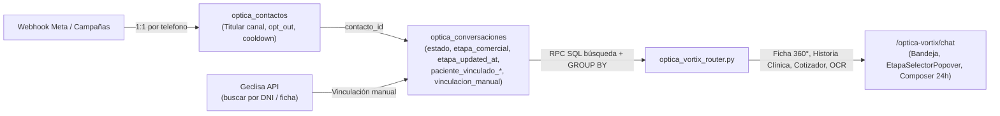

# Óptica Vortix Chat: Vinculación de Fichas Geclisa, Clasificación por Etapas y Regla de Autocierre

*   **Author:** malko
*   **Status:** Approved
*   **Date:** 2026-11-27

--------------------------------------------------------------------------------

## Overview

Este documento especifica el rediseño operativo del módulo de WhatsApp de Óptica Vortix (`/optica-vortix/chat`) para resolver tres problemas que hoy bloquean la gestión comercial del equipo de óptica:

1.  **Teléfonos compartidos entre familiares:** Permite vincular manualmente una conversación a otra ficha de paciente en Geclisa (por ejemplo, cuando el número pertenece a la ficha de un menor pero escribe un familiar con su propia receta), sin modificar el titular del canal ni bloquear campañas futuras.
2.  **Clasificación y filtrado por etapas comerciales:** Habilita el embudo completo de 8 etapas (incluyendo `SIN_INTERES`) con contadores exactos en las tres pestañas (`Activas`, `Cerradas`, `Archivadas`), búsqueda sobre toda la base sin truncamiento de 100 registros, y un selector visual directo para eliminar fricción operativa.
3.  **Retención comercial frente a la ventana Meta de 24 horas:** Protege las 5 etapas en gestión comercial del autocierre de 24 h con un límite de abandono de 30 días sin actividad, y separa visualmente en el compositor el estado del embudo del estado de la ventana de texto libre de WhatsApp.

### Glosario de Dominio

*   **Geclisa:** Sistema externo de gestión clínica y turnos médicos de la clínica; provee números de ficha (`ficha_geclisa_id`), cobertura y evoluciones oftalmológicas vía API.
*   **`public.pacientes`:** Tabla maestra de pacientes de la unidad médica general en Postgres/Supabase; almacena la referencia numérica `geclisa_ficha_id` (`INTEGER`).
*   **Ficha 360°:** Panel lateral derecho en `/optica-vortix/chat` que muestra graduación, cupón activo, oportunidades de Geclisa y acceso a la Historia Clínica Geclisa del paciente seleccionado.
*   **Cotizador:** Modal de presupuesto rápido dentro del chat (`Cotizador Rápido`) que arma opciones de cristales/armazones, las envía por WhatsApp y mueve la conversación a `PRESUPUESTO_AEREOS`.
*   **`modo_atencion_previo`:** Columna de `optica_conversaciones` que resguarda el modo activo (`autonomo`, `copiloto` o `humano`) antes de cerrar una conversación para poder restaurarlo al reabrirla.

--------------------------------------------------------------------------------

## The Problem

En producción (`optica_conversaciones`: ~1.385 filas; `optica_contactos`: ~1.453 filas), el módulo presenta fallas verificadas que reducen la adopción del embudo y generan errores de atención:

*   **Identidad rígida 1 teléfono = 1 paciente:** `optica_contactos` exige unicidad por `telefono`. Cuando el número `+5492610000001` (vinculado en Geclisa a `Paciente Titular A`, DNI `11111111`) es usado por `Familiar B` (quien figura aparte con otro número `+5492610000002`), el operador no puede asociar la conversación a la ficha clínica correcta. Además, el botón "Ver Historia Clínica Geclisa" lee `selectedConv.paciente_geclisa_id` mientras el backend retorna `ficha_geclisa_id` como `string`, enviando `null` al modal.
*   **Selector de clasificación incompleto:** El selector actual es un `<select>` nativo en un encabezado saturado, sin confirmación visual ni opción `SIN_INTERES` (15 chats en base de datos hoy se renderizan falsamente como `Nueva Consulta`).
*   **Filtros y contadores rotos por truncamiento:** La barra de etapas solo aparece en `Activas` aunque 27 de los 28 chats clasificados están en `Cerradas`; los contadores en backend omiten el filtro `estado` y golpean el tope de 1.000 filas de PostgREST; y `GET /conversaciones` corta a 100 filas antes de filtrar `search` en Python.
*   **Pérdida de presupuestos abiertos por autocierre de 24 h:** Al vencer las 24 h de inactividad, el cron cierra chats en `PRESUPUESTO_AEREOS` o `CONSULTA_ARMAZON` y los saca de `Activas`. Sin embargo, retenerlos 30 días en `Activas` hará que la mayoría tenga la ventana Meta de 24 h vencida; hoy el compositor deja escribir texto libre y falla contra Meta.
*   **Ruido de datos en bandeja:** Coexisten estados `'abierta'` (92 filas) y `'activa'` (3 filas); archivos PDF entrantes guardan nombres con doble codificación UTF-8 (`Indicaciones Médicas.pdf`); y algunas conversaciones iniciadas por campaña conservan `nombre_contacto = "Contacto XXXX"` aun cuando `optica_contactos` ya tiene el nombre real.

--------------------------------------------------------------------------------

## Goals

*   **Aumentar la adopción de clasificación por etapas:** Pasar de ~2% actual (28 de ~1.385 conversaciones fuera de `NUEVA_CONSULTA`) a al menos **60% de conversaciones con interacción humana clasificadas** en los 30 días posteriores al despliegue, instrumentando `etapa_updated_at` y `clasificacion_origen`.
*   **Habilitar filtrado exacto y búsqueda completa en las 3 pestañas:** Mostrar las 8 etapas (incluida `SIN_INTERES`) con contadores calculados por `GROUP BY` en SQL dentro de `Activas`, `Cerradas` y `Archivadas`, conservando `filtroEtapa` al cambiar de pestaña y ejecutando `search` en SQL sobre toda la tabla con debounce de 300 ms.
*   **Permitir vinculación manual a otra ficha de Geclisa sin afectar campañas:** Implementar un override clínico reversible a nivel de `optica_conversaciones` que alimente encabezado, Ficha 360°, Historia Clínica Geclisa, Cotizador, Copiloto IA y OCR, guardando la graduación vinculada exclusivamente en la conversación y manteniendo `optica_contactos` 1:1 por teléfono para campañas.
*   **Diferenciar autocierre por etapa (24 h vs. 30 días) con backfill inicial:** Cerrar a las 24 h toda etapa no protegida (`NUEVA_CONSULTA`, `SIN_INTERES`, `VENDIDO`, nulos o legacy); retener en `Activas` hasta 30 días sin movimiento (`GREATEST(ultimo_mensaje_at, etapa_updated_at)`) las 5 etapas en gestión (`CONSULTA_ARMAZON`, `PRESUPUESTO_AEREOS`, `LENTES_CONTACTO`, `EN_LABORATORIO`, `LISTO_PARA_RETIRAR`); ejecutar backfill único etiquetado para reabrir chats cerrados por 24 h en esas 5 etapas con menos de 30 días de inactividad; y bloquear el texto libre en el compositor cuando vence la ventana Meta 24 h ofreciendo envío de plantilla y Notas Internas habilitadas.
*   **Sanear inconsistencias operativas del módulo:** Corregir el mapeo numérico `ficha_geclisa_id` para `ModalHistoriaClinica`, unificar `estado` (`'abierta'` → `'activa'`) y etapas legacy (`'DESCARTADO'` → `'SIN_INTERES'`), validar `etapa_comercial` en `PATCH`, y corregir mojibake UTF-8 + `nombre_contacto` genéricos en un commit separado dentro del rollout.

--------------------------------------------------------------------------------

## Non-Goals

*   Implementar etiquetas libres múltiples personalizadas (`optica_contactos.etiquetas`) independientes de las etapas del embudo.
*   Fusionar historiales de WhatsApp pertenecientes a distintos números de teléfono.
*   Construir un modelo N:M de grupos familiares (`optica_telefono_pacientes`) en esta iteración.
*   Crear un tablero analítico ni un indicador numérico compacto de adopción en la UI de bandeja en v1 (solo se instrumentan `etapa_updated_at` y `clasificacion_origen` en base de datos).
*   Agregar nudges automáticos tras responder/cerrar ni modificar el componente compartido `ChatContactContextMenu.tsx` del chat médico general en v1 (enfoque YAGNI en `EtapaSelectorPopover`).
*   Bloquear o pausar campañas masivas sobre un teléfono por haber sido vinculado manualmente a otra ficha clínica.

--------------------------------------------------------------------------------

## Open Questions

Ninguna pregunta abierta pendiente. Las decisiones de alcance y arquitectura descartadas quedan documentadas en la sección `Alternatives Considered`.

--------------------------------------------------------------------------------

## Critical User Journeys (CUJs)

### CUJ 1: Vincular una conversación de teléfono compartido a otra ficha de Geclisa

*   **Given**: Una conversación en `/optica-vortix/chat` (ej. `+5492610000001`) figura a nombre del titular de canal `Paciente Titular A`, pero quien escribe y envía una receta es `Familiar B`.
*   **When**: El operador abre el modal `"Vincular paciente Geclisa"`, busca a `Familiar B` por DNI o N° de ficha en Geclisa en vivo (o por nombre en la caché local), selecciona la ficha correspondiente y confirma; luego extrae la graduación con OCR y abre `"Ver Historia Clínica Geclisa"`.
*   **Then**: El encabezado y la Ficha 360° muestran a `Familiar B` con un indicador visible del vínculo manual y del titular del teléfono (`Paciente Titular A`); `"Ver Historia Clínica Geclisa"` abre la ficha de `Familiar B` pasando su `ficha_geclisa_id` parseada como entero; la graduación OCR se guarda únicamente en la conversación sin modificar `optica_contactos`; las futuras campañas al `+5492610000001` siguen habilitadas; y el vínculo puede revertirse en 1 clic limpiando la graduación vinculada.

### CUJ 2: Clasificar conversaciones y filtrar por etapa en cualquier pestaña

*   **Given**: El operador trabaja en `/optica-vortix/chat` con conversaciones distribuidas entre `Activas`, `Cerradas` y `Archivadas`, incluyendo casos en `SIN_INTERES` y presupuestos antiguos fuera de los últimos 100 chats.
*   **When**: El operador cambia la etapa de un chat desde `EtapaSelectorPopover` en el encabezado o en la Ficha 360° a `PRESUPUESTO_AEREOS` o `SIN_INTERES`, filtra por esa etapa, alterna entre `Activas` y `Cerradas`, y busca por DNI o nombre un paciente con más de 3 semanas de antigüedad.
*   **Then**: El cambio persiste con toast de confirmación y actualización de `etapa_updated_at` y contadores exactos vía SQL; `SIN_INTERES` se muestra con su propia etiqueta y no como `Nueva Consulta`; la barra de etapas y el filtro seleccionado se conservan al cambiar de pestaña; y la búsqueda devuelve coincidencias de toda la base tras un debounce de 300 ms.

### CUJ 3: Seguimiento de un presupuesto activo con ventana Meta de 24 h vencida

*   **Given**: Una conversación en etapa `PRESUPUESTO_AEREOS` lleva 5 días sin respuesta del paciente (ventana Meta 24 h vencida, menos de 30 días de abandono).
*   **When**: Se ejecuta el cron de autocierre y luego el operador abre esa conversación en `Activas` para retomar el contacto o dejar una anotación interna.
*   **Then**: El cron mantiene la conversación en `Activas` (solo la cerrará si supera 30 días sin mensajes ni cambios de etapa, con motivo `'abandono_30d'`); al abrirla (o si vence mientras redacta y pulsa enviar), el compositor bloquea el envío de texto libre/adjuntos a WhatsApp indicando que la ventana de 24 h venció, ofrece un botón directo `"Enviar Plantilla de Seguimiento"` (abriendo `ModalSelectorPlantillasMeta`) y permite guardar Notas Internas cambiando a `modoNotaInterna`.

--------------------------------------------------------------------------------

## Technical Plan (Architecture)

La arquitectura separa tres responsabilidades que hoy están acopladas: **identidad del canal WhatsApp** (`optica_contactos`), **contexto clínico y comercial de la conversación** (`optica_conversaciones`) y **consultas/agregaciones en base de datos** (RPCs en Postgres como única fuente de verdad).

### 0. Invariante de Ciclo de Vida de `optica_conversaciones`

En Óptica Vortix, `optica_conversaciones` mantiene **una fila reutilizable por teléfono** (`get_or_create_conversacion`). Para prevenir fuga clínica entre sesiones del titular y un familiar vinculado:

*   **Al reabrir automáticamente una conversación cerrada** (por mensaje entrante en webhook o despacho de campaña en `procesar_cola_envios_optica`), se resetean obligatoriamente `vinculacion_manual = FALSE`, todas las columnas `paciente_vinculado_* = NULL`, `vinculado_at = NULL`, `vinculado_por = NULL` y se remueve `metadata_json.graduacion_vinculada_json`, registrando una nota interna de auditoría cuando existía un vínculo manual previo.
*   **Al desvincular (`DELETE /vincular-paciente`) o revincular a un `ficha_geclisa_id` distinto (`POST /vincular-paciente`)**, se elimina igualmente `metadata_json.graduacion_vinculada_json` para evitar herencia cruzada de graduaciones OCR entre pacientes.
*   **Reclasificación desde `Cerradas`:** Cambiar `etapa_comercial` mediante `PATCH` sobre una conversación en `'cerrada'` conserva `estado = 'cerrada'` (solo los mensajes entrantes o un envío/reapertura explícita la devuelven a `'activa'`).

### 1. Modelo de Datos y Migración SQL (`supabase/migrations/`)

Se crea una migración aditiva e idempotente (`supabase/migrations/20261127_optica_identidad_etapas_autocierre.sql`) con cuatro bloques:

1.  **Columnas de override clínico y trazabilidad de etapas en `public.optica_conversaciones`:**
    *   `paciente_vinculado_ficha_id VARCHAR(64)`
    *   `paciente_vinculado_nombre TEXT`
    *   `paciente_vinculado_dni VARCHAR(32)`
    *   `paciente_vinculado_obra_social TEXT`
    *   `vinculacion_manual BOOLEAN NOT NULL DEFAULT FALSE`
    *   `vinculado_at TIMESTAMPTZ`
    *   `vinculado_por TEXT`
    *   `etapa_updated_at TIMESTAMPTZ DEFAULT NOW()`
    *   `clasificacion_origen VARCHAR(32) DEFAULT 'inicial'` (`inicial` | `manual` | `auto_cotizador` | `auto_ocr` | `auto_retiro`)
    *   Índices compuestos: `(archivada, estado, etapa_comercial, ultimo_mensaje_at DESC)` y `(archivada, estado, ultimo_mensaje_at DESC)` para acelerar listado, ordenamiento y conteo por pestaña y etapa.
2.  **Saneamiento de estados y backfill único determinista:**
    *   Unificar `estado = 'abierta'` → `'activa'` en `optica_conversaciones`.
    *   Normalizar etapas legacy: `etapa_comercial = 'DESCARTADO'` → `'SIN_INTERES'`, y `etapa_comercial IS NULL` → `'NUEVA_CONSULTA'`.
    *   Sincronizar `nombre_contacto` cuando empieza con `'Contacto '` y el `optica_contactos.nombre` asociado no es genérico.
    *   Inicializar `etapa_updated_at = COALESCE(ultimo_mensaje_at, created_at)` para registros existentes (evitando tomar cierres técnicos recientes de `updated_at` como actividad comercial).
    *   **Backfill único de etapas protegidas:** Reabrir (`estado = 'activa'`, `cerrado_at = NULL`, `cerrado_motivo = NULL`, `metadata_json = COALESCE(metadata_json, '{}'::jsonb) || '{"reabierta_backfill_20261127": true}'::jsonb`) las conversaciones con `estado = 'cerrada'`, `archivada = FALSE`, `cerrado_motivo = 'inactividad_24h'`, `etapa_comercial IN ('CONSULTA_ARMAZON', 'PRESUPUESTO_AEREOS', 'LENTES_CONTACTO', 'EN_LABORATORIO', 'LISTO_PARA_RETIRAR')` y `COALESCE(ultimo_mensaje_at, created_at) >= NOW() - INTERVAL '30 days'`.
3.  **RPC actualizado `cerrar_conversaciones_inactivas_24h_optica()` (fuente única de verdad):**
    *   **Rama 30 días (`'abandono_30d'`):** Aplica a `etapa_comercial IN ('CONSULTA_ARMAZON', 'PRESUPUESTO_AEREOS', 'LENTES_CONTACTO', 'EN_LABORATORIO', 'LISTO_PARA_RETIRAR')` cuando `GREATEST(COALESCE(ultimo_mensaje_at, created_at), COALESCE(etapa_updated_at, created_at)) < NOW() - INTERVAL '30 days'`.
    *   **Rama 24 h (`'inactividad_24h'`):** Aplica al complemento exhaustivo (`etapa_comercial IS NULL OR etapa_comercial NOT IN ('CONSULTA_ARMAZON', 'PRESUPUESTO_AEREOS', 'LENTES_CONTACTO', 'EN_LABORATORIO', 'LISTO_PARA_RETIRAR')`, cubriendo `'NUEVA_CONSULTA'`, `'SIN_INTERES'`, `'VENDIDO'` y cualquier legacy) cuando `ventana_24h_expira_at < NOW()` o `COALESCE(ultimo_mensaje_at, created_at) < NOW() - INTERVAL '24 hours'`.
    *   En ambas ramas preserva `modo_atencion_previo` y devuelve el total cerrado. Se conserva el nombre histórico del RPC para compatibilidad con invocaciones existentes.
4.  **RPCs de consulta y conteo exacto:**
    *   `obtener_contadores_bandeja_optica(p_estado TEXT DEFAULT NULL, p_archivada BOOLEAN DEFAULT FALSE)`: si `p_archivada = TRUE`, filtra por `archivada = TRUE` **ignorando `p_estado`**; si `p_archivada = FALSE`, filtra por `archivada = FALSE AND (p_estado IS NULL OR p_estado = 'TODAS' OR estado = p_estado)`. Ejecuta `GROUP BY etapa_comercial` y retorna JSONB con `etapas_counts`, `tab_counts` (`activas`, `cerradas`, `archivadas`) y `total_no_leidos` sin pasar por el límite de 1.000 filas de PostgREST.
    *   `buscar_conversaciones_optica(p_estado TEXT DEFAULT 'activa', p_archivada BOOLEAN DEFAULT FALSE, p_etapa TEXT DEFAULT 'TODAS', p_origen TEXT DEFAULT NULL, p_search TEXT DEFAULT NULL, p_limit INT DEFAULT 100, p_offset INT DEFAULT 0)`: cuando `p_archivada = TRUE` ignora `p_estado`; cuando `p_etapa` es `'TODAS'` o `NULL` no filtra por etapa; si `p_search` no es nulo ni vacío realiza `JOIN` con `optica_contactos` aplicando `ILIKE` sobre `optica_contactos.nombre`, `telefono`, `dni`, `obra_social`, `codigo_cupon_activo`, `optica_conversaciones.nombre_contacto`, `paciente_vinculado_nombre` y `paciente_vinculado_dni` **antes** de ordenar (`fijada` primero, luego `ultimo_mensaje_at DESC`) y paginar (`LIMIT/OFFSET`). Retorna las columnas de `optica_conversaciones`, `optica_contactos` anidado como JSONB y `total_count` (`COUNT(*) OVER()`).

### 2. Cambios en Backend (`backend/app/routers/optica_vortix_router.py` y `backend/app/services/optica_vortix_service.py`)

*   **Resolución de identidad y graduación efectiva (`_enriquecer_conversacion_optica_frontend`):**
    *   Cuando `vinculacion_manual = True`, los campos efectivos `nombre_paciente`, `dni`, `ficha_geclisa_id` y `obra_social` se resuelven desde `paciente_vinculado_*`, exponiendo además `titular_telefono_nombre`, `titular_telefono_dni`, `vinculacion_manual`, `vinculado_at`, `vinculado_por`, `etapa_updated_at` y `clasificacion_origen`. Se retira el uso de `paciente_geclisa_id` alineando todo el monorepo a `ficha_geclisa_id`.
    *   Cuando `vinculacion_manual = True`, `graduacion_actual_json` se lee y guarda exclusivamente en `optica_conversaciones.metadata_json.graduacion_vinculada_json` (nunca lee ni pisa `optica_contactos.graduacion_actual_json`).
*   **Nuevos endpoints de vinculación Geclisa:**
    *   `GET /api/optica-vortix/geclisa/buscar-paciente?q=...` (`min_length=2`): retorna `{ "success": True, "candidatos": GeclisaPacienteCandidato[] }`. Si `q` es numérico (DNI o N° de ficha), consulta Geclisa en vivo (`geclisa_client.buscar_candidatos_por_dni` / `buscar_paciente_por_ficha`) con degradación controlada (si Geclisa API falla o hace timeout, retorna resultados locales más `warning` no bloqueante). Si `q` es texto o en complemento local, busca por nombre/DNI en `optica_contactos` (`ficha_geclisa_id`) y `public.pacientes` (`geclisa_ficha_id` normalizado a `str`), deduplicando por `ficha_geclisa_id` con prioridad `geclisa` > `optica_contactos` > `pacientes`.
    *   `POST /api/optica-vortix/conversaciones/{conv_id}/vincular-paciente`: valida existencia de conversación (HTTP 404) y `es_ficha_geclisa_valida(ficha_geclisa_id)` (HTTP 400 si es inválida); deriva `vinculado_por` server-side desde el usuario autenticado del request (con fallback opcional); si cambia respecto de un `paciente_vinculado_ficha_id` previo, elimina `metadata_json.graduacion_vinculada_json`; actualiza `paciente_vinculado_*`, `vinculacion_manual = True`, `vinculado_at`; y registra nota interna de auditoría mediante `_record_optica_outbound_msg(..., tipo="nota_interna")`.
    *   `DELETE /api/optica-vortix/conversaciones/{conv_id}/vincular-paciente`: valida HTTP 404, limpia `paciente_vinculado_*`, establece `vinculacion_manual = False`, elimina `metadata_json.graduacion_vinculada_json` y registra nota interna de auditoría con `_record_optica_outbound_msg(..., tipo="nota_interna")` usando identidad server-side del operador.
*   **Cobertura completa de override clínico y trazabilidad de etapas:**
    *   `GET /conversaciones` delega búsqueda/filtrado/paginación (`offset`, `limit`) a `buscar_conversaciones_optica` y contadores a `obtener_contadores_bandeja_optica` (retornando `has_more` y `total_count`).
    *   `PATCH /conversaciones/{conv_id}` (`PatchConversacionOpticaPayload`) valida `etapa_comercial` contra `ETAPAS_COMERCIALES_OPTICA` (HTTP 400 si es inválida), actualiza `etapa_updated_at = now_iso` y `clasificacion_origen` (default `'manual'`), y si `vinculacion_manual = True` guarda `graduacion_actual_json` únicamente en `optica_conversaciones.metadata_json.graduacion_vinculada_json`.
    *   **OCR sin sobrescritura (`optica_vortix_service.py` y `optica_vortix_router.py`):** Agregar parámetro `persistir_en_contacto: bool = True` a `extraer_graduacion_desde_imagen_receta()`; en `POST /ia/ocr-receta`, si `vinculacion_manual = True`, invocarla con `persistir_en_contacto=False`, guardar la graduación únicamente en `optica_conversaciones.metadata_json.graduacion_vinculada_json` y actualizar `etapa_updated_at = now_iso`, `clasificacion_origen = 'auto_ocr'`.
    *   **Consumidores clínicos del override:** Actualizar `GET /conversaciones/{conv_id}/ficha-optica` (resolución de `grad_norm`, `ficha_id` y `dni` desde `conv` enriquecida), `enviar_mensaje_conversacion_optica` (resolución de `nombre_pac` y actualización de `etapa_updated_at`/`clasificacion_origen` en `auto_retiro` y `auto_cotizador`), `generar_sugerencia_copiloto_optica` (contexto de nombre, obra social y graduación desde override clínico) y Smart Flows en `handle_optica_line_inbound_message` (actualizar `etapa_updated_at`).
*   **Eliminación de fallback duplicado y saneamiento de datos:**
    *   En `ejecutar_cierre_conversaciones_inactivas_24h()` (`backend/app/services/optica_vortix_service.py`), eliminar el fallback Python duplicado; ante falla del RPC `cerrar_conversaciones_inactivas_24h_optica`, registrar error en logs y retornar `0`.
    *   Unificar estado inicial a `'activa'` en `iniciar_conversacion_optica`, `contactar_oportunidad_individual` (`optica_vortix_router.py`) y `procesar_cola_envios_optica` (`optica_vortix_service.py`).
    *   En `reabrir_conversacion_optica` / webhook entrante / `procesar_cola_envios_optica`, limpiar el override clínico (`vinculacion_manual = False`, `paciente_vinculado_* = NULL`, `graduacion_vinculada_json`) si la conversación estaba cerrada.
    *   *(Commit separado de saneamiento dentro del rollout):* Agregar `_reparar_mojibake_utf8(texto: str) -> str` para `file_name` de documentos entrantes y evitar sobrescrituras/creaciones con `"Contacto XXXX"` cuando `optica_contactos.nombre` tiene nombre real.

### 3. Cambios en Frontend (`frontend/src/types/optica.ts`, componentes nuevos y `frontend/src/app/optica-vortix/chat/page.tsx`)

*   **Tipado unificado (`frontend/src/types/optica.ts`):** Reemplazar `'DESCARTADO'` por `'SIN_INTERES'` en `EtapaComercialOptica` y agregar `ficha_geclisa_id?: string | null`, `vinculacion_manual?: boolean`, `titular_telefono_nombre?: string | null`, `titular_telefono_dni?: string | null`, `vinculado_at?: string | null`, `vinculado_por?: string | null`, `etapa_updated_at?: string | null`, `clasificacion_origen?: string | null`, e interfaz `GeclisaPacienteCandidato`.
*   **Barra de etapas en las 3 pestañas + búsqueda con debounce:**
    *   Agregar `SIN_INTERES` a `ETAPAS_EMBUDO` y renderizar la barra en `Activas`, `Cerradas` y `Archivadas` mostrando los badges exactos de `etapasCounts` y un botón `×` para limpiar `filtroEtapa` (conservando `filtroEtapa` al cambiar `mainTab`).
    *   Aplicar debounce de 300 ms a `searchQuery` y botón `"Cargar más"` (`offset += limit`) cuando `hasMore === true`.
*   **Ergonomía de clasificación (`EtapaSelectorPopover`):**
    *   Reemplazar el `<select>` nativo por `EtapaSelectorPopover` (agrupando *Ingreso*: `NUEVA_CONSULTA`; *En Gestión 30d*: `CONSULTA_ARMAZON`, `PRESUPUESTO_AEREOS`, `LENTES_CONTACTO`, `EN_LABORATORIO`, `LISTO_PARA_RETIRAR`; *Cierre*: `VENDIDO`, `SIN_INTERES`), usable desde encabezado y Ficha 360°.
    *   Ampliar `toastNotificacion.tipo` en `page.tsx` para soportar `'error'` además de `'success' | 'info'`, refrescar `etapasCounts` tras cada `PATCH`, y ajustar `handleEnviarCotizacion` para actualizar la etapa localmente sin disparar un `PATCH` manual que sobrescriba `'auto_cotizador'`.
*   **Vinculación de paciente Geclisa y fix de Historia Clínica:**
    *   En `ModalHistoriaClinica` (`page.tsx:2650-2657`), parsear de forma segura `const rawFicha = selectedConv.ficha_geclisa_id || selectedConv.paciente_geclisa_id`, calcular `const parsedFicha = rawFicha ? parseInt(String(rawFicha), 10) : null`, pasar `geclisa_ficha_id: parsedFicha && !Number.isNaN(parsedFicha) ? parsedFicha : null` y `id: rawFicha || selectedConv.id`.
    *   Integrar `ModalVincularPacienteGeclisa` (con leyenda guía explícita: numérico busca Geclisa en vivo, texto busca caché local) desde encabezado y Ficha 360°, mostrar badge `Vinculado manualmente • Tel. titular: <nombre>` y botón `"Desvincular"`.
*   **Compositor consciente de ventana Meta 24 h:**
    *   Usar el estado existente `modoNotaInterna` y reemplazar el banner actual (`page.tsx:2360-2377`). Cuando `selectedConv.estado === 'activa'` (o `'cerrada'`) y `!selectedConv.ventana_24h_activa && !modoNotaInterna` (también verificado en submit con `ventana_24h_expira_at <= Date.now()` y fallback ante error backend de ventana vencida), bloquear `<textarea>`, `handleSendMessage`, botón Enviar, Clip, Micrófono, Drag & Drop y Paste, mostrando el botón `"Enviar Plantilla de Seguimiento"` (abre `ModalSelectorPlantillasMeta`) y el botón `"Escribir Nota Interna"` (`setModoNotaInterna(true)`).

--------------------------------------------------------------------------------

## Alternatives Considered

### Alternative A: Sobrescribir directamente `optica_contactos` al vincular otro paciente Geclisa

*   **Pros**: Cambio mínimo en los queries actuales; no requiere columnas adicionales en `optica_conversaciones`.
*   **Cons**: En la siguiente sincronización de turnos de Geclisa (`upsert_optica_contacto`), el sistema busca por `telefono` y pisa `ficha_geclisa_id` y `dni` de vuelta al titular original dejando el `nombre` nuevo (contacto corrupto); además duplica `ficha_geclisa_id` cuando el paciente vinculado ya existe con otro teléfono y altera las campañas masivas del titular.
*   **Reason for Rejection**: Descartada por análisis técnico (corrupción de datos en sincronización posterior y ruptura de unicidad clínica).

### Alternative B: Tabla N:M `optica_telefono_pacientes` con selector de perfil familiar

*   **Pros**: Modela grupos familiares recurrentes con historial de perfiles asociados al teléfono.
*   **Cons**: Agrega tablas intermedias, migraciones de relación y complejidad de interfaz innecesaria para la frecuencia actual del caso de uso.
*   **Reason for Rejection**: Descartada para esta iteración por sobre-ingeniería; el modelo elegido de override por conversación permite migrar a una tabla N:M en el futuro sin pérdida de datos.

### Alternative C: Mantener el autocierre de 24 h sin cambios y solo habilitar filtros por etapa en `Cerradas`

*   **Pros**: No requiere modificar el RPC de autocierre ni gestionar el bloqueo de ventana Meta 24 h en el compositor de chats activos.
*   **Cons**: Saca presupuestos y pedidos en laboratorio de la bandeja principal `Activas` a las 24 h, obligando al equipo a revisar dos pestañas distintas para seguir ventas en curso.
*   **Reason for Rejection**: Descartada por el autor: las conversaciones en etapas comerciales en curso deben permanecer visibles en `Activas` hasta cierre manual o abandono de 30 días.

### Alternative D: Bloquear futuras campañas masivas en teléfonos con vinculación manual

*   **Pros**: Evita que una futura campaña dirigida al titular del teléfono llegue al familiar que usó ese celular.
*   **Cons**: Excluye de campañas comerciales a teléfonos válidos de clientes activos por una excepción puntual de consulta.
*   **Reason for Rejection**: Descartada por el autor: no se debe bloquear el teléfono para futuras campañas masivas.

### Alternative E: Agregar etiquetas libres múltiples (`optica_contactos.etiquetas`) independientes del embudo

*   **Pros**: Permite etiquetar conversaciones con atributos ortogonales.
*   **Cons**: Agrega complejidad de mantenimiento cuando el cuello de botella real es que las etapas del embudo existentes no se pueden clasificar ni filtrar correctamente.
*   **Reason for Rejection**: Descartada por el autor: alcanza con corregir y habilitar el filtro por etapas comerciales existentes.

--------------------------------------------------------------------------------

## Non-Functional Requirements

*   **Performance & Latency**: Los índices compuestos sobre `(archivada, estado, etapa_comercial, ultimo_mensaje_at DESC)` aceleran listado, ordenamiento y conteo por `GROUP BY` en `obtener_contadores_bandeja_optica` y `buscar_conversaciones_optica` (meta p95 < 250 ms), eliminando el truncamiento silencioso de 1.000 filas de PostgREST. Para el volumen actual (~1.400 a 10.000 filas), `ILIKE` en SQL ofrece latencia suficiente; el debounce de 300 ms en `searchQuery` evita ráfagas de peticiones por tecla.
*   **Data Integrity & Security**: Las acciones de vinculación y desvinculación de paciente Geclisa solo modifican `optica_conversaciones` (nunca `optica_contactos` de terceros ni `public.pacientes`), limpian `graduacion_vinculada_json` y el override al desvincular/revincular/reabrir, derivan `vinculado_por` server-side desde la sesión autenticada, registran nota interna de auditoría en `optica_mensajes` y protegen los endpoints bajo la autenticación estándar del router de Óptica Vortix.
*   **Rollout & Rollback**: La migración `20261127_optica_identidad_etapas_autocierre.sql` es aditiva e idempotente (`ADD COLUMN IF NOT EXISTS`, `CREATE OR REPLACE FUNCTION`). Las filas reabiertas por el backfill único llevan la marca determinista `"reabierta_backfill_20261127": true` en `metadata_json`, permitiendo revertir exactamente ese lote con un `UPDATE` único de ser necesario. El saneamiento de mojibake UTF-8 y nombres `"Contacto XXXX"` se despliega en un commit separado dentro del rollout para aislar su rollback.

--------------------------------------------------------------------------------

## Future Improvements

*   **Índices trigramas (`pg_trgm` GIN):** Agregar índices GIN sobre columnas de búsqueda de texto en `optica_contactos` y `optica_conversaciones` si el padrón supera las 20.000 conversaciones.
*   **Tabla N:M de perfiles familiares (`optica_telefono_pacientes`):** Promover el override de conversación a un selector de perfiles por teléfono si crece la recurrencia de 3 o más familiares por número.
*   **Panel de conversión del embudo e indicador en bandeja:** Explotar `etapa_updated_at` y `clasificacion_origen` en métricas de adopción y conversión por etapa.

--------------------------------------------------------------------------------

## Detailed Implementation Plan

### Target Files to Create/Modify

#### 1. `supabase/migrations/20261127_optica_identidad_etapas_autocierre.sql` (Create)

*   **Type / Scope**: Migración SQL aditiva e idempotente en Postgres / Supabase.
*   **Proposed Changes**:
    *   Agregar a `public.optica_conversaciones`: `paciente_vinculado_ficha_id VARCHAR(64)`, `paciente_vinculado_nombre TEXT`, `paciente_vinculado_dni VARCHAR(32)`, `paciente_vinculado_obra_social TEXT`, `vinculacion_manual BOOLEAN NOT NULL DEFAULT FALSE`, `vinculado_at TIMESTAMPTZ`, `vinculado_por TEXT`, `etapa_updated_at TIMESTAMPTZ DEFAULT NOW()`, `clasificacion_origen VARCHAR(32) DEFAULT 'inicial'`.
    *   Crear índices compuestos `idx_optica_conv_bandeja_etapa` sobre `(archivada, estado, etapa_comercial, ultimo_mensaje_at DESC)` e `idx_optica_conv_bandeja` sobre `(archivada, estado, ultimo_mensaje_at DESC)`.
    *   Ejecutar saneamiento único: unificar `'abierta'` → `'activa'`, `'DESCARTADO'` → `'SIN_INTERES'`, `etapa_comercial IS NULL` → `'NUEVA_CONSULTA'`; sincronizar `nombre_contacto` genéricos (`LIKE 'Contacto %'`) con `optica_contactos.nombre` real; inicializar `etapa_updated_at = COALESCE(ultimo_mensaje_at, created_at)`.
    *   Ejecutar backfill único etiquetado: reabrir a `estado = 'activa'` (`cerrado_at = NULL`, `cerrado_motivo = NULL`, `metadata_json = COALESCE(metadata_json, '{}'::jsonb) || '{"reabierta_backfill_20261127": true}'::jsonb`) conversaciones con `estado = 'cerrada'`, `archivada = FALSE`, `cerrado_motivo = 'inactividad_24h'`, `etapa_comercial IN ('CONSULTA_ARMAZON', 'PRESUPUESTO_AEREOS', 'LENTES_CONTACTO', 'EN_LABORATORIO', 'LISTO_PARA_RETIRAR')` y `COALESCE(ultimo_mensaje_at, created_at) >= NOW() - INTERVAL '30 days'`.
    *   Reemplazar `cerrar_conversaciones_inactivas_24h_optica()` aplicando 30 días (`'abandono_30d'`, `GREATEST(COALESCE(ultimo_mensaje_at, created_at), COALESCE(etapa_updated_at, created_at))`) a las 5 etapas protegidas y 24 h (`'inactividad_24h'`) al complemento (`etapa_comercial IS NULL OR etapa_comercial NOT IN (...)`).
    *   Crear RPC `obtener_contadores_bandeja_optica(p_estado TEXT DEFAULT NULL, p_archivada BOOLEAN DEFAULT FALSE)` ignorando `p_estado` cuando `p_archivada = TRUE`, calculando `etapas_counts` vía `GROUP BY etapa_comercial`, `tab_counts` (`activas`, `cerradas`, `archivadas`) y `total_no_leidos`.
    *   Crear RPC `buscar_conversaciones_optica(p_estado TEXT DEFAULT 'activa', p_archivada BOOLEAN DEFAULT FALSE, p_etapa TEXT DEFAULT 'TODAS', p_origen TEXT DEFAULT NULL, p_search TEXT DEFAULT NULL, p_limit INT DEFAULT 100, p_offset INT DEFAULT 0)` con filtro `ILIKE` previo al orden/paginación, ordenamiento por fijada y `ultimo_mensaje_at DESC`, retornando columnas de `optica_conversaciones`, `optica_contactos` JSONB y `total_count`.

#### 2. `backend/app/routers/optica_vortix_router.py` (Modify)

*   **Type / Scope**: Router FastAPI de Óptica Vortix (`ETAPAS_COMERCIALES_OPTICA` ya contiene las 8 etapas en líneas 63–72).
*   **Proposed Changes**:
    *   Actualizar `_enriquecer_conversacion_optica_frontend` para resolver identidad efectiva (`nombre_paciente`, `dni`, `ficha_geclisa_id`, `obra_social`) y `graduacion_actual_json` desde `metadata_json.graduacion_vinculada_json` cuando `vinculacion_manual = True`, exponiendo `titular_telefono_nombre`, `titular_telefono_dni`, `vinculacion_manual`, `vinculado_at`, `vinculado_por`, `etapa_updated_at`, `clasificacion_origen`.
    *   Refactorizar `GET /conversaciones` para aceptar `offset: int = 0` y delegar en `buscar_conversaciones_optica` y `obtener_contadores_bandeja_optica` (retornando `has_more` y `total_count`).
    *   Actualizar `PATCH /conversaciones/{conv_id}` (`PatchConversacionOpticaPayload`): validar `etapa_comercial` contra `ETAPAS_COMERCIALES_OPTICA` (HTTP 400), aceptar `clasificacion_origen: Optional[str] = "manual"`, actualizar `etapa_updated_at = now_iso`, y aislar `graduacion_actual_json` en `metadata_json.graduacion_vinculada_json` si `vinculacion_manual = True`.
    *   Actualizar `GET /conversaciones/{conv_id}/ficha-optica` (leer `grad_norm`, `ficha_id` y `dni` efectivos desde `conv`), `POST /ia/ocr-receta` (pasar `persistir_en_contacto=False` si `vinculacion_manual = True`, guardar en `graduacion_vinculada_json`, setear `etapa_updated_at` y `clasificacion_origen = 'auto_ocr'`), y `enviar_mensaje_conversacion_optica` (usar `nombre_pac` efectivo y actualizar `etapa_updated_at` / `clasificacion_origen` para `auto_retiro` y `auto_cotizador`).
    *   Agregar endpoints nuevos:
        *   `GET /geclisa/buscar-paciente?q=...` (`min_length=2`): retorna `{ success, candidatos }`, consultando Geclisa en vivo si `q` es numérico (con degradación controlada) + búsqueda local en `optica_contactos.ficha_geclisa_id` y `public.pacientes.geclisa_ficha_id` (normalizado a `str`), deduplicando con prioridad `geclisa` > `optica_contactos` > `pacientes`.
        *   `POST /conversaciones/{conv_id}/vincular-paciente`: valida HTTP 404 y `es_ficha_geclisa_valida()` (HTTP 400), deriva `vinculado_por` server-side desde sesión, limpia `graduacion_vinculada_json` si cambia la ficha vinculada y registra nota interna con `_record_optica_outbound_msg(..., tipo="nota_interna")`.
        *   `DELETE /conversaciones/{conv_id}/vincular-paciente`: limpia `paciente_vinculado_*`, pone `vinculacion_manual = False`, elimina `graduacion_vinculada_json` y registra nota interna con `_record_optica_outbound_msg(..., tipo="nota_interna")` usando operador autenticado server-side.
    *   Unificar escritura inicial `'abierta'` → `'activa'` en `iniciar_conversacion_optica` y `contactar_oportunidad_individual`.

#### 3. `backend/app/services/optica_vortix_service.py` (Modify)

*   **Type / Scope**: Servicio de negocio, cron de automatismos y webhook entrante de Óptica Vortix.
*   **Proposed Changes**:
    *   Eliminar el fallback Python duplicado en `ejecutar_cierre_conversaciones_inactivas_24h()` dejando `cerrar_conversaciones_inactivas_24h_optica` en Postgres como única fuente de verdad (loguear error y retornar `0` ante fallo).
    *   Actualizar `extraer_graduacion_desde_imagen_receta()` (líneas 2621–2633) para aceptar `persistir_en_contacto: bool = True` y omitir el `update` sobre `optica_contactos` cuando sea `False`.
    *   Actualizar `generar_sugerencia_copiloto_optica()` (líneas 2670–2678) para priorizar nombre, obra social y graduación desde override clínico cuando `vinculacion_manual = True`.
    *   Actualizar Smart Flows en `handle_optica_line_inbound_message` para setear `etapa_updated_at` cuando cambian `etapa_comercial`, y resetear cualquier vínculo manual previo (`vinculacion_manual = False`, `paciente_vinculado_* = NULL`, limpiar `graduacion_vinculada_json`) al reabrir una conversación cerrada por webhook entrante o campaña en `procesar_cola_envios_optica`.
    *   Unificar `'abierta'` → `'activa'` en `procesar_cola_envios_optica`.
    *   *(En commit separado de saneamiento):* Agregar `_reparar_mojibake_utf8(texto: str) -> str` para `file_name` de documentos entrantes y evitar `nombre_contacto = "Contacto XXXX"` cuando `optica_contactos.nombre` tiene nombre real.

#### 4. `backend/tests/test_optica_identidad_etapas_autocierre.py` (Create)

*   **Type / Scope**: Suite de tests unitarios con `pytest` para la lógica backend del módulo.
*   **Proposed Changes**:
    *   Probar `_enriquecer_conversacion_optica_frontend` con y sin `vinculacion_manual` y aislamiento de `graduacion_vinculada_json`.
    *   Probar `POST`/`DELETE /vincular-paciente` verificando validación `es_ficha_geclisa_valida()`, limpieza de `graduacion_vinculada_json` al desvincular/revincular y reseteo al reabrir conversación cerrada.
    *   Probar `extraer_graduacion_desde_imagen_receta(..., persistir_en_contacto=False)` verificando que no escribe en `optica_contactos`.
    *   Probar `GET /geclisa/buscar-paciente` verificando uso de `public.pacientes.geclisa_ficha_id` y deduplicación por `ficha_geclisa_id`.
    *   Probar validación de `etapa_comercial` en `PATCH /conversaciones/{conv_id}` y `_reparar_mojibake_utf8` (idempotente).

#### 5. `frontend/src/types/optica.ts` (Modify)

*   **Type / Scope**: Definiciones TypeScript compartidas de Óptica Vortix.
*   **Proposed Changes**:
    *   Reemplazar `'DESCARTADO'` por `'SIN_INTERES'` en `EtapaComercialOptica`.
    *   Agregar a `OpticaConversacion`: `ficha_geclisa_id?: string | null`, `vinculacion_manual?: boolean`, `titular_telefono_nombre?: string | null`, `titular_telefono_dni?: string | null`, `vinculado_at?: string | null`, `vinculado_por?: string | null`, `etapa_updated_at?: string | null`, `clasificacion_origen?: string | null`.
    *   Agregar interfaz `GeclisaPacienteCandidato` (`ficha_geclisa_id`, `nombre`, `dni`, `obra_social`, `telefono`, `fuente`).

#### 6. `frontend/src/components/optica/EtapaSelectorPopover.tsx` (Create)

*   **Type / Scope**: Componente React reutilizable de clasificación visual por etapas.
*   **Proposed Changes**:
    *   Mostrar la etapa actual como pill coloreada y desplegar popover con las 8 etapas en 3 bloques (*Ingreso*: `NUEVA_CONSULTA`; *En Gestión 30d*: `CONSULTA_ARMAZON`, `PRESUPUESTO_AEREOS`, `LENTES_CONTACTO`, `EN_LABORATORIO`, `LISTO_PARA_RETIRAR`; *Cierre*: `VENDIDO`, `SIN_INTERES`), soportando variantes `header` y `compact`.

#### 7. `frontend/src/components/optica/ModalVincularPacienteGeclisa.tsx` (Create)

*   **Type / Scope**: Modal React de búsqueda y vinculación de paciente Geclisa.
*   **Proposed Changes**:
    *   Input de búsqueda con debounce de 300 ms (`GET /api/optica-vortix/geclisa/buscar-paciente?q=...`) y leyenda guía aclarando búsqueda en vivo en Geclisa por DNI/ficha vs. caché local por nombre.
    *   Listado de candidatos y confirmación vía `POST /conversaciones/{conv_id}/vincular-paciente`, aclarando que no bloquea futuras campañas al teléfono y que la graduación OCR queda solo en el chat.

#### 8. `frontend/src/app/optica-vortix/chat/page.tsx` (Modify)

*   **Type / Scope**: Página principal del chat de Óptica Vortix.
*   **Proposed Changes**:
    *   Agregar `SIN_INTERES` a `ETAPAS_EMBUDO`, renderizar la barra de etapas en las 3 pestañas (`Activas`, `Cerradas`, `Archivadas`) con `etapasCounts` reales y chip `×` de limpieza, conservando `filtroEtapa` al cambiar `mainTab`.
    *   Agregar debounce de 300 ms a `searchQuery` y paginación (`"Cargar más"` con `offset` cuando `hasMore === true`).
    *   Reemplazar el `<select>` nativo por `EtapaSelectorPopover` en encabezado y Ficha 360°; ampliar `toastNotificacion.tipo` para soportar `'error'`; refrescar `etapasCounts` en `handleChangeEtapa`; y actualizar `handleEnviarCotizacion` para reflejar la etapa localmente sin `PATCH` manual redundante.
    *   En `ModalHistoriaClinica` (`L2650-2657`), parsear `ficha_geclisa_id` a `number | null` (`parseInt` + `!Number.isNaN`) y pasar `id: rawFicha || selectedConv.id`.
    *   Integrar `ModalVincularPacienteGeclisa`, badge de vínculo manual (`Vinculado manualmente • Tel. titular: ...`) y botón `"Desvincular"` (`DELETE /vincular-paciente`).
    *   Reemplazar el banner 24 h existente (`L2360-2377`) usando `modoNotaInterna`: cuando `!selectedConv.ventana_24h_activa && !modoNotaInterna` (o si `ventana_24h_expira_at <= Date.now()` al enviar o ante error `WINDOW_CLOSED` del backend), deshabilitar `<textarea>`, `handleSendMessage`, botón Enviar, adjunto (Clip), Micrófono, Drag & Drop y Paste, mostrando `"Enviar Plantilla de Seguimiento"` (`ModalSelectorPlantillasMeta`) y `"Escribir Nota Interna"` (`setModoNotaInterna(true)`).

### Verification Plan

*   **Database Migration**: Aplicar `supabase/migrations/20261127_optica_identidad_etapas_autocierre.sql` en Supabase y verificar con SQL:
    *   `SELECT estado, COUNT(*) FROM optica_conversaciones GROUP BY estado;` → `0` filas en `'abierta'`.
    *   `SELECT * FROM obtener_contadores_bandeja_optica('cerrada', false);` → suma de etapas coincide exactamente con `tab_counts.cerradas` (>1.000 filas sin truncamiento).
    *   `SELECT * FROM obtener_contadores_bandeja_optica(NULL, true);` → suma de etapas coincide exactamente con `tab_counts.archivadas`.
    *   `SELECT COUNT(*) FROM buscar_conversaciones_optica('cerrada', false, 'TODAS', NULL, '<termino_ejemplo>', 50, 0);` → encuentra registros fuera de los últimos 100 chats.
    *   Backfill verificable: los chats en `PRESUPUESTO_AEREOS` y `CONSULTA_ARMAZON` con `< 30` días de inactividad muestran `estado = 'activa'` y `"reabierta_backfill_20261127": true` en `metadata_json`.
*   **Backend Unit Tests**: Ejecutar `pytest backend/tests/test_optica_identidad_etapas_autocierre.py -v` (100% de tests pasando).
*   **Frontend Compilation & Type Check**: Ejecutar `npm --prefix frontend run build` (0 errores de TypeScript o build de Next.js).
*   **Manual E2E Verification (CUJ 1–3)**:
    *   CUJ 1: Abrir conversación de prueba compartida (`+5492610000001`), vincular a ficha de paciente B, verificar encabezado, Ficha 360°, apertura de Historia Clínica Geclisa de paciente B, ejecución de OCR verificando aislamiento en `metadata_json.graduacion_vinculada_json` sin modificar `optica_contactos`, y reversión con `"Desvincular"`.
    *   CUJ 2: Cambiar etapa desde `EtapaSelectorPopover` a `SIN_INTERES` y `PRESUPUESTO_AEREOS`, comprobar toast + contadores exactos en `Activas`/`Cerradas`/`Archivadas`, verificar conservación de `filtroEtapa` entre pestañas y búsqueda de contactos antiguos.
    *   CUJ 3: Abrir chat activo en `PRESUPUESTO_AEREOS` con ventana 24 h vencida; confirmar bloqueo de texto libre/adjuntos, envío de plantilla desde el botón directo y guardado de Nota Interna.

--------------------------------------------------------------------------------

*Drafted with EGM*
