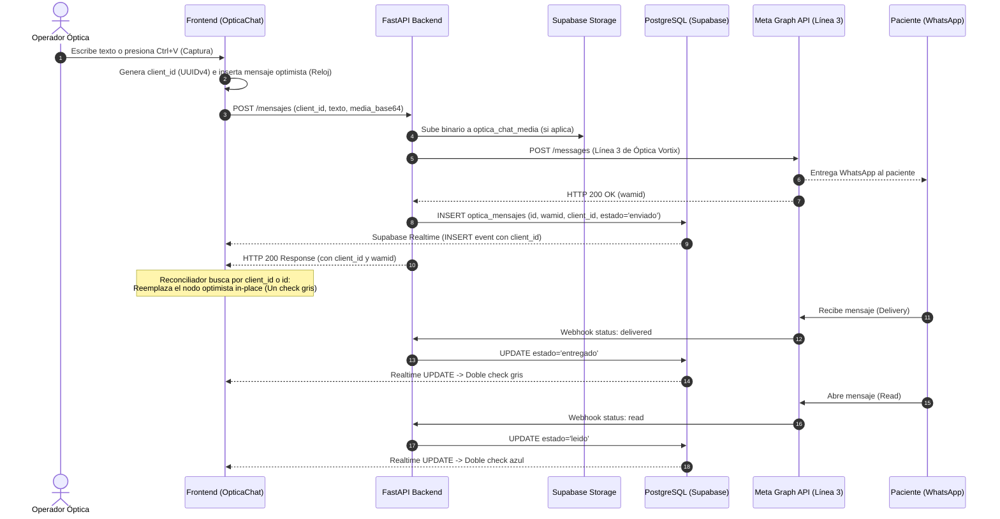

# Modernización del Gestor de WhatsApp Óptica Vortix: Experiencia WhatsApp Web, Multimedia y Ciclo de Vida Autónomo

*   **Author:** malko
*   **Status:** Approved Draft
*   **Date:** 2026-11-11
*   **Design Document:** `docs/designs/optica_vortix_chat_whatsapp_web_multimedia.md`

--------------------------------------------------------------------------------

## Overview

Este documento de diseño técnico especifica la modernización del módulo de mensajería de Óptica Vortix (`/optica-vortix/chat`), alineando su interacción con los estándares de **WhatsApp Web** para maximizar la velocidad y familiaridad de uso de los operadores comerciales. Preserva al 100% las capacidades clínicas y de conversión integradas (Ficha Óptica 360°, Copiloto de Graduación OCR, Cotizador 1-clic y Plantillas Meta), soluciona de forma definitiva el defecto de renderizado que provoca la duplicación visual de mensajes salientes, habilita la gestión integral de archivos multimedia (imágenes, PDFs y notas de voz con acelerador de velocidad), e introduce un ciclo de vida con cierre automático tras 24 horas continuas de inactividad a estado `cerrado`, con reapertura dinámica en tiempo real que preserva el modo de atención asignado (`autonomo`, `copiloto`, `humano`).

## The Problem

1. **Fricción Operativa y Falta de Paridad con WhatsApp Web:**
   Los operadores del local óptico están acostumbrados a la dinámica ágil de WhatsApp Web (pegar capturas de recetas con `Ctrl+V`, arrastrar archivos sobre el chat, atajos de `Enter` y `Shift+Enter`, e indicadores de entrega con doble tilde). En la interfaz actual, el flujo de carga de imágenes es rígido, no existe atajo de pegado directo, y los estados de entrega carecen de confirmación granular inmediata.
2. **Defecto de Mensajes Duplicados en Pantalla (`Ghost Duplication`):**
   Al despachar un mensaje desde `handleSendMessage` ([`page.tsx:729`](file:///d:/Github/crm_agentico_nube/frontend/src/app/optica-vortix/chat/page.tsx#L729)), el cliente lo inserta en el estado local tras recibir la respuesta de `apiFetch`, mientras que el canal de Supabase Realtime ya había insertado ese mismo registro milisegundos antes al propagarse el `INSERT` de la base de datos. Al no existir una clave de correlación o idempotencia cliente, el mensaje se renderiza dos veces para el operador, aunque al paciente solo le llega uno.
3. **Persistencia Efímera de Medios en Meta Cloud API:**
   WhatsApp Cloud API entrega URLs temporales de binarios que expiran a las pocas horas. Si un paciente envía una foto de su receta o un audio de voz, el CRM pierde el acceso al archivo si no se descarga y almacena de forma inmediata y desacoplada en Supabase Storage.
4. **Saturación de la Bandeja de Entrada por Falta de Cierre Automático:**
   Todas las conversaciones permanecen indefinidamente en la pestaña de `Activas`. Al superar las 24 horas del último mensaje del paciente, la ventana de servicio de Meta se cierra y la API rechaza mensajes de texto libre (`error 131047`), pero la conversación sigue ocupando espacio en la bandeja activa, generando confusión visual en el equipo sobre qué chats están vivos y cuáles caducaron.

## Goals

*   **Goal 1 (Ergonomía WhatsApp Web):** Soportar pegado directo de imágenes (`Ctrl+V`), zona de arrastrar y soltar archivos (drag & drop), atajos de teclado (`Enter` para enviar, `Shift+Enter` para salto de línea, `Esc` para cancelar respuestas), y barra de progreso interactiva de estados de entrega (reloj → un check gris → doble check gris → doble check azul).
*   **Goal 2 (Erradicación del Doble Mensaje):** Implementar reconciliación cliente/servidor por identificador único de correlación (`client_id = crypto.randomUUID()`), garantizando que la inserción optimista y el evento de Supabase Realtime reemplacen atómicamente el mismo nodo sin duplicar elementos en la interfaz.
*   **Goal 3 (Gestión Multimedia Completa):** Habilitar el envío de imágenes (JPG, PNG, WEBP) y documentos PDF con diálogo de confirmación y vista previa; e incorporar el reproductor de notas de voz entrantes (`ChatVoicePlayer`) con soporte OGG/Opus, control de velocidad (`1x`, `1.5x`, `2x`) y botón de transcripción IA vinculada a Gemini.
*   **Goal 4 (Persistencia Permanente en Storage):** Almacenar automáticamente todo medio entrante y saliente en el bucket `optica_chat_media` de Supabase Storage antes de que expiren los enlaces de Meta.
*   **Goal 5 (Ciclo de Vida 24h & Pestaña 'Cerradas'):** Crear el estado explícito `cerrada` y la pestaña organizativa correspondiente en la barra lateral; ejecutar un cron de backend cada 15 minutos que cierre conversaciones cuya ventana de 24h haya expirado (`ventana_24h_expira_at < NOW()`); y reabrir automáticamente la conversación ante nuevos mensajes entrantes restaurando con fidelidad su `modo_atencion_previo` (`autonomo`, `copiloto` o `humano`).

## Non-Goals

*   **Non-Goal 1 (Captura de Audio por Micrófono):** No se incluirá grabador de notas de voz desde el navegador (PTT) para no sobrecargar de permisos de hardware a los puestos de trabajo.
*   **Non-Goal 2 (Llamadas de Voz y Video):** No se implementarán llamadas de WhatsApp (limitación intrínseca de Meta Cloud API).
*   **Non-Goal 3 (Afectación a Campañas Masivas):** El motor de envíos masivos, el escudo anti-bloqueo y las plantillas promocionales permanecen totalmente desacoplados de este ciclo de vida de chat 1 a 1.

## Open Questions

*   *Ninguna pregunta abierta pendiente.* Las 4 decisiones arquitectónicas fundamentales fueron resueltas y alineadas en el RFC.

## Critical User Journeys (CUJs)

### CUJ 1: Operador pega captura de presupuesto con Ctrl+V y despacha al paciente
*   **Given**: El operador está en el chat de un paciente activo en `/optica-vortix/chat` con la ventana de 24 horas abierta.
*   **When**: El operador copia una captura de pantalla de un armazón y presiona `Ctrl+V` dentro del área del chat.
*   **Then**: Se abre un modal de vista previa instantánea con la imagen, un campo de texto opcional para el pie de foto (caption) y botones de "Cancelar" y "Enviar". Al confirmar, el mensaje aparece de inmediato con ícono de reloj, se sube a Supabase Storage, se envía a Meta Graph API, y se actualiza a un check gris sin duplicarse en pantalla.

### CUJ 2: Paciente envía nota de voz y el operador la reproduce a 1.5x y lee la transcripción
*   **Given**: El paciente envía una nota de voz por WhatsApp preguntando por el valor de cristales multifocales.
*   **When**: El webhook de Meta procesa el evento, descarga el audio OGG/Opus a Supabase Storage y lo inserta en `optica_mensajes`.
*   **Then**: En el chat del operador aparece el componente `ChatVoicePlayer`. El operador puede presionar Play, conmutar la píldora de velocidad a `1.5x` para escucharla con mayor rapidez, o pulsar el icono de Gemini para leer la transcripción instantánea del audio.

### CUJ 3: Conversación inactiva se auto-cierra tras 24h y se reabre en modo Autónomo al escribir el paciente
*   **Given**: Una conversación activa que estaba siendo atendida por el Copiloto IA en modo `autonomo` no recibe nuevos mensajes durante 24 horas continuas.
*   **When**: El cron periódico de mantenimiento se ejecuta.
*   **Then**: La conversación almacena `modo_atencion_previo = 'autonomo'`, actualiza su estado a `cerrada` y desaparece de la pestaña `Activas`, pasando a listarse en la pestaña `Cerradas`.
*   **When (Reapertura)**: Dos días después, el paciente envía un mensaje: *"Hola, estuve pensando en la propuesta"*.
*   **Then (Reapertura)**: El webhook detecta el mensaje entrante, actualiza el estado a `activa`, restaura `modo_atencion = 'autonomo'` y despacha el mensaje al motor IA, el cual responde de inmediato al paciente sin intervención humana, ubicando la conversación al tope de la bandeja de `Activas`.

--------------------------------------------------------------------------------

## Technical Plan (Architecture)

### 1. Diagrama de Flujo y Reconciliación Optimista



---

### 2. Arquitectura de Frontend (`frontend/src/app/optica-vortix/chat/`)

#### A. Reconciliación de Mensajes sin Duplicación (`page.tsx`)
1. **Generación de ID Cliente:**
   ```typescript
   const clientId = typeof crypto !== 'undefined' && crypto.randomUUID 
     ? crypto.randomUUID() 
     : `cli_${Date.now()}_${Math.random().toString(36).substring(2, 9)}`
   ```
2. **Inserción Optimista:**
   Se agrega el mensaje temporal a `setMensajes` con `id: "temp_" + clientId`, `metadata: { client_id: clientId }`, `estado: "pending"`.
3. **Reductor Atómico de Reconciliación:**
   ```typescript
   function reconciliarMensaje(prev: OpticaMensaje[], nuevo: OpticaMensaje): OpticaMensaje[] {
     const cid = nuevo.metadata?.client_id || (nuevo as any).client_id
     const idx = prev.findIndex(m => 
       (cid && (m.metadata?.client_id === cid || (m as any).client_id === cid)) ||
       (m.id === nuevo.id) ||
       (m.wamid && nuevo.wamid && m.wamid === nuevo.wamid)
     )
     if (idx >= 0) {
       const clon = [...prev]
       clon[idx] = { ...clon[idx], ...nuevo, id: nuevo.id }
       return clon
     }
     return [...prev, nuevo]
   }
   ```
   Este reductor se aplica tanto en la resolución de `apiFetch` como en el callback de `supabase.channel("optica_mensajes_rt")`.

#### B. Gestor de Pegado Directo y Drag & Drop (`StagedMediaModal.tsx`)
*   Se añade un listener global `onPaste` sobre el contenedor de chat:
    ```typescript
    const handlePaste = (e: React.ClipboardEvent) => {
      const items = e.clipboardData?.items
      if (!items) return
      for (let i = 0; i < items.length; i++) {
        if (items[i].type.startsWith("image/")) {
          const file = items[i].getAsFile()
          if (file) {
            e.preventDefault()
            setStagedFile(file)
            setStagedPreviewUrl(URL.createObjectURL(file))
            break
          }
        }
      }
    }
    ```
*   Componente modal flotante `StagedMediaModal`:
    *   Muestra vista previa de la imagen / PDF.
    *   Input de caption ("Escribe un comentario opcional...").
    *   Botón "Enviar" (despacha la imagen con caption) y "Cancelar" (`Esc`).

#### C. Reproductor de Notas de Voz (`ChatVoicePlayer.tsx`)
*   Ubicado en las burbujas de mensaje cuando `tipo === 'audio'`.
*   Propiedades del componente:
    *   Tag `<audio ref={audioRef} src={mediaUrl} preload="metadata" />`.
    *   Botón Play / Pause circular con ícono SVG.
    *   Scrubber interactivo con barra de progreso estilizada en verde esmeralda / azul institucional.
    *   Contador de tiempo dinámico (`mm:ss / mm:ss`).
    *   Píldora interactiva de velocidad: botón `[ 1x ]` que cicla a `[ 1.5x ]` y `[ 2x ]`. Almacena la preferencia en `localStorage.getItem("vortix_audio_playback_rate")`.
    *   Botón de transcripción IA: al hacer clic, invoca `/api/optica-vortix/mensajes/{id}/transcribir` y muestra el texto transcrito desplegable debajo del reproductor.

#### D. Pestañas de la Barra Lateral: `Activas`, `Cerradas`, `Archivadas`
*   El selector superior de la barra lateral se amplía a 3 pestañas:
    *   **Activas** (`filtroTab === 'activas'`): Conversaciones vivas con `estado === 'activa'`. Muestra badge de total y badge de no leídos.
    *   **Cerradas** (`filtroTab === 'cerradas'`): Conversaciones inactivas tras 24h (`estado === 'cerrada'`).
    *   **Archivadas** (`filtroTab === 'archivadas'`): Conversaciones marcadas manualmente como archivadas (`estado === 'archivada'`).

---

### 3. Arquitectura de Backend y Base de Datos (`FastAPI` & `PostgreSQL`)

#### A. Modelo de Datos (`optica_conversaciones` y `optica_mensajes`)
*   Migración SQL / Alter Table:
    ```sql
    -- optica_conversaciones: unificación de estados históricos y soporte de ciclo de vida 24h
    UPDATE public.optica_conversaciones 
      SET estado = 'activa' 
      WHERE estado = 'abierta' OR estado IS NULL;

    ALTER TABLE public.optica_conversaciones 
      ADD COLUMN IF NOT EXISTS modo_atencion_previo VARCHAR(30) DEFAULT 'autonomo',
      ADD COLUMN IF NOT EXISTS cerrado_at TIMESTAMPTZ,
      ADD COLUMN IF NOT EXISTS cerrado_motivo VARCHAR(50);

    -- Asegurar índice para el cron de inactividad de 24h sincronizado con Meta
    CREATE INDEX IF NOT EXISTS idx_optica_conv_autocierre 
      ON public.optica_conversaciones (estado, ventana_24h_expira_at) 
      WHERE estado = 'activa';

    -- optica_mensajes: soporte de idempotencia client_id
    CREATE INDEX IF NOT EXISTS idx_optica_mensajes_client_id 
      ON public.optica_mensajes (((metadata->>'client_id')));
    ```

#### B. API de Envío de Mensajes con Idempotencia y Medios
*   Ruta: `POST /api/optica-vortix/conversaciones/{conversacion_id}/mensajes`
*   Payload:
    ```json
    {
      "texto": "Estimado paciente, le adjunto el presupuesto de sus multifocales.",
      "client_id": "9b1deb4d-3b7d-4bad-9bdd-2b0d7b3dcb6d",
      "media_base64": "data:image/jpeg;base64,...",
      "media_nombre": "receta_arago.jpg",
      "tipo": "imagen"
    }
    ```
*   Proceso:
    1. Si `media_base64` existe, el backend lo decodifica y lo sube al bucket `optica_chat_media/outbound/{fecha}/{uuid}_{nombre}` en Supabase Storage.
    2. Envía el mensaje a Meta Graph API mediante `wa_client.send_image` o `wa_client.send_document` con la URL pública firmada.
    3. Inserta el registro en `optica_mensajes` con `metadata = {"client_id": payload.client_id, "wamid": wamid}`.
    4. Retorna el objeto `OpticaMensaje` completo.

#### C. Webhook Inbound: Descarga Persistente y Reapertura Automática
*   Ruta: `POST /api/whatsapp/cloud/webhook`
*   Lógica ante mensaje entrante de un paciente:
    1. **Descarga Persistente de Medios:**
       Si el evento contiene `image`, `audio` o `document`, consulta a Meta `GET /v21.0/{media_id}` para obtener el `download_url`, descarga los bytes binarios y los persiste en Supabase Storage (`optica_chat_media/inbound/{fecha}/{media_id}.{ext}`). Así, la URL registrada en `optica_mensajes.media_url` es permanente y nunca expira.
    2. **Reapertura de Conversación Cerrada:**
       ```python
       c_res = supabase.table("optica_conversaciones").select("estado, modo_atencion_previo").eq("id", conv_id).limit(1).execute()
       if c_res.data and c_res.data[0].get("estado") == "cerrada":
           modo_restaurado = c_res.data[0].get("modo_atencion_previo") or "autonomo"
           supabase.table("optica_conversaciones").update({
               "estado": "activa",
               "modo_atencion": modo_restaurado,
               "cerrado_at": None,
               "cerrado_motivo": None,
               "updated_at": datetime.now(timezone.utc).isoformat()
           }).eq("id", conv_id).execute()
           
           # Si el modo restaurado es autónomo, encolar ejecución inmediata del agente IA
           if modo_restaurado == "autonomo":
               asyncio.create_task(ejecutar_agente_ia_optica(conv_id, texto_paciente))
       ```

#### D. Cron de Cierre Automático por Inactividad 24h
*   Función en `optica_vortix_service.py`: `ejecutar_cierre_conversaciones_inactivas_24h()`.
*   Ejecutada periódicamente cada 15 minutos en el loop de fondo de FastAPI / Railway con actualización atómica en lote (evitando tormentas N+1):
    ```python
    now_iso = datetime.now(timezone.utc).isoformat()
    # Actualización atómica en lote: sincronizada con la expiración oficial de Meta
    supabase.table("optica_conversaciones")\
        .update({
            "estado": "cerrada",
            "cerrado_at": now_iso,
            "cerrado_motivo": "inactividad_24h",
            "updated_at": now_iso
        })\
        .eq("estado", "activa")\
        .lt("ventana_24h_expira_at", now_iso)\
        .execute()
    ```

--------------------------------------------------------------------------------

## Alternatives Considered

### Alternative A: Captura y Grabación de Notas de Voz por Micrófono en el Navegador
*   **Pros**: Permitiría a los operadores responder con audios grabados directamente desde la computadora sin utilizar un teléfono celular.
*   **Cons**: Exige solicitar y gestionar permisos de micrófono en el navegador, lidiar con bloqueos de políticas de seguridad en sistemas Windows de escritorio, comprimir audio en tiempo real en el cliente (conversión a contenedor OGG Opus) y aumenta el tiempo de respuesta operativo en lugar de usar atajos de teclado, cotizador 1-clic o plantillas predefinidas.
*   **Reason for Rejection**: *Rejected by author: La operatoria comercial en el local óptico prioriza la velocidad de respuesta escrita, cotizaciones en 1-clic y plantillas pre-aprobadas. No se justifica la complejidad de permisos de hardware y codecs en los puestos de trabajo. Se adopta exclusivamente la recepción y reproducción ágil de audios entrantes.*

### Alternative B: Mover Conversaciones Inactivas a la Pestaña 'Archivadas' en vez de Crear el Estado 'Cerrada'
*   **Pros**: Reutiliza la columna existente `archivada` sin requerir migraciones de enum/columna ni agregar una pestaña adicional en el frontend.
*   **Cons**: Mezcla conceptualmente dos eventos operativos distintos: el archivo voluntario (un operador decide archivar un caso concluido o cancelado) con la expiración técnica de la ventana de sesión de 24 horas de Meta. Imposibilita a la gerencia medir métricas de resolución y volumen de conversaciones activas vs. cerradas por inactividad.
*   **Reason for Rejection**: *Rejected by author: Es indispensable separar conceptual y visualmente las conversaciones cerradas por inactividad de aquellas archivadas manualmente por el personal comercial.*

### Alternative C: Forzar Modo de Atención 'Humano' en la Reapertura Automática de Chats
*   **Pros**: Garantiza que un operador humano revise cualquier nuevo mensaje antes de que la IA responda.
*   **Cons**: Si un paciente venía interactuando satisfactoriamente con el agente autónomo de IA (por ejemplo, cotizando cristales fuera de horario o coordinando entrega), la reapertura forzada a 'Humano' deja al paciente esperando hasta que un asesor esté libre en el local, degradando la conversión nocturna y de fin de semana.
*   **Reason for Rejection**: *Rejected by author: El sistema debe honrar estrictamente el modo de atención previo (`modo_atencion_previo`). Si la conversación operaba con IA en modo autónomo, debe continuar en modo autónomo de forma inmediata y sin fricción.*

### Alternative D: Eliminar la Inserción Optimista en el Frontend para Resolver el Mensaje Doble
*   **Pros**: Solución trivial en una sola línea de código eliminando el `setMensajes` previo a la llamada de red.
*   **Cons**: Destruye la experiencia de inmediatez propia de WhatsApp Web, introduciendo una latencia perceptible de 1 a 2 segundos en cada mensaje saliente mientras se espera la confirmación de la API de Meta y Supabase.
*   **Reason for Rejection**: *Rejected by author: Rompe la paridad con la agilidad de WhatsApp Web. La solución técnica correcta es implementar identificadores de correlación (`client_id`) y reconciliación atómica en el reductor de React.*

--------------------------------------------------------------------------------

## Detailed Implementation Plan

### Target Files to Create/Modify

#### 1. `supabase/migrations/20261111_optica_conversaciones_ciclo_24h_idempotencia.sql` (Create)
*   **Type / Scope**: Migración SQL para PostgreSQL en Supabase.
*   **Rationale**: Soporte en base de datos para el ciclo de vida de conversaciones (estado `cerrada`, `modo_atencion_previo`, `cerrado_at`, `cerrado_motivo`) e índices de aceleración para el cron de 24 horas y búsqueda por `metadata->>'client_id'`.
*   **Proposed Changes**:
    *   `ALTER TABLE public.optica_conversaciones ADD COLUMN IF NOT EXISTS modo_atencion_previo VARCHAR(30) DEFAULT 'autonomo', ADD COLUMN IF NOT EXISTS cerrado_at TIMESTAMPTZ, ADD COLUMN IF NOT EXISTS cerrado_motivo VARCHAR(50);`
    *   Índice parcial `idx_optica_conv_autocierre` sobre `(estado, ultimo_mensaje_at)` condicionado a `estado = 'activa'`.
    *   Índice de expresión `idx_optica_mensajes_client_id` sobre `(metadata->>'client_id')`.

#### 2. `frontend/src/types/optica.ts` (Modify)
*   **Type / Scope**: Definiciones de tipos TypeScript compartidas en el frontend de Óptica.
*   **Rationale**: Garantizar tipado estricto para los nuevos estados de conversación (`'activa' | 'cerrada' | 'archivada'`), campos de auditoría de cierre (`modo_atencion_previo`, `cerrado_at`) y el soporte de `client_id` y estados granulares de entrega en mensajes.
*   **Proposed Changes**:
    *   Actualizar `OpticaConversacion`: expandir `estado` a `'activa' | 'cerrada' | 'archivada'`, incorporar `modo_atencion_previo?: string`, `cerrado_at?: string`, `cerrado_motivo?: string`.
    *   Actualizar `OpticaMensaje`: incorporar `client_id?: string`, estados de entrega `'pending' | 'enviado' | 'entregado' | 'leido' | 'fallido'`.

#### 3. `frontend/src/components/optica/StagedMediaModal.tsx` (Create)
*   **Type / Scope**: Componente modal de React (TypeScript/Tailwind CSS).
*   **Rationale**: Replicar la experiencia nativa de WhatsApp Web para pegar capturas (`Ctrl+V`) o arrastrar archivos sobre el chat, permitiendo al operador visualizar la imagen o documento, añadir un pie de foto (caption) opcional y confirmar el envío o cancelar con `Esc`.
*   **Proposed Changes**:
    *   Modal flotante centrado con backdrop translúcido.
    *   Visor de imagen o ícono de documento PDF con nombre y tamaño en KB/MB.
    *   Input de texto para caption con atajo de `Enter` para enviar.
    *   Botón "Enviar" con spinner de carga durante la subida y botón "Cancelar".

#### 4. `frontend/src/components/optica/ChatVoicePlayer.tsx` (Create)
*   **Type / Scope**: Componente de reproducción de audio interactivo en React.
*   **Rationale**: Reemplazar los controles estándar de HTML5 por un reproductor estilizado con el diseño de WhatsApp, selector interactivo de velocidad de audio (1x / 1.5x / 2x) persistido en `localStorage` y botón de transcripción rápida con Gemini.
*   **Proposed Changes**:
    *   Botón circular Play/Pause.
    *   Scrubber interactivo con barra de progreso.
    *   Píldora interactiva de velocidad `[1x] -> [1.5x] -> [2x] -> [1x]`.
    *   Botón de transcripción IA vinculada al endpoint del backend.

#### 5. `frontend/src/app/optica-vortix/chat/page.tsx` (Modify)
*   **Type / Scope**: Página principal del módulo de mensajería de Óptica Vortix.
*   **Rationale**: Integrar todos los componentes de experiencia WhatsApp Web, resolver el defecto de duplicación visual de mensajes y desplegar la pestaña de conversaciones cerradas.
*   **Proposed Changes**:
    *   **Reconciliación Optimista:** Implementar `client_id = crypto.randomUUID()` al despachar mensajes y aplicar el reductor de reemplazo *in-place* tanto en la resolución de `apiFetch` como en el listener de Supabase Realtime, eliminando definitivamente la duplicación.
    *   **Atajos y Portapapeles:** Listener `onPaste` para interceptar imágenes de `Ctrl+V` y contenedor con `onDrop` / `onDragOver` que abren `StagedMediaModal`.
    *   **Pestañas de la Barra Lateral:** Extender la cabecera lateral para soportar `Activas`, `Cerradas` y `Archivadas`.
    *   **Renderizado de Burbujas:** Visualización de ticks de entrega (reloj $\to$ un check gris $\to$ doble check gris $\to$ doble check azul) e integración del `ChatVoicePlayer` para notas de voz.

#### 6. `backend/app/routers/optica_vortix_router.py` & `backend/app/services/optica_vortix_service.py` (Modify)
*   **Type / Scope**: Enrutador FastAPI y módulo de servicios de Óptica Vortix.
*   **Rationale**: Soporte en el backend para recepción de `client_id`, persistencia desacoplada de medios en Supabase Storage, reapertura automática en webhooks y cron de cierre tras 24 horas de inactividad.
*   **Proposed Changes**:
    *   En `POST /conversaciones/{id}/mensajes`: aceptar `client_id`, `media_base64`, `media_nombre`, `tipo`; almacenar `client_id` en `metadata.client_id`; decodificar binarios y subirlos a Supabase Storage (`optica_chat_media/outbound/`) antes de enviar a Meta.
    *   En `GET /conversaciones`: aceptar parámetro `estado: Optional[str] = None` para listar `activas`, `cerradas` o `archivadas`.
    *   Endpoint `POST /conversaciones/{id}/reabrir` y `POST /conversaciones/{id}/cerrar` (manual).
    *   Endpoint `POST /mensajes/{id}/transcribir` (para transcripción rápida de audio con Gemini).
    *   En `optica_vortix_service.py`: función `ejecutar_cierre_conversaciones_inactivas_24h()` incorporada al ciclo periódico de background cada 15 minutos.
    *   En `procesar_webhook_inbound_optica`: descarga persistente de binarios de Meta hacia Supabase Storage (`optica_chat_media/inbound/`) y lógica de reapertura automática si `estado == 'cerrada'`, restaurando `modo_atencion = COALESCE(modo_atencion_previo, 'autonomo')` y encolando la IA si correspondía.

---

## Verification Plan

### 1. Verificación Estática y Compilación
*   **Backend**: `python -m py_compile backend/app/routers/optica_vortix_router.py backend/app/services/optica_vortix_service.py` sin errores de sintaxis ni importación.
*   **Frontend**: `npm run build` en el directorio `frontend/` verificando cero errores de compilación TypeScript y empaquetado de Next.js exitoso.

### 2. Prueba de Reconciliación Optimista y Eliminación del Doble Mensaje
*   Enviar un mensaje desde el chat de óptica.
*   Verificar que en la pantalla del operador el mensaje aparece inmediatamente con ícono de reloj.
*   Verificar que al completar la llamada HTTP y al llegar el evento de Supabase Realtime, el mensaje se actualiza a un check gris en la misma burbuja sin duplicarse.

### 3. Prueba de Pegado Directo (`Ctrl+V`) y Envío Multimedia
*   Copiar una captura de pantalla al portapapeles y presionar `Ctrl+V` dentro del área de chat.
*   Verificar que se abre `StagedMediaModal` con la vista previa y el campo de texto para caption.
*   Despachar el mensaje y validar que el archivo binario se almacena en Supabase Storage (`optica_chat_media`) y que Meta Graph API devuelve HTTP 200 OK.

### 4. Prueba del Reproductor de Voz con Acelerador (1x / 1.5x / 2x)
*   Abrir una conversación con un audio de voz recibido de un paciente.
*   Verificar que `ChatVoicePlayer` reproduce el audio OGG Opus correctamente, que el botón de velocidad conmuta fluidamente a `1.5x` y `2x` persistiendo la preferencia en `localStorage`, y que el botón de transcripción IA muestra el texto emitido por el paciente.

### 5. Prueba del Ciclo de Vida: Cierre tras 24h y Reapertura Preservada
*   Verificar que una conversación con más de 24 horas de silencio pasa a estado `cerrada` y se ubica en la pestaña `Cerradas`.
*   Simular o recibir un mensaje entrante del paciente por webhook:
    *   Validar que la conversación transiciona a `activa` y se mueve al inicio de la pestaña `Activas`.
    *   Validar que si estaba en modo `autonomo`, el agente IA responde automáticamente al paciente sin intervención manual.

--------------------------------------------------------------------------------

*Drafted with EGM*