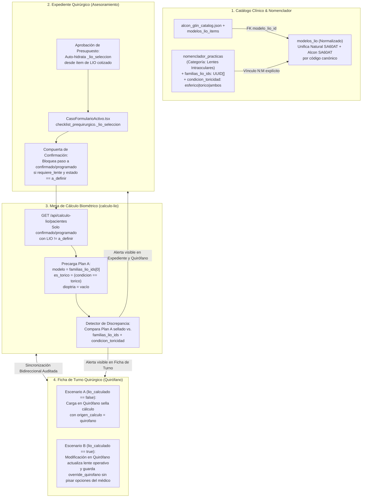

# Unificación del Flujo Comercial, Biométrico y Quirúrgico de Lentes Intraoculares (LIO)

*   **Author:** malko
*   **Status:** Proposed
*   **Date:** 2026-11-15

--------------------------------------------------------------------------------

## Overview

Este documento define la unificación del ciclo de vida de los Lentes Intraoculares (LIO) dentro del CRM institucional de Centrovisión, conectando extremo a extremo cuatro dominios operativos que hoy funcionan de forma aislada:

1.  **Catálogo Clínico y Trazabilidad GTIN (`modelos_lio` / `modelos_lio_items`)**: donde se administran las familias ópticas, constantes biométricas (`Constante A`), dioptrías, toricidad y stock físico en tiempo real sincronizado con el ERP Geclisa.
2.  **Nomenclador Comercial (`nomenclador_practicas`)**: donde se configuran los aranceles y prácticas facturables de lentes (`TRIFOCAL`, `TRIFOCALT`, `CLAREON`, `CLAREONT`, `VIVTY`, `MULTIFOCAL`) asociadas a las cirugías que requieren implante.
3.  **Expediente Quirúrgico de Asesoramiento (`asesorias_quirurgicas`)**: donde el equipo de asesoramiento define junto al paciente la tecnología de lente propuesta o confirmada por ojo (`OD` / `OI`) y emite el presupuesto oficial.
4.  **Mesa de Cálculo Biométrico (`calculo-lio`) y Ficha de Turno Quirúrgico (`turnos_quirofano`)**: donde el cirujano calcula la graduación dióptrica a implantar y el equipo de quirófano reserva el lote físico y ejecuta la cirugía.

El objetivo de negocio es garantizar una única cadena de información coherente desde el presupuesto hasta el quirófano, eliminando la carga manual duplicada, depurando la bandeja de cálculo biométrico de casos inmaduros y asegurando trazabilidad clínica y comercial ante cualquier cambio de lente decidido por el cirujano o en sala quirúrgica.

## The Problem

Actualmente no existe un vínculo de datos entre el **lente comercial** que elige el paciente en Asesoramiento y la **familia clínica con GTIN** que utilizan el cirujano en `Cálculo de LIO` y el personal de sala en la `Ficha de Turno Quirúrgico`. Esta desconexión genera cinco problemas operativos directos:

1.  **Falta de correspondencia entre Nomenclador y Familias Clínicas (`modelos_lio`)**:
    *   En el Nomenclador, las prácticas de categoría `Lentes Intraoculares` (`TRIFOCAL`, `TRIFOCALT`, `MULTIFOCAL`, `CLAREON`, `VIVTY`) sólo guardan código, nombre y tarifa, infiriendo si son tóricas o esféricas mediante búsqueda de texto en el código o nombre. No tienen ninguna referencia a las familias clínicas de `modelos_lio` (`Clareon PanOptix Común`, `Clareon Vivity`, `Clareon Monofocal`, `Natural SA60AT`).
    *   Además, el formulario de configuración integral del Nomenclador muestra en las prácticas de lentes el interruptor *"Requiere Selección de Lente Intraocular (LIO)"* (propio de una cirugía como Catarata) en lugar de permitir asociar a qué familia o familias clínicas de `modelos_lio` y condición de toricidad corresponde ese lente comercial.
2.  **Fragmentación de familias en el Catálogo Maestro GTIN**:
    *   Un mismo modelo físico de lente se encuentra dividido en múltiples familias clínicas por diferencias de nomenclatura entre procesos de importación (por ejemplo, `Natural SA60AT` contiene las dioptrías de +10.00 D a +11.00 D mientras que `Alcon SA60AT` contiene de +11.50 D en adelante), impidiendo resolver el SKU y el stock de Geclisa en todo el rango dióptrico bajo una sola familia.
3.  **Saturación de la bandeja de `Cálculo de LIO` con casos sin definir (491 pendientes)**:
    *   La cola de trabajo del cirujano incluye todos los expedientes en etapas iniciales (`en_asesoramiento`, `en_analisis`) o con el lente comercial en estado `"A Definir"`. El médico se enfrenta a cientos de registros que todavía no tienen confirmación quirúrgica ni tipo de lente acordado con el paciente.
    *   Existen además cuatro caminos en el sistema (auto-promoción al cargar fecha definitiva, aprobación de presupuesto, recontacto rápido y carga parcial en casos bilaterales diferenciados) que permiten pasar un expediente a `'confirmado'` o `'programado'` manteniendo el LIO en `'a_definir'`.
4.  **Pérdida de contexto y falta de alertas de discrepancia en `Cálculo de LIO`**:
    *   Cuando el cirujano abre un paciente para calcular, el Plan A no precarga la familia clínica ni la toricidad del lente comercial elegido en el expediente, sino que selecciona por defecto el primer modelo activo del catálogo con `+20.00 D`.
    *   Si el cirujano decide cambiar el tipo de lente por criterio clínico (por ejemplo, el paciente presupuestó un `TRIFOCAL` esférico pero la biometría requiere un lente tórico `TRIFOCALT` o un lente EDOF `Vivity`), el sistema guarda el cálculo sin advertir a Asesoramiento ni a Quirófano que el lente calculado no coincide con el lente presupuestado.
5.  **Contaminación de datos y pérdida de historial entre `Ficha de Turno Quirúrgico` y `Cálculo de LIO`**:
    *   La `Ficha de Turno Quirúrgico` inicializa por defecto `'AcrySof IQ SN60WF (Alcon)'` con `'+21.50'` en todo turno sin cálculo previo, inyectando opciones falsas en la mesa de cálculo.
    *   Cuando el médico informa el lente por teléfono directamente a Quirófano (sin usar `Cálculo de LIO`), el personal carga el lente en la ficha del turno pero el caso no queda adecuadamente sellado con trazabilidad de origen en `Cálculo de LIO`.
    *   Inversamente, cuando el médico sí selló su cálculo en el CRM y Quirófano modifica a último momento el modelo o la dioptría en la Ficha de Turno, no existe un registro separado (`override`) que actualice el lente operativo del turno preservando intacto el cálculo original del médico, ni protección para evitar que una edición administrativa posterior en el Expediente vuelva a pisar el cambio de Quirófano.

## Goals

*   **G1 — Vinculación Nomenclador $\leftrightarrow$ Familias Clínicas (`modelos_lio`)**: Permitir que cada práctica comercial de categoría `Lentes Intraoculares` en `nomenclador_practicas` se asocie a una o más familias clínicas de `modelos_lio` (`familias_lio_ids`) y a una condición explícita de toricidad (`esferico`, `torico`, `ambos`), tanto para lentes específicos (`TRIFOCAL` $\rightarrow$ `Clareon PanOptix Común` esférico) como para familias genéricas (`MULTIFOCAL`).
*   **G2 — Unificación de Familias Duplicadas en Catálogo GTIN**: Consolidar bajo una única familia canónica en `modelos_lio` los modelos duplicados por nombre (como `Natural SA60AT` y `Alcon SA60AT`), migrando sus ítems GTIN y evitando que la sincronización con Geclisa vuelva a crear duplicados.
*   **G3 — Compuerta de Confirmación en Expediente y Depuración de `Cálculo de LIO`**: Impedir que un expediente quirúrgico que requiere LIO pase a estado `confirmado` o `programado` si el lente comercial está en `"A Definir"` (en todas las vías de transición de estado, auto-adoptando el lente del presupuesto cuando se aprueba un presupuesto que lo contenga), y filtrar la bandeja de pendientes de `Cálculo de LIO` exclusivamente a casos confirmados/programados con LIO definido.
*   **G4 — Precarga del Plan A y Alerta de Discrepancia Comercial-Clínica**: Precargar automáticamente en `Cálculo de LIO` el Plan A con la familia clínica por defecto y la condición de toricidad correspondientes al LIO comercial del expediente (con dioptría inicialmente vacía para exigir ingreso explícito del médico), y disparar una alerta persistente de discrepancia comercial-clínica visible en Cálculo de LIO, Expediente y Ficha Quirúrgica si el médico sella un Plan A de otra familia o distinta toricidad.
*   **G5 — Sincronización Bidireccional Auditada con `Ficha de Turno Quirúrgico`**:
    *   Eliminar los valores por defecto fijos (`AcrySof IQ SN60WF +21.50 D`) en turnos no calculados.
    *   Si el caso no estaba calculado por el médico y Quirófano carga modelo y dioptría en la Ficha de Turno, marcar el caso como calculado/confirmado en `Cálculo de LIO` dejando trazabilidad de que fue cargado desde Quirófano.
    *   Si el caso ya estaba calculado por el médico y Quirófano cambia el modelo, dioptría o toricidad en la Ficha de Turno, aplicar el nuevo valor operativo al turno y registrar el cambio como un `override_quirofano` auditado sin sobrescribir las opciones originales calculadas por el médico.

## Non-Goals

*   **NG1**: Modificar las fórmulas matemáticas de cálculo biométrico (`SRK/T` o `Barrett Universal II`) o el parser de archivos PDF de biometría de Geclisa.
*   **NG2**: Modificar la facturación contable interna dentro del sistema externo Geclisa ERP (la discrepancia comercial-clínica se gestiona y alerta dentro del CRM para que Asesoramiento actualice el presupuesto o cobro).
*   **NG3**: Bloquear de forma rígida al cirujano en `Cálculo de LIO` o al personal de `Quirófano` impidiéndoles seleccionar un lente distinto al presupuestado; la prioridad clínica prevalece siempre, acompañada de la alerta de discrepancia y del registro de auditoría.

## Open Questions

*   Ninguna pregunta abierta pendiente de la fase de ideación (`concepts_brief.md`). Todas las reglas de negocio sobre cardinalidad, compuerta de ingreso, manejo de discrepancias y preservación del cálculo médico frente a cambios en Quirófano fueron definidas y validadas.

## Critical User Journeys (CUJs)

### CUJ 1: Configuración de Lente Comercial en Nomenclador y Selección en Expediente

*   **Given**: Una práctica comercial en el Nomenclador (`TRIFOCAL - LENTE TRIFOCAL ESFERICO`) de categoría `Lentes Intraoculares` vinculada a la familia clínica `Clareon PanOptix Común` con condición `esferico`, y un expediente quirúrgico de Catarata (`34031`) en etapa `en_asesoramiento`.
*   **When**: El asesor intenta pasar el expediente a `confirmado` o `programado` con el LIO Comercial en estado `"A Definir"`, y luego selecciona `TRIFOCAL` en estado `"Definitivo" (estado: 'confirmado')` (o aprueba un presupuesto que incluye `TRIFOCAL`).
*   **Then**: En el primer intento el sistema impide avanzar a `confirmado`/`programado` indicando que debe definir el LIO comercial; una vez seleccionado `TRIFOCAL` (o auto-hidratado al aprobar el presupuesto), el expediente avanza a `confirmado` y el ojo correspondiente ingresa a la bandeja de pendientes de `Cálculo de LIO`.

### CUJ 2: Cálculo Biométrico con Precarga del Plan A y Detección de Discrepancia

*   **Given**: Un paciente con expediente en estado `confirmado` y LIO Comercial `TRIFOCAL` (vinculado a `Clareon PanOptix Común`, `esferico`) aparece en la cola de `Cálculo de LIO`.
*   **When**: El cirujano selecciona al paciente en `Cálculo de LIO`, visualiza el Plan A precargado con `Clareon PanOptix Común (Alcon)` (`es_torico = false`, dioptría vacía), pero al revisar la topografía corneal activa la casilla `Lente Tórico` (T3, eje 150°) con dioptría `+21.50 D` y presiona `"Confirmar y Sellar LIO"`.
*   **Then**: El sistema permite sellar el cálculo, resuelve el SKU y stock en Geclisa para la graduación tórica, y registra una alerta activa de **Discrepancia Comercial-Clínica** (`Comercial: TRIFOCAL Esférico` vs. `Clínico: Clareon PanOptix Común Tórico T3`) visible inmediatamente en el Expediente de Asesoramiento y en la Ficha de Turno Quirúrgico.

### CUJ 3: Carga Directa en Quirófano (Sin Cálculo Previo del Médico en CRM)

*   **Given**: Un turno quirúrgico programado cuyo cálculo de LIO aún figura pendiente (`lio_calculado = false`), y el cirujano informa telefónicamente a Quirófano que implantará un `Clareon Vivity +20.50 D`.
*   **When**: El personal de Quirófano abre la `Ficha de Turno Quirúrgico` (que muestra la dioptría vacía, sin valores fijos preasignados), selecciona `Clareon Vivity`, ingresa `20.50 D` y guarda los cambios del turno.
*   **Then**: El turno y el expediente se marcan automáticamente como `lio_calculado = true` con trazabilidad `origen_calculo: "quirofano"` y el nombre del usuario de Quirófano, el paciente sale de la lista de pendientes de `Cálculo de LIO` y pasa a figurar en `LIO Confirmados`.

### CUJ 4: Modificación en Quirófano sobre un Caso Ya Calculado por el Médico (Override Auditado)

*   **Given**: Un turno quirúrgico cuyo Plan A fue calculado y sellado por el cirujano en `Cálculo de LIO` con `Clareon PanOptix Común +21.00 D`, pero en prequirófano se decide utilizar `+21.50 D` por disponibilidad inmediata de lote en sala.
*   **When**: El personal de Quirófano activa la modificación de LIO en la `Ficha de Turno Quirúrgico`, cambia la dioptría operativa a `+21.50 D`, selecciona el lote físico de Geclisa y guarda la ficha.
*   **Then**: El turno actualiza su lente operativo a `+21.50 D` para el consumo de stock y la Pausa de Seguridad OMS, pero conserva intacto el array original `opciones` (`+21.00 D`) calculado por el médico y guarda el registro `override_quirofano` con usuario, fecha, valor original del médico y valor aplicado en quirófano. Si Asesoramiento edita luego otros datos del expediente, la sincronización respeta el `override_quirofano` vigente y no sobrescribe el `+21.50 D`.

--------------------------------------------------------------------------------

## Technical Plan (Architecture)

La arquitectura unifica los cuatro eslabones del circuito de LIO mediante contratos de datos explícitos en PostgreSQL/Supabase y una máquina de estados sincronizada entre el Nomenclador, el Expediente Quirúrgico, la Mesa de Cálculo de LIO y la Ficha de Turno Quirúrgico.

### 1. Flujo de Datos e Interacción de Componentes



### 2. Modelo de Datos y Esquema Relacional

#### 2.1. Vínculo Nomenclador $\leftrightarrow$ Familias Clínicas (`nomenclador_practicas`)
Se incorporan dos columnas a la tabla `nomenclador_practicas`:
*   `familias_lio_ids` (`JSONB DEFAULT '[]'::jsonb`): lista ordenada de UUIDs pertenecientes a `modelos_lio` asociados a esa práctica comercial. El primer elemento (`familias_lio_ids[0]`) define la familia clínica que se precarga por defecto en el Plan A de `Cálculo de LIO`; si la práctica comercial es genérica (por ejemplo, `MULTIFOCAL`), la lista puede contener múltiples UUIDs de `modelos_lio` válidos sin disparar alerta de discrepancia cuando el médico elija cualquiera de ellos.
*   `condicion_toricidad` (`TEXT DEFAULT 'esferico'`): admite los valores `'esferico'`, `'torico'` o `'ambos'`.

En el modal de configuración integral del Nomenclador (`NomencladorSettingsCard.tsx`):
*   Cuando la práctica tiene categoría distinta de `Lentes Intraoculares` (ej. `34031 - Catarata con Facoemulsificación`), se mantiene el interruptor *"Requiere Selección de Lente Intraocular (LIO)"* que habilita la pestaña de qué prácticas comerciales de lentes pueden cotizarse con esa cirugía (`lios_habilitados`).
*   Cuando la práctica pertenece a la categoría `Lentes Intraoculares` (ej. `TRIFOCAL`, `TRIFOCALT`, `MULTIFOCAL`, `CLAREON`, `VIVTY`), ese interruptor se reemplaza por el bloque **"Vinculación con Familias Clínicas (`modelos_lio`) & Toricidad"**, donde el usuario selecciona la(s) familia(s) clínica(s) y si el ítem comercial corresponde a `'esferico'`, `'torico'` o `'ambos'`.

#### 2.2. Normalización Idempotente de Familias Duplicadas en `modelos_lio`
Para resolver la partición de graduaciones entre familias duplicadas (como `Natural SA60AT` y `Alcon SA60AT`):
*   Se introduce en el servicio de base de datos una rutina idempotente de consolidación por **código de modelo canónico** (`SA60AT`, `SN60WF`, `CNA0T0`, `CNW0T`, `TFNT00`, `TFNT`, `DFT015`, `DFT`, `MA60AC`, `MA60MA`).
*   Cuando existen dos registros en `modelos_lio` que refieren al mismo modelo físico (por ejemplo, `"Natural SA60AT"` y `"Alcon SA60AT"`), la rutina conserva la familia canónica activa, reasigna todos los ítems de `modelos_lio_items` (`modelo_lio_id`) y las referencias de `catalogo_maestro_gtin` (`modelo_lio_id`) hacia el UUID canónico evitando colisiones por `(modelo_lio_id, dioptria, torico_valor)`, actualiza `admite_toricos = true` cuando la familia consolida variantes tóricas, y elimina o desactiva el registro duplicado huérfano.
*   En las rutinas de sincronización con el catálogo maestro y Geclisa (`sincronizar_lentes_masivos` en `POST /api/modelos-lio/sincronizar-masivo-alcon` y `sincronizar_catalogo_maestro_con_geclisa_endpoint` en `POST /api/catalogo-maestro/sincronizar-geclisa`), la búsqueda previa de familia verifica primero la coincidencia por código de modelo canónico antes de crear una nueva familia con el patrón `"{marca} {codigo}"`.

### 3. Compuerta de Confirmación en Expediente y Filtro de Bandeja en `Cálculo de LIO`

#### 3.1. Validación Unificada de LIO Comercial Definido
Para que un expediente quirúrgico cuya práctica requiere LIO (`requiere_lente == true`) pueda pasar a estado `'confirmado'` o `'programado'`, debe cumplirse que `checklist_prequirurgico._lio_seleccion.estado` sea `'tentativo'` o `'confirmado'` y que tenga asignado un lente comercial para cada ojo intervenido (`lente_nombre` / `lente_codigo` en unilateral o bilateral con mismo lente, y ambos `lente_od` y `lente_oi` cuando `ojo == 'AO'` y `modalidad_bilateral == 'diferenciado'`).

Esta regla se aplica en todos los puntos de transición:
1.  **Cambio manual de etapa en el Stepper (`CasoFormularioActivo.tsx`)**: bloquea el avance a `'confirmado'` o `'programado'` y muestra el aviso indicando que debe seleccionarse el LIO Comercial / Propuesto.
2.  **Auto-promoción a `'programado'` al asignar `fechaDefinitiva` (`CasoFormularioActivo.tsx` y `sincronizar_turno_quirofano_desde_asesoria`)**: antes de promover `estadoEfectivo = 'programado'`, verifica que el LIO comercial no esté en `'a_definir'`.
3.  **Creación, actualización y recontacto rápido de asesoría en Backend (`POST /api/asesorias-quirurgicas`, `PUT /api/asesorias-quirurgicas/{id}` y `registrar_quick_recontacto_asesoria` cuando `accion == 'confirmado'`)**: rechaza con HTTP 400 el cambio de estado a `'confirmado'` o `'programado'` si la práctica requiere LIO y `_lio_seleccion` sigue en `'a_definir'` o vacío. Además, en `actualizar_asesoria_quirurgica`, el backend preserva siempre los sub-objetos `_lio_calculo_OD` y `_lio_calculo_OI` existentes en la base de datos antes de fusionar el `checklist_prequirurgico` enviado por el cliente, evitando que un guardado administrativo sobrescriba cálculos del cirujano u overrides de quirófano ocurridos en paralelo.
4.  **Auto-hidratación al aprobar un presupuesto (`cambiar_estado_presupuesto`)**: cuando se aprueba un presupuesto vinculado a una asesoría cuyo `_lio_seleccion` está en `'a_definir'`, el backend inspecciona los ítems del presupuesto aprobado. Si encuentra 1 o 2 ítems comerciales de LIO cotizados (soportando casos unilaterales, bilaterales simétricos y bilaterales diferenciados), completa automáticamente `_lio_seleccion` con `estado: 'confirmado'`, código, nombre e ID del lente antes de promover el expediente a `'confirmado'`. Si el presupuesto aprobado corresponde a una cirugía que requiere LIO pero no incluye ningún ítem comercial de lente y `_lio_seleccion` continúa en `'a_definir'`, el presupuesto se marca como `'aprobado'` (`presupuesto_aceptado = true`) pero la asesoría permanece en `'en_analisis'` hasta que Asesoramiento seleccione el LIO comercial.

#### 3.2. Depuración de `GET /api/calculo-lio/pacientes`
El endpoint `/api/calculo-lio/pacientes` modifica sus criterios de selección:
*   **Expedientes sin turno (`asesorias_quirurgicas`) y turnos vinculados (`turnos_quirofano` con `asesoria_id IS NOT NULL`)**: consulta únicamente expedientes en estado `'confirmado'` o `'programado'` (excluyendo `'en_asesoramiento'` y `'en_analisis'`). Los turnos manuales de quirófano creados sin asesoría (`asesoria_id IS NULL` con `lleva_lente == true`) se mantienen visibles en la bandeja.
*   **Exigencia por ojo para casos pendientes**: si un ojo (`OD` u `OI`) perteneciente a un expediente (`asesoria_id IS NOT NULL`) no está calculado (`lio_calculado == false`), sólo se incluye en la bandeja si `_resolver_lio_propuesto_ojo` devuelve un lente comercial con `estado in ('tentativo', 'confirmado')`. Si el ojo ya cuenta con un cálculo sellado previo (`lio_calculado == true`), se mantiene visible en el filtro de `Calculados`.
*   **Supresión de `opt-base` falso desde `turnos_quirofano`**: si un turno tiene `lio_calculado == false`, el endpoint no sintetiza una opción `opt-base` a partir de `turno.lente_tipo`, devolviendo `lio_calculo_opciones: []` para permitir la precarga limpia del Plan A.

### 4. Precarga del Plan A y Motor de Discrepancia Comercial-Clínica

#### 4.1. Contrato Enriquecido de `lio_propuesto`
La función `_resolver_lio_propuesto_ojo` cruza el código/ID del lente comercial guardado en `_lio_seleccion` contra `nomenclador_practicas` y `modelos_lio`, devolviendo en cada ítem de `/api/calculo-lio/pacientes`:

```json
{
  "lente_nombre": "LENTE TRIFOCAL ESFERICO",
  "lente_codigo": "TRIFOCAL",
  "lente_id": "uuid-nomenclador",
  "estado": "confirmado",
  "estado_label": "Definitivo",
  "ojo": "OD",
  "condicion_toricidad": "esferico",
  "familias_lio_ids": ["uuid-clareon-panoptix-comun"],
  "familias_lio_nombres": ["Clareon PanOptix Común (Alcon)"],
  "modelo_lio_defecto_id": "uuid-clareon-panoptix-comun",
  "modelo_lio_defecto_nombre": "Clareon PanOptix Común (Alcon)"
}
```

#### 4.2. Precarga en `calculo-lio/page.tsx`
Cuando el cirujano selecciona un paciente con `lio_calculado == false` y sin opciones guardadas en borrador:
*   El Plan A (`tipo_opcion: 'principal'`) se inicializa con `modelo = lio_propuesto.modelo_lio_defecto_nombre`, `modelo_lio_id = lio_propuesto.modelo_lio_defecto_id`, `es_torico = (lio_propuesto.condicion_toricidad === 'torico')`, y `dioptria = ''` (vacío, exigiendo que el médico ingrese o seleccione la dioptría calculada antes de sellar).
*   En la cabecera del paciente en `calculo-lio/page.tsx` se muestra una insignia destacada con el **Lente Comercial Acordado en Expediente** (por ejemplo: `💎 LIO Comercial: LENTE TRIFOCAL ESFERICO • Familia esperada: Clareon PanOptix Común (Esférico)`).

#### 4.3. Detección y Persistencia de Discrepancia Comercial-Clínica
Se evalúa una discrepancia sobre el Plan A (`es_implantado == true` o primera opción principal) cuando existe un `lio_propuesto` válido y ocurre cualquiera de estas dos condiciones:
1.  **Discrepancia de Familia Clínica**: `lio_propuesto.familias_lio_ids` no está vacío y el `modelo_lio_id` del Plan A no está incluido en `lio_propuesto.familias_lio_ids`.
2.  **Discrepancia de Toricidad**:
    *   `lio_propuesto.condicion_toricidad == 'esferico'` y `plan_a.es_torico == true`, o
    *   `lio_propuesto.condicion_toricidad == 'torico'` y `plan_a.es_torico == false`.

Cuando se detecta discrepancia:
*   En `calculo-lio/page.tsx`, aparece una alerta preventiva no bloqueante antes de sellar informando la diferencia entre el lente comercial del expediente y el Plan A biométrico.
*   La evaluación se centraliza en el backend mediante la función `_evaluar_discrepancia_comercial_clinica` y se ejecuta en los tres puntos de mutación: al guardar/sellar en `POST /api/calculo-lio/guardar`, al cargar o modificar el lente desde Quirófano en `sincronizar_asesoria_desde_quirofano` (Escenarios A y B), y al cambiar `_lio_seleccion` en `PUT /api/asesorias-quirurgicas/{id}`. El backend persiste el objeto `discrepancia_comercial_clinica` (incluyendo la sugerencia inversa `comercial_sugerido` para actualización de 1 clic) dentro de `checklist_prequirurgico._lio_calculo_{ojo}`:

```json
{
  "activa": true,
  "tipo": "toricidad | familia | familia_y_toricidad",
  "comercial_codigo": "TRIFOCAL",
  "comercial_nombre": "LENTE TRIFOCAL ESFERICO",
  "comercial_toricidad": "esferico",
  "clinico_modelo_id": "uuid-clareon-panoptix-comun",
  "clinico_modelo_nombre": "Clareon PanOptix Común (Alcon)",
  "clinico_dioptria": "+21.50",
  "clinico_es_torico": true,
  "clinico_torico_valor": 3,
  "comercial_sugerido": {
    "id": "uuid-nomenclador-trifocalt",
    "codigo": "TRIFOCALT",
    "nombre": "LENTE TRIFOCAL TORICO"
  },
  "registrada_at": "2026-11-15T10:30:00Z",
  "registrada_por": "Dr. Hernán Gras"
}
```

*   Esta alerta se renderiza en la tarjeta de LIO Comercial del Expediente (`CasoFormularioActivo.tsx`) —con un botón rápido de 1 clic que aplica `comercial_sugerido` a la selección comercial si el paciente acepta el cambio de presupuesto— y en la `Ficha de Turno Quirúrgico` (`FichaTurnoModal.tsx`). Si posteriormente Asesoramiento actualiza el LIO comercial del expediente para que coincida con lo calculado por el médico, la reevaluación automática pasa `discrepancia_comercial_clinica.activa` a `false`.

### 5. Sincronización Bidireccional Auditada con `Ficha de Turno Quirúrgico` (`FichaTurnoModal.tsx`)

#### 5.1. Eliminación de Defaults Fijos en Turnos No Calculados
En `FichaTurnoModal.tsx`, cuando el turno o caso seleccionado tiene `lio_calculado == false`:
*   No se inicializa `'AcrySof IQ SN60WF (Alcon)'` ni `'+21.50'`.
*   El campo `lente_tipo` se preselecciona con la familia clínica mapeada desde `lio_propuesto` (o vacío si aún no hay familia mapeada) y `lente_dioptria` se inicializa vacío (`''`).
*   Si el usuario guarda cambios generales de la ficha (como instrumentadora, anestesiólogo u horario) dejando `lente_dioptria` vacío, el turno permanece con `lio_calculado = false`.

#### 5.2. Escenario A: Carga de LIO en Quirófano cuando NO estaba calculado (`lio_calculado == false`)
Si el caso tenía `lio_calculado == false` y el personal de Quirófano selecciona en `FichaTurnoModal.tsx` un `lente_tipo` y una `lente_dioptria` numérica válida:
*   Al guardar el turno (`POST /api/turnos-quirofano` o `PUT /api/turnos-quirofano/{turno_id}`), el backend marca automáticamente:
    *   En `turnos_quirofano`: `lio_calculado = true`, `lio_calculado_at = now()`, `lio_calculado_por = "{usuario_actual} (Cargado en Quirófano)"`, y construye `lio_calculo_opciones` con el Plan A cargado y `"origen_carga": "quirofano"`.
    *   En `asesorias_quirurgicas.checklist_prequirurgico._lio_calculo_{ojo}`: `lio_calculado = true`, `origen_calculo = "quirofano"`, `lio_calculado_por = "{usuario_actual} (Cargado en Quirófano)"`, `opciones = [...]`, y evalúa `discrepancia_comercial_clinica` contra el LIO comercial del expediente.

#### 5.3. Escenario B: Modificación en Quirófano cuando YA estaba calculado por el médico (`lio_calculado == true`)
Si el caso ya tenía un cálculo sellado por el médico (`lio_calculado == true` con `origen_calculo != "quirofano"`) y el personal de Quirófano modifica `lente_tipo`, `lente_dioptria`, `es_torico`, `lente_torico_valor` o `lente_torico_eje` en `FichaTurnoModal.tsx`:
*   **Preservación del cálculo original del médico**: El array `opciones` dentro de `asesorias_quirurgicas.checklist_prequirurgico._lio_calculo_{ojo}` y `turnos_quirofano.lio_calculo_opciones` **no se sobrescribe**; conserva las opciones exactas (Plan A, Alternativa, Tórico, Sulcus) que selló el cirujano.
*   **Actualización operativa y registro de `override_quirofano`**:
    *   Se actualizan las columnas operativas de `turnos_quirofano` (`lente_tipo`, `lente_dioptria`, `es_torico`, `lente_torico_valor`, `lente_torico_eje`, más lote/serie/vencimiento).
    *   Se guarda el objeto `override_quirofano` de forma canónica dentro de `asesorias_quirurgicas.checklist_prequirurgico._lio_calculo_{ojo}.override_quirofano` (sin agregar columnas extra en `turnos_quirofano`; para turnos manuales sin `asesoria_id`, se almacena en el metadato de `lio_calculo_opciones`):

```json
{
  "activo": true,
  "modificado_at": "2026-11-15T11:15:00Z",
  "modificado_por": "Malena Parmeggiani (Quirófano)",
  "motivo": "Ajuste en quirófano / indicación telefónica",
  "calculo_original_medico": {
    "modelo": "Clareon PanOptix Común (Alcon)",
    "dioptria": "+21.00",
    "es_torico": false,
    "torico_valor": null,
    "torico_eje": null,
    "calculado_por": "Dr. Hernán Gras",
    "calculado_at": "2026-11-12T09:00:00Z"
  },
  "lente_aplicado_quirofano": {
    "modelo": "Clareon Vivity (Alcon)",
    "dioptria": "+20.50",
    "es_torico": true,
    "torico_valor": 3,
    "torico_eje": 150
  }
}
```

*   **Protección en `sincronizar_turno_quirofano_desde_asesoria`**: Cuando Asesoramiento guarda cambios en el expediente, si `_lio_calculo_{ojo}.override_quirofano.activo == true`, la sincronización hacia `turnos_quirofano` no sobrescribe `lente_tipo` ni `lente_dioptria` con el Plan A original del médico. Si en cambio el médico reabre el cálculo en `calculo-lio/page.tsx` y vuelve a sellar un nuevo Plan A, el backend archiva el override anterior y desactiva `override_quirofano.activo`.
*   **Visualización Dual en `calculo-lio/page.tsx` y `FichaTurnoModal.tsx`**: Ambas pantallas muestran simultáneamente el **Cálculo Original del Médico** y el badge de **Cambio Aplicado en Quirófano (`override_quirofano`)** para mantener trazabilidad completa.

--------------------------------------------------------------------------------

## Alternatives Considered

### Alternative A: Vínculo estricto 1:1 (`modelo_lio_id` único) entre `nomenclador_practicas` y `modelos_lio`

*   **Pros**: Simplifica el esquema con una única columna `UUID` en `nomenclador_practicas` y evita manejar listas de familias elegibles.
*   **Cons**: No permite representar prácticas comerciales genéricas del Nomenclador (como `LENTE MULTIFOCAL` o `LENTE EXPAND`) que pueden resolverse en más de una familia clínica durante el cálculo biométrico. Tampoco resuelve por sí solo la distinción entre códigos comerciales esféricos (`TRIFOCAL`, `CLAREON`) y tóricos (`TRIFOCALT`, `CLAREONT`) cuando ambos apuntan a la misma familia clínica (`Clareon PanOptix Común` o `Clareon Monofocal`) en `modelos_lio`.
*   **Reason for Rejection**: Rejected by author: se requiere soportar tanto prácticas comerciales vinculadas a una familia con condición esférica/tórica (`TRIFOCAL` vs. `TRIFOCALT`) como prácticas comerciales genéricas que agrupan varias familias clínicas (`familias_lio_ids` + `condicion_toricidad`).

### Alternative B: Bloquear la edición de Modelo y Dioptría en la `Ficha de Turno Quirúrgico` (Modo Solo Lectura desde `Cálculo de LIO`)

*   **Pros**: Garantiza una única vía de entrada para el cálculo biométrico (`calculo-lio/page.tsx`) y elimina la posibilidad de divergencia entre la mesa de cálculo y la ficha del turno quirúrgico.
*   **Cons**: Interrumpe la operatoria real de quirófano cuando los cirujanos externos o de planta informan la graduación por teléfono directamente a instrumentación/secretaría quirúrgica sin haber ingresado a `Cálculo de LIO`, o cuando en sala es necesario ajustar la dioptría por disponibilidad inmediata de lote en consignación.
*   **Reason for Rejection**: Rejected by author: el personal de Quirófano debe poder configurar el lente desde la Ficha de Turno Quirúrgico (marcándolo como calculado con trazabilidad de Quirófano si no estaba calculado, o guardando un cambio auditado sin pisar el cálculo original del médico si ya estaba calculado).

### Alternative C: Permitir que los expedientes con LIO en estado `"A Definir"` ingresen a la bandeja de `Cálculo de LIO`

*   **Pros**: Permite al cirujano ver en su lista de cálculo a pacientes que aún están en etapa de asesoramiento comercial antes de que definan el presupuesto.
*   **Cons**: Satura la bandeja de `Cálculo de LIO` con cientos de pendientes falsos (491 acumulados actualmente) y obliga al cirujano a adivinar qué tecnología óptica (Monofocal, EDOF o Trifocal) va a elegir el paciente.
*   **Reason for Rejection**: Rejected by author: cuando el expediente tiene el lente por definir no debe enviarse a calcular; la bandeja de `Cálculo de LIO` solo debe habilitarse cuando se confirma o programa la cirugía con un lente comercial seleccionado.

--------------------------------------------------------------------------------

## Non-Functional Requirements

*   **Integridad de Datos e Idempotencia**: La consolidación de familias duplicadas en `modelos_lio` (`Natural SA60AT` / `Alcon SA60AT`) y la migración de columnas en `nomenclador_practicas` deben ser idempotentes y preservar el 100% de las referencias de `modelos_lio_items` (`geclisa_ele_id`, `geclisa_ele_cod`) sin duplicar ni huérfanar graduaciones.
*   **Trazabilidad Médico-Legal (ISO 9001)**: Todo sellado de LIO originado desde `FichaTurnoModal.tsx` y todo `override_quirofano` sobre un cálculo médico previo deben registrar fecha/hora ISO, nombre del usuario autenticado y valores originales del cirujano, reflejándose además en el registro de auditoría de la Pausa de Seguridad OMS (`confirmar-pausa-oms`).
*   **Compatibilidad Retroactiva**: Los expedientes y turnos históricos que ya tienen `lio_calculado == true` pero fueron creados antes de existir `familias_lio_ids` deben seguir visualizándose en la pestaña de `LIO Confirmados` y en la Ficha Quirúrgica sin errores de lectura.

--------------------------------------------------------------------------------

## Detailed Implementation Plan

### Target Files to Create/Modify

#### 1. `supabase/migrations/20261115_unificacion_flujo_lio_nomenclador_quirofano.sql` (Create)

*   **Type / Scope**: Migración SQL de PostgreSQL / Supabase
*   **Proposed Changes**:
    *   Agregar en `nomenclador_practicas` las columnas `familias_lio_ids JSONB DEFAULT '[]'::jsonb` y `condicion_toricidad TEXT DEFAULT 'esferico'`.
    *   Ejecutar bloque SQL idempotente para consolidar familias duplicadas en `modelos_lio` por código de modelo canónico (`SA60AT`, `SN60WF`, `CNA0T0`, `CNW0T`, `TFNT00`, `TFNT`, `DFT015`, `DFT`, `MA60AC`, `MA60MA`), unificando `"Alcon SA60AT"` dentro de `"Natural SA60AT"`, reasignando tanto `modelos_lio_items.modelo_lio_id` como `catalogo_maestro_gtin.modelo_lio_id` sin generar conflictos de unicidad, activando `admite_toricos = true` cuando la familia consolide variantes tóricas, y eliminando el registro duplicado huérfano.
    *   Ejecutar un seed idempotente en `nomenclador_practicas` que asocie las prácticas actuales de categoría `Lentes Intraoculares` (`TRIFOCAL`, `TRIFOCALT`, `CLAREON`, `CLAREONT`, `VIVTY`, `VIVTYT`, `MULTIFOCAL`) con sus respectivos UUIDs de `modelos_lio` y su `condicion_toricidad` (`'esferico'`, `'torico'` o `'ambos'`).

#### 2. `backend/app/db.py` (Modify)

*   **Type / Scope**: Servicio de Acceso a Datos y Reglas de Dominio en Python
*   **Proposed Changes**:
    *   **En `guardar_practica_crm_integral`, `listar_catalogo_completo_crm`, `get_practica_resumen_operativo` y `crear_lio_comercial_rapido` (líneas 2323-2820)**: persistir y proyectar en todas las lecturas `familias_lio_ids` (lista de UUIDs) y `condicion_toricidad` (`'esferico' | 'torico' | 'ambos'`).
    *   **En `obtener_lios_comerciales` (líneas 2661-2780)**: enriquecer cada ítem comercial retornado con `familias_lio_ids`, `familias_lio_nombres` (resueltos contra `modelos_lio`), `modelo_lio_defecto_id`, `modelo_lio_defecto_nombre` y `condicion_toricidad` explícita (usando la columna configurada y manteniendo el fallback actual sólo para registros sin configurar).
    *   **Nueva función `normalizar_familias_modelos_lio()` (junto a `get_modelos_lio` en línea 9106) y actualización de `sincronizar_lentes_masivos` (líneas 9318-9378)**: consolidar de forma idempotente cualquier par de familias duplicadas en `modelos_lio` que compartan el mismo código de plataforma (`SA60AT`, `SN60WF`, `CNA0T0`, `CNW0T`, `TFNT00`, `TFNT`, `DFT015`, `DFT`, `MA60AC`, `MA60MA`), migrando sus referencias en `modelos_lio_items` y `catalogo_maestro_gtin`, asegurando `admite_toricos = True` cuando existan variantes tóricas, y buscando por código canónico en `sincronizar_lentes_masivos` antes de crear una nueva familia.
    *   **Nueva función `_validar_lio_definido_para_confirmacion(practica_codigo, practica_nombre, ojo, checklist_prequirurgico)` y protección concurrente en `actualizar_asesoria_quirurgica` (líneas 3135-3335 y 11188)**:
        *   Validar en `crear_asesoria_quirurgica`, `actualizar_asesoria_quirurgica`, `registrar_quick_recontacto_asesoria` (cuando `accion == "confirmado"`) y `sincronizar_turno_quirofano_desde_asesoria` que si el estado destino es `'confirmado'` o `'programado'` y la práctica requiere LIO, `_lio_seleccion.estado` sea `'tentativo'` o `'confirmado'` con lente válido para el ojo u ojos intervenidos.
        *   En `actualizar_asesoria_quirurgica` (líneas 3267-3277), preservar siempre los sub-objetos `_lio_calculo_OD` y `_lio_calculo_OI` leídos desde `prev_chk` en base de datos antes de fusionar el `checklist_prequirurgico` enviado por el cliente, y reevaluar `_evaluar_discrepancia_comercial_clinica` si cambió `_lio_seleccion`.
    *   **Nueva función `_evaluar_discrepancia_comercial_clinica(as_row, ojo, lente_clinico_efectivo, usuario)`**: comparar el lente clínico efectivo contra `lio_propuesto` (`familias_lio_ids` y `condicion_toricidad`), resolver de forma inversa `comercial_sugerido: { id, codigo, nombre }` buscando en `obtener_lios_comerciales()` la práctica comercial correspondiente al lente clínico, y retornar el objeto `discrepancia_comercial_clinica`.
    *   **En `cambiar_estado_presupuesto` (líneas 4615-4660)**: cuando un presupuesto pasa a `'aprobado'`, si `_lio_seleccion` está en `'a_definir'` o vacío, inspeccionar los ítems del presupuesto aprobado buscando 1 o 2 prácticas comerciales de LIO y autocompletar `_lio_seleccion` con `estado: 'confirmado'` antes de promover la asesoría a `'confirmado'`. Si la cirugía requiere LIO pero el presupuesto aprobado no contiene ítems de LIO y `_lio_seleccion` sigue en `'a_definir'`, marcar el presupuesto como `'aprobado'` (`presupuesto_aceptado = True`) manteniendo `asesorias_quirurgicas.estado` en `'en_analisis'`.
    *   **En `get_turnos_quirofano`, `get_turno_quirofano_by_id` y `get_asesorias_confirmadas_pendientes` (líneas 6804-7164)**: seleccionar `checklist_prequirurgico, ojo` de la asesoría vinculada y adjuntar en cada fila retornada `lio_propuesto`, `discrepancia_comercial_clinica` y `override_quirofano` (respetando `override_quirofano.lente_aplicado_quirofano` cuando `override_quirofano.activo == True`).
    *   **En `sincronizar_asesoria_desde_quirofano`, `crear_turno_quirofano` y `actualizar_turno_quirofano` (líneas 7289-7470)**:
        *   Pasar el diccionario `datos` original (sin el filtrado restrictivo de `COLUMN_KEYS_TURNOS_QUIROFANO`) a `sincronizar_asesoria_desde_quirofano` para conservar metadatos de auditoría (`usuario_operador`, `motivo_override`).
        *   **Escenario A (`lio_calculado` era `False` y Quirófano envía `lente_tipo` y `lente_dioptria` no vacíos)**: marcar `lio_calculado = True`, `lio_calculado_por = "{usuario} (Cargado en Quirófano)"`, construir `lio_calculo_opciones` con `"origen_carga": "quirofano"`, sincronizar `checklist_prequirurgico._lio_calculo_{ojo}` con `origen_calculo: "quirofano"`, y evaluar `_evaluar_discrepancia_comercial_clinica`.
        *   **Escenario B (`lio_calculado` ya era `True` sellado por el médico y Quirófano cambia `lente_tipo`, `lente_dioptria` o toricidad)**: actualizar las columnas operativas del turno (`lente_tipo`, `lente_dioptria`, `es_torico`, `lente_torico_valor`, `lente_torico_eje`) sin modificar el array `opciones` original del médico, guardar `override_quirofano` (con `activo: True`, `modificado_at`, `modificado_por`, `calculo_original_medico` y `lente_aplicado_quirofano`) en `checklist_prequirurgico._lio_calculo_{ojo}` (y dentro de `lio_calculo_opciones` en turnos manuales sin `asesoria_id`), y reevaluar `_evaluar_discrepancia_comercial_clinica`.
    *   **En `sincronizar_turno_quirofano_desde_asesoria` (líneas 7544-7770)**: si `_lio_calculo_{ojo}.override_quirofano.activo` es `True`, preservar `lente_tipo`, `lente_dioptria` y toricidad del turno; si `override_quirofano.activo` es `False` y `_lio_calculo_{ojo}.lio_calculado` es `True`, sincronizar hacia el turno los campos operativos del Plan A calculado por el médico.

#### 3. `backend/app/main.py` (Modify)

*   **Type / Scope**: Endpoints FastAPI de Catálogo LIO, Cálculo Biométrico y Quirófano
*   **Proposed Changes**:
    *   **En `sincronizar_masivo_alcon_endpoint` y `sincronizar_catalogo_maestro_con_geclisa_endpoint` (líneas 8277-8593)**: invocar `normalizar_familias_modelos_lio()` y hacer coincidir las familias existentes en `modelos_lio` por código de modelo canónico (`SA60AT`, `SN60WF`, `CNA0T0`, `CNW0T`, `TFNT00`, `TFNT`, `DFT015`, `DFT`, `MA60AC`, `MA60MA`) antes de insertar una nueva familia.
    *   **En `_resolver_lio_propuesto_ojo` (líneas 8972-9027)**: consultar el mapa en memoria de `obtener_lios_comerciales` para añadir al diccionario `lio_propuesto` los campos `condicion_toricidad`, `familias_lio_ids`, `familias_lio_nombres`, `modelo_lio_defecto_id` y `modelo_lio_defecto_nombre`.
    *   **En `listar_pacientes_calculo_lio` (`GET /api/calculo-lio/pacientes`, líneas 9029-9345)**:
        *   En la rama de `turnos_quirofano` (líneas 9078-9089): generar la opción sintética `opt-base` únicamente si `es_calculado` es `True`; si `es_calculado` es `False`, dejar `opciones = []`.
        *   En la rama de `asesorias_quirurgicas` (línea 9145): restringir `.in_("estado", ["confirmado", "programado"])`.
        *   Para todo candidato pendiente (`es_calculado == False`) vinculado a una asesoría (`asesoria_id IS NOT NULL`, tanto en la rama `turnos_quirofano` como en `asesorias_quirurgicas`), exigir que el expediente esté en `'confirmado'` o `'programado'`, que `lio_propuesto` no sea `None` y que `lio_propuesto["estado"]` sea `'tentativo'` o `'confirmado'` (excluyendo `'a_definir'`). Los turnos manuales de quirófano sin asesoría (`asesoria_id IS NULL`) se mantienen visibles.
        *   Incluir en cada ítem retornado los campos `discrepancia_comercial_clinica` y `override_quirofano` leídos desde `_lio_calculo_{ojo}`.
    *   **En `guardar_calculo_lio_endpoint` y `confirmar_calculo_lio_endpoint` (`POST /api/calculo-lio/guardar` y `POST /api/calculo-lio/confirmar`, líneas 9462-9660)**:
        *   Invocar `_evaluar_discrepancia_comercial_clinica` sobre el Plan A sellado contra `lio_propuesto` (`familias_lio_ids` y `condicion_toricidad`) y persistir `discrepancia_comercial_clinica` en `_lio_calculo_{ojo}`.
        *   Si el cirujano sella un cálculo nuevo sobre un ojo que tenía `override_quirofano.activo == True`, archivar el override anterior en `historial_overrides` y pasar `override_quirofano.activo = False`.
    *   **En `confirmar_pausa_seguridad_oms` (`POST /api/turnos-quirofano/{turno_id}/confirmar-pausa-oms`, líneas 7814-7870)**: incluir en `pausa_oms_audit` el resumen de `override_quirofano` cuando se encuentre activo.

#### 4. `frontend/src/components/settings/NomencladorSettingsCard.tsx` (Modify)

*   **Type / Scope**: Componente React de Configuración del Nomenclador
*   **Proposed Changes**:
    *   Extender la interfaz `CrmPracticaConfigurada` y las funciones de hidratación del modal (`handleOpenConfigureGeclisa` y `handleOpenEditCrm`) para leer y conservar `familias_lio_ids` y `condicion_toricidad`.
    *   Cargar el listado de familias clínicas desde `GET /api/modelos-lio?solo_activos=true`.
    *   En la pestaña `1. Datos Generales` del modal de Configuración Integral: cuando la categoría de la práctica es `Lentes Intraoculares` (o código de lente comercial), ocultar el interruptor quirúrgico *"Requiere Selección de Lente Intraocular (LIO)"* y renderizar en su lugar el panel **"Vinculación con Familias Clínicas (`modelos_lio`) y Toricidad"**, permitiendo seleccionar una o más familias clínicas asociadas (`familias_lio_ids`, indicando cuál es la familia principal por defecto) y el selector de `condicion_toricidad` (`Esférico`, `Tórico`, `Ambos / Genérico`).

#### 5. `frontend/src/components/asesoria/CasoFormularioActivo.tsx` (Modify)

*   **Type / Scope**: Componente React de Expediente Quirúrgico de Asesoramiento
*   **Proposed Changes**:
    *   **En `handleCambiarEstadoStepper` (línea 856) y `handleGuardarCambios` (línea 1455)**: validar que si `practicaRequiereLente` es `true` y el estado destino efectivo es `'confirmado'` o `'programado'`, `lioSeleccion.estado` no sea `'a_definir'` y exista lente comercial seleccionado para el ojo u ojos intervenidos (mostrando alerta explicativa y bloqueando el guardado en caso contrario).
    *   **En la tarjeta de `Lente Intraocular (LIO) Comercial / Propuesto`**:
        *   Mostrar bajo el lente comercial seleccionado la familia clínica de `modelos_lio` vinculada (`Familia Clínica: Clareon PanOptix Común • Esférico`).
        *   Si `chkData._lio_calculo_OD?.discrepancia_comercial_clinica?.activa` o `chkData._lio_calculo_OI?.discrepancia_comercial_clinica?.activa` es `true`, renderizar un banner de alerta de **Discrepancia Comercial-Clínica** detallando qué calculó el médico frente a qué tenía presupuestado el paciente, con un botón rápido de 1 clic que aplica `comercial_sugerido` a la selección comercial si corresponde.
        *   Si existe `override_quirofano.activo`, mostrar la insignia informativa con el cambio aplicado en Quirófano y el cálculo original del médico.

#### 6. `frontend/src/app/calculo-lio/page.tsx` (Modify)

*   **Type / Scope**: Página React de Mesa de Cálculo Biométrico de LIO
*   **Proposed Changes**:
    *   **En `seleccionarPaciente` (líneas 277-311)**: cuando `!p.lio_calculado` y no existen opciones previas, inicializar el Plan A usando `p.lio_propuesto?.modelo_lio_defecto_nombre`, `p.lio_propuesto?.modelo_lio_defecto_id`, `es_torico = (p.lio_propuesto?.condicion_toricidad === 'torico')` y `dioptria = ''` (en lugar de `modelosLio[0]` y `'20.00'`).
    *   **En la cabecera del paciente activo**: mostrar una tarjeta con el **LIO Comercial elegido por el paciente en Expediente** (`lente_nombre`, `estado_label`, `condicion_toricidad` y familias clínicas admitidas).
    *   **Evaluación reactiva de discrepancia en Plan A**: si el cirujano selecciona en el Plan A una familia fuera de `lio_propuesto.familias_lio_ids` o cambia el estado de `Lente Tórico` contradiciendo `lio_propuesto.condicion_toricidad`, mostrar un aviso de discrepancia comercial-clínica indicando que se permitirá sellar el cálculo y se notificará al Expediente y a Quirófano.
    *   **Visualización de trazabilidad de Quirófano**: si el cálculo fue cargado directamente desde Quirófano (`origen_calculo === 'quirofano'`) o si tiene un `override_quirofano.activo`, mostrar un banner con el detalle del usuario de Quirófano, fecha, lente aplicado en sala y el cálculo original del médico preservado.

#### 7. `frontend/src/components/quirofano/FichaTurnoModal.tsx` (Modify)

*   **Type / Scope**: Modal React de Ficha de Turno Quirúrgico
*   **Proposed Changes**:
    *   **En la inicialización de `formData` y selección de caso (líneas 200-201 y 363-364)**: eliminar los defaults fijos `'AcrySof IQ SN60WF (Alcon)'` y `'+21.50'`. Cuando `lio_calculado` es `false`, inicializar `lente_tipo` desde `lio_propuesto.modelo_lio_defecto_nombre` (o `''`) y `lente_dioptria: ''`.
    *   **En la sección de Lente Intraocular (LIO)**:
        *   Mostrar una barra de contexto con: (1) **LIO Comercial del Expediente** (`lio_propuesto`), (2) **Estado de Discrepancia Comercial-Clínica** si existe, y (3) **Cálculo Original del Médico** cuando el caso fue calculado por el cirujano.
        *   Si `lio_calculado == false` y el usuario de Quirófano completa modelo y dioptría, informar en la UI que al guardar el turno el lente quedará **Confirmado en Cálculo de LIO (Origen: Quirófano)**.
        *   Si `lio_calculado == true` (calculado por el médico) y el usuario modifica modelo, dioptría o toricidad en la ficha, mostrar un aviso indicando que se guardará como **Cambio en Quirófano (`Override Auditado`)** manteniendo intacto el registro original del médico.

#### 8. `backend/tests/test_flujo_lio_unificado.py` (Create)

*   **Type / Scope**: Suite de Pruebas Unitarias y de Integración en Pytest
*   **Proposed Changes**:
    *   Verificar la normalización idempotente de `Natural SA60AT` y `Alcon SA60AT` sin pérdida de ítems GTIN.
    *   Verificar el bloqueo de paso a `'confirmado'` / `'programado'` cuando `requiere_lente == True` y `_lio_seleccion.estado == 'a_definir'`, y la auto-hidratación al aprobar un presupuesto con ítem de LIO.
    *   Verificar que `GET /api/calculo-lio/pacientes` excluye expedientes en `'en_asesoramiento'`, `'en_analisis'` o con LIO `'a_definir'`, y que no genera `opt-base` cuando `lio_calculado == False`.
    *   Verificar la detección de `discrepancia_comercial_clinica` al sellar en `POST /api/calculo-lio/guardar` un lente tórico o de otra familia frente a un expediente esférico.
    *   Verificar los dos escenarios de `FichaTurnoModal` en backend: sellado automático con `origen_calculo == 'quirofano'` cuando `lio_calculado == False`, y preservación de `opciones` del médico con creación de `override_quirofano` (y no sobrescritura desde asesoría) cuando `lio_calculado == True`.

### Verification Plan

*   **Compilation/Build**: Ejecutar `npm run build` dentro de `frontend/` para verificar que no existan errores de tipos en TypeScript ni de compilación en Next.js.
*   **Unit Tests**: Ejecutar `pytest backend/tests/test_flujo_lio_unificado.py` para validar los cinco invariantes del flujo unificado en backend.
*   **Static Analysis & Linting**: Verificar sintaxis de Python (`python -m py_compile backend/app/db.py backend/app/main.py`) y chequeo de tipos de frontend (`npx tsc --noEmit`).
*   **Test Coverage Requirement**: 100% de cobertura sobre las nuevas funciones de normalización de familias, validación de compuerta de LIO, resolución de `lio_propuesto`, cálculo de discrepancia y sincronización bidireccional con override de quirófano.
*   **E2E/Integration**: Recorrido completo sobre los 4 CUJs (Vinculación en Nomenclador $\rightarrow$ Selección y compuerta en Expediente $\rightarrow$ Precarga y alerta de discrepancia en Cálculo de LIO $\rightarrow$ Carga directa y override auditado en Ficha de Turno Quirúrgico).

--------------------------------------------------------------------------------

*Drafted with EGM*
